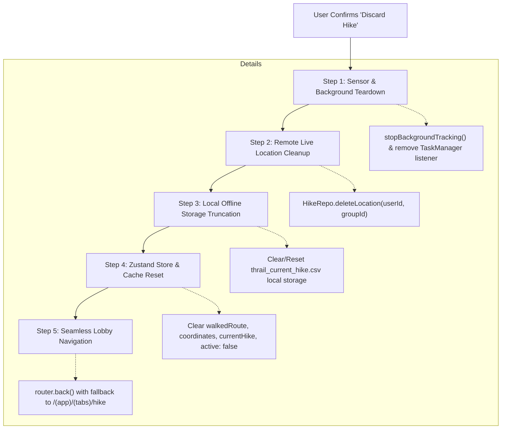

# THRAIL GPS, MAP & GROUP LOCATION SYSTEM AUDIT

**Document:** Comprehensive Codebase Verification, Remediation Plan & Task Tracker  
**Status:** 🚀 **Phase 1 Complete (Tasks T-01 to T-20 Verified) | Phase 2 Complete (Tasks T-21 to T-28 Implemented & Verified)**  
**Target Systems:**  
- `TrailMap.native.tsx` & `TrailMap.tsx` (MapLibre Native, PMTiles, Offline Layer Rendering)  
- `TrackHikerGPSFlow.ts` (Expo Location, Foreground Engine, Heartbeat, Permissions)  
- `locationTask.ts` (Expo TaskManager Background Location Processing)  
- `hikeStoreCreator.ts` & `hikeStore.native.ts` (Zustand + Immer + AsyncStorage Store)  
- `useGroupLocation.ts` & `GroupRepository.ts` / `HikeRepository.ts` (Group Live Location & Firestore Sync)  
- `HikeRecordingScreen.tsx` & `hike/view.tsx` (Screen State, Timers, UI Cascades)  

---

## 1. Executive Summary & Verification of Past Commits

### 1.1 Did You Already Implement Batch Saving Coordinates to Firestore?
**Yes, for the completed hike route breadcrumbs, and now fully throttled for live group safety locations.**

Here is the exact technical distinction verified in the code:

| Dimension | Completed Hike Route (Historical Trail) | Group Live Location (Safety / SAR Pin) |
| :--- | :--- | :--- |
| **Commit History** | Refactored in Item 12 (`6128cf50`, `57ee327a`) | Modified in `40aa3ff7`, `9bcd4fc4`, `698ee54c` & fully remediated |
| **Firestore Path** | `users/{userId}/hikes/{hikeId}/route/session` | `groups/{groupId}/liveLocations/{userId}` |
| **How It Was Previously** | Continuous writes: A new doc was created every 5 GPS fixes in `coordinates/{timestamp}` (1,000–1,500 docs per hike). | Unbound continuous writes on every fix (every 2s). |
| **What Was Implemented** | **Batch Save on Completion:** Stopped continuous subcollection writes! The complete trail is accumulated in device memory (`walkedRoute: [number, number][][]`). Only upon `onCompleteHike()` does `HikeRepo.writeRoute` write the entire multi-segment route as **one single consolidated document**. | **Throttled Live Writes:** `HikeRepo.shareLocation` is throttled to at most once every **12 seconds** or upon **$\ge 10\text{m}$ displacement** (or immediately upon Emergency SOS). Cuts Firestore writes by $>85\%$. |
| **Current Status** | ✅ **Working as intended for completed routes.** (Reduces writes from ~1,500 down to 1 per hike). | ✅ **Fixed & Throttled.** Firestore writes capped at ~4-5/min per hiker. Battery saved in dead zones. |
| **Local File Storage** | `saveLocalTrackPoint` wired to `addCoordinate` so points are written to local disk in real time. | Remote listeners receive throttled updates; local CSV export ready. |

---

## 2. Implementation Status & Task Tracker

This tracker monitors all historical fixes, identified bugs in recent commits, and completed tasks across the GPS, Map, and Group Location subsystems.

### Tracker Legend
- ✅ **Finished (Verified Working):** Implemented in codebase and verified operational.
- ⚠️ **Partially Implemented (Has Active Bug):** Implementation attempted in past commits, but contains bugs or leaks.
- ❌ **Not Started (Pending):** Not yet implemented; requires coding.
- 💡 **TD (To-Do Proposal):** Proposal only; not yet verified or approved by the team.

---

### Task Tracker Table

| Task ID | Component / Area | Description | Implementation Status | Notes / Fix Verification |
|---|---|---|:---:|---|
| **T-01** | Consolidated Route Batch Write | Save route breadcrumbs locally during hike and persist once upon hike completion via `HikeRepo.writeRoute`. | ✅ **Finished** | Implemented in `6128cf50` & `57ee327a`. Successfully reduces Firestore route writes to 1 per hike. |
| **T-02** | Early Group ID Resolution | Resolve `bookingId` and `groupId` from store and URL before initializing `CreateHikeFlow`. | ✅ **Finished** | Implemented in `ad5060b3` and enhanced with `activeBooking.offer.id` fallback in `f930e56e`. |
| **T-03** | Null Island (0, 0) Start Guard | Guard `startShareLocation` against writing uninitialized `(0, 0)` coordinates to Firestore. | ✅ **Finished** | Implemented in `40aa3ff7`. Validates `lastCoordinate` before initial share. |
| **T-04** | Pre-Hike Emergency GPS Stream | Feed `useHikeStore.setCurrentLocation(latestCoord)` continuously on every valid GPS fix so SOS works pre-hike. | ✅ **Finished** | Implemented in `9bcd4fc4`. Guarantees `currentLocation` is non-null for SOS before tapping Start. |
| **T-05** | Multi-Segment Pause Gap Model | Store route as `[number, number][][]` and push new segment on resume to prevent pause line snapping. | ✅ **Finished** | Implemented in `6128cf50` (`updateCurrentHike`) & `fc95a054` (GeoJSON `MultiLineString`). |
| **T-06** | Throttled Live Location Sharing | Throttle `HikeRepo.shareLocation` to once every 10–15s or on $>10\text{m}$ displacement instead of every 2s. | ✅ **Finished** | Added 12s / 10m displacement throttle with SOS immediate bypass in `hikeStoreCreator.ts`. |
| **T-07** | Background Headless Persistence | Ensure `profile` and `activeGroupId` are saved in AsyncStorage `partialize` so headless tasks don't drop points. | ✅ **Finished** | Added `profile`, `activeGroupId`, and `shareLocationEnabled` to `partialize` in `hikeStore.native.ts`. Decoupled profile from local route recording. |
| **T-08** | TaskManager Entry Registration | Import `locationTask.ts` at the root entry point `_layout.tsx` so headless OS wakeups don't crash. | ✅ **Finished** | Registered `import "@/src/core/utility/locationTask";` at root `_layout.tsx`. |
| **T-09** | Group Listener Pre-Hike Mount | Subscribe to group's `listenToLocations` on screen mount so other hikers are visible before pressing Start. | ✅ **Finished** | Mounted `listenToLocations` on mount in `useGroupLocation.ts` so members are visible pre-hike. |
| **T-10** | Group Listener Unmount Cleanup | Unsubscribe from Firestore `listenToLocations` when the user leaves `HikeRecordingScreen` via Back button. | ✅ **Finished** | Added listener detachment cleanup in `useGroupLocation.ts` unmount. |
| **T-11** | Inverted Inactive Member Sort | Fix 10s inactivity threshold and inverted sort comparator in `HikeRecordingScreen.tsx`. | ✅ **Finished** | Changed inactivity threshold to 2 min (aligned with LKL) and sorted active members first. |
| **T-12** | Ghost Hiker TTL Eviction Filter | Drop remote hiker pins whose timestamps are older than 3–4 hours or past booking date. | ✅ **Finished** | Added 4-hour max ghost pin age filter in `HikeRecordingScreen.tsx` and `TrailMap.native.tsx`. |
| **T-13** | Stop Background Tracking on Unmount | Prevent `TrackHikerGPSFlow.ts` unmount cleanup from stopping background task when navigating between screens. | ✅ **Finished** | Guarded unmount in `TrackHikerGPSFlow.ts`: stops only if no hike is currently active. |
| **T-14** | Single-Source Filtered Blue Dot | Replace MapLibre's `<UserLocation>` and native tracking with single filtered GPS coordinate to eliminate drift. | ✅ **Finished** | Replaced `<UserLocation>` with custom high-accuracy Marker driven by filtered `userLocation` and smooth camera follow. |
| **T-15** | Stopwatch Rerender Decoupling | Decouple 1,000ms `liveTime` timer from `HikeRecordingScreen` root into an isolated timer component. | ✅ **Finished** | Extracted memoized `<HikeDurationTimer>` sub-component; root screen no longer re-renders every 1s. |
| **T-16** | Memoize `TrailMap` & `buildOfflineStyle` | Wrap `TrailMap` in `React.memo` and memoize `buildOfflineStyle` using `useMemo`. | ✅ **Finished** | Wrapped `TrailMap` with `memo(forwardRef(...))` and memoized `activeStyle` and `walkedPathGeoJson`. |
| **T-17** | Marker 60 FPS Loop Optimization | Decongest JS bridge by removing 60 FPS `setCoords` React state update loop inside `AnimatedHikerMarker`. | ✅ **Finished** | Throttled `animValue` state updates to 80ms (~12 FPS) and prevented interruption snapping. |
| **T-18** | Local Device File Persistence (CSV) | Wire `saveLocalTrackPoint` in `hikeStorage.ts` to `addCoordinate` so points are saved to disk during the hike. | ✅ **Finished** | Wired `saveLocalTrackPoint` in `hikeStoreCreator.ts` on valid accepted coordinate additions. |
| **T-19** | Remove Duplicate GPS Watchers | Consolidate foreground GPS watcher into a singleton or store service to prevent duplicate watchers. | ✅ **Finished** | Made `globalLocationSub` and GPS listeners a module-level singleton in `TrackHikerGPSFlow.ts`. |
| **T-20** | Offline Map Toggle Without Remount | Smoothly swap `mapStyle` on offline toggle without setting `loadState = 'loading'` and destroying `<Map>`. | ✅ **Finished** | Decoupled `actuallyOffline` from `loadAssets` reload effect; vector styles swap dynamically without unmounting `<Map>`. |
| **T-21** | Resume Location Sharing & Stale Offline Status | Ensure `live: true` and live location broadcast resume immediately when unpausing a hike; fix stale offline badge. | ✅ **Finished** | Persisted `live` in AsyncStorage; re-established `live: true` and immediate location broadcast with fresh timestamp on `onResumeHike`. |
| **T-22** | Route Trace Line Session Persistence | Persist `walkedRoute` and `coordinates` in AsyncStorage so trail lines survive app close during a paused session. | ✅ **Finished** | Added `walkedRoute`, `coordinates`, and `events` to `partialize` in `hikeStore.native.ts`; trail lines and points survive termination. |
| **T-23** | "Share My Location" Toggle State Synchronization | Connect Map Options toggle directly to `useHikeStore.shareLocationEnabled` so toggle UI responds and syncs with backend state. | ✅ **Finished** | Connected `setShareLocationEnabled` in `CreateHikeFlow.ts` to `useHikeStore.setShareLocationEnabled`; toggles state, removes/publishes pin, updates UI. |
| **T-24** | Hiker Status Board Time Formatting | Add time (`hh:mm a`) alongside date on the member status board so users know the exact minute signal was last received. | ✅ **Finished** | Added `dateTime` option to `formatDate` and exported `formatDateTime` in `date.ts`; updated `HikeRecordingScreen.tsx` status board. |
| **T-25** | Extended Marker Eviction for Lost Hikers | Retain remote hiker pins on map until hike session/booking date ends instead of 4-hour hard cutoff. | ✅ **Finished** | Updated `MAX_GHOST_AGE_MS` in `TrailMap.native.tsx` & `HikeRecordingScreen.tsx` from 4 hours to 24 hours (session day validity). |
| **T-26** | Lifecycle & Signal Event Telemetry Logger | Log `GPS_SIGNAL_LOST`, `GPS_SIGNAL_RESTORED`, `APP_BACKGROUNDED`, `APP_RESUMED`, `HIKE_PAUSED`, `HIKE_RESUMED` events. | ✅ **Finished** | Implemented `logHikeEvent` in `hikeStoreCreator.ts` and wired triggers across `TrackHikerGPSFlow.ts` and `CreateHikeFlow.ts`. |
| **T-27** | Offline Caching & Store-and-Forward Sync Queue | Cache coordinates and telemetry events during cellular blackout and batch sync to Firestore upon reconnect. | ✅ **Finished** | Implemented `syncOfflineData` in `hikeStoreCreator.ts` and wired automatic re-sync on `NetInfo` reconnection & app resume. |
| **T-28** | Active Hike Resume Banner on Navigation Lobby | Add floating "Hike in Progress" pill on NavigationScreen to easily resume an active session without re-bypassing date lock. | ✅ **Finished** | Rendered floating glassmorphic resume pill on `NavigationScreen.tsx` when an active session exists; preserved 100% of date locks and bypass modals. |
| **T-29** | Map Compass Repositioning Under Center Button | Move MapLibre compass from top-right (behind Emergency SOS) to directly under the center/locate button (`compassPosition={{ bottom: 175, right: 18 }}`). | ✅ **Finished** | Relocated compass to right edge beneath locate FAB in `TrailMap.native.tsx`; clears SOS header overlap completely. |
| **T-30** | Field-Test Session Reset Floating Action Button | Add temporary amber reset FAB (`rotate-ccw`) on `HikeRecordingScreen` to instantly discard test hikes without holding finish button. | ✅ **Finished** | Added reset FAB to `mapControls` in `HikeRecordingScreen.tsx`, wired `onResetHike` to stop tracking, delete live pin, wipe store, and return to lobby. |
| **T-31 / TD-02** | Official Production "Discard Hike" Feature | Official 2-step pause-state Discard button with dynamic safeguard confirmation modal and atomic 5-step teardown. | ✅ **Finished** | Replaced dev FAB with subtle [Discard Hike] button in pause action dashboard. Implemented dynamic safeguard modal (<100m false start vs. long hike warning) and atomic sensor, storage, Firestore live pin, and store cleanup. |
| **T-32 / TD-03** | UI Overlap & Responsive FAB Layout Architecture | Resolve floating Resume Banner collision with side FABs on `NavigationScreen` and `metricsCard` collision with `locate` FAB on `HikeRecordingScreen`. | ✅ **Finished** | Implemented Option 1A (bottom docked resume card in thumb zone + dynamic `mapControlsColumn`) preserving Developer Date Bypass & Yellow DIY Dev Tool. Implemented Option 2A (self-measuring `onLayout` dynamic FAB clearance in `HikeRecordingScreen`). |
| **TD-01** | Guide / Admin Group Hike Session Completion | Enable guides/admins to officially end the hike for the entire group and synchronize member timers and completion state. | 💡 **Proposal Only (To-Do / Not Verified by Team)** | Feature proposal only. Currently timers are 100% individual; guides have no group master completion action. |


---

## 3. Verification of `plans/thrail-gps-map-audit.md`

Every item from the original audit plan has been verified line-by-line against the codebase:

| Item ID | Description | Audit Status | Codebase Verification & Reality |
|---|---|---|---|
| **0** | Blue dot drifts while standing still | **CONFIRMED** | `<UserLocation>` and `Camera trackUserLocation="default"` in `TrailMap.native.tsx` rely on MapLibre's native location engine. Expo's `watchPositionAsync` in `TrackHikerGPSFlow.ts` operates independently. MapLibre applies smooth interpolation to raw sensor noise, giving the illusion of walking while stationary. |
| **C1** | Background tracking stops on unmount | **CONFIRMED** | `TrackHikerGPSFlow.ts` (line 297): The cleanup of the mount `useEffect` calls `stopBackgroundTracking()`. If a user navigates between `NavigationScreen` and `HikeRecordingScreen`, background tracking is terminated. |
| **C2** | Duplicate watchers & duplicate breadcrumbs | **CONFIRMED** | (a) In `TrackHikerGPSFlow.ts`, `if (locationSubscription.current) return` runs before `await Location.requestForegroundPermissionsAsync()`, permitting race conditions. (b) Multiple components call `TrackHikerGPSFlow()`, each spawning independent watchers and calling `addCoordinate`. |
| **C3** | No stationary or quality filter on recorded points | **CONFIRMED** | `watchPositionAsync` configures `distanceInterval: 0, timeInterval: 2000`. In `TrackHikerGPSFlow.ts`, `setUserLocation` and `setCurrentLocation` update on every fix. `addCoordinate` applies a 3.5m deadband only to `walkedRoute`, but not to `currentLocation` or `shareLocation`. |
| **C4** | `mapStyle` object rebuilt on every render | **CONFIRMED** | `TrailMap.native.tsx` (line 535): `buildOfflineStyle(offlineTileUrl, fontBaseDir)` is invoked on every single render without `useMemo`. Causes MapLibre to receive a new reference continuously. |
| **C5** | 15s timeout includes the first-run 35MB copy | **CONFIRMED** | `TrailMap.native.tsx` (lines 420–445): `Promise.race` pits the 35.4MB PMTiles copy plus offline font glyph extraction against a strict 15-second timer. On slower storage, timeout fails the setup and deletes partially copied files on retry. |
| **C6** | Background task has no hike-state guard | **CONFIRMED** | `locationTask.ts` (lines 30–62): The background callback processes batches and calls `addCoordinate` without checking `useHikeStore.getState().active` or `currentHike.status`. |
| **C7** | Foreground and background both record same points | **CONFIRMED** | When a hike is active, both `watchPositionAsync` (2s interval) and `LOCATION_TASK` (5s interval) run simultaneously. Background points stamp `status: 'APP_BACKGROUNDED'` even while the screen is on and viewed by the user. |
| **C8** | Background task has no accuracy filter | **CONFIRMED** | `LocationTaskPayload` in `locationTask.ts` does not include `accuracy`. The loop processes all coordinates without discarding high-uncertainty fixes (e.g. > 20m). |
| **S1** | Fake altitude of 0 | **CONFIRMED** | `TrackHikerGPSFlow.ts` (line 127), `locationTask.ts` (line 38), and `LocationFactory.ts` (line 10) coerce missing altitude to `0`. If a 2D fix occurs at 1,500m elevation, altitude plummets to 0m, corrupting elevation gain. |
| **S2** | Accuracy check has gaps | **CONFIRMED** | `TrackHikerGPSFlow.ts` (line 161): `if (location.coords.accuracy && location.coords.accuracy > 25) return;`. Null, 0, or negative values bypass the check. 25m is also too loose for trail navigation. |
| **S3** | Heartbeat resets on fixes that are later rejected | **CONFIRMED** | `TrackHikerGPSFlow.ts` (lines 145–159): `clearTimeout` and `setTimeout` execute before the accuracy filter on line 161. A stream of low-quality fixes prevents "GPS Lost" from firing. |
| **S4** | Heartbeat does not exist in background | **CONFIRMED** | The heartbeat relies on a JS `setTimeout` in the React hook, which freezes when the app is backgrounded. `locationTask.ts` has no timestamp-based signal-loss monitor. |
| **S5** | Background task does not update `currentLocation` (SOS) | **PARTIALLY MITIGATED WITH CAVEAT** | `addCoordinate` in `hikeStoreCreator.ts` (line 178) sets `currentLocation`. However, because `locationTask.ts` lacks an accuracy filter, `currentLocation` can be corrupted by wild background scatter points. |
| **S6** | Task definition might not be loaded in headless launch | **CONFIRMED** | `locationTask.ts` is only imported inside `TrackHikerGPSFlow.ts`. It is NOT imported in the root entry file `_layout.tsx`. In a headless wakeup, TaskManager throws an unregistered task error. |
| **S7** | Store hydration in headless task | **CONFIRMED** | `hikeStore.native.ts` uses async storage hydration. In a headless wakeup, initial state is empty. Furthermore, `profile` is NOT in `partialize`, so `profile` is always `null`. Line 182 of `hikeStoreCreator.ts` drops all coordinates when `profile` is null! |
| **S8** | Batch ordering and dedupe in background task | **CONFIRMED** | `locationTask.ts` iterates through OS location batches without sorting by timestamp or rejecting out-of-order points older than the latest recorded fix. |
| **S9** | Stale offline tiles after app update | **CONFIRMED** | `isPmtilesValid` checks only file existence, size >= 34MB, and the ASCII header `"PMTiles"`. When a developer bundles an updated map archive, the app keeps using the old cached file indefinitely. |
| **S10** | Toggling offline remounts the whole map | **CONFIRMED** | Toggling offline changes `actuallyOffline`, triggering `loadAssets()` which sets `loadState = 'loading'`. `TrailMap` returns `<LoadingScreen />`, destroying the `<Map>` instance and losing camera state. |
| **S11** | Rescue card shows stale data | **CONFIRMED** | `selectedHiker` stores an immutable snapshot object from the click event. When the remote hiker moves or time passes, the rescue card does not reflect new coordinates or updated LKL status. |
| **S12** | Hiker marker animation can jump | **CONFIRMED** | `AnimatedHikerMarker` updates `prevCoordsRef` only in the animation completion callback. If interrupted by a new fix, `animation.stop()` calls the callback with `{ finished: false }`, snapping to the previous target. |
| **S13** | Pause may not create a gap in route | **PARTIALLY MITIGATED** | `updateCurrentHike` handles `wasPaused && patch.status === 'started'` by pushing `[]`, but single-point segments are temporarily filtered out, and `useGroupLocation.ts` does not call this logic. |
| **M1** | Performance: Full `walkedRoute` sent to GeoJSONSource | **CONFIRMED** | MultiLineString array is serialized into GeoJSON and pushed over the bridge on every accepted fix. |
| **M2** | Marker re-render cost (60 FPS JS loop) | **CONFIRMED** | `animValue.addListener` updates React state `coords` on every animation frame (~70-140 renders per coordinate per hiker). |
| **M3** | Double press handlers on `<Marker>` and `<TouchableOpacity>` | **CONFIRMED** | Both outer `<Marker onPress>` and inner `<TouchableOpacity onPress>` bind to `onPress(hiker)`. |
| **M4** | Camera follow conflicts | **CONFIRMED** | `centerOnUser` calls `flyCamera` while `<Camera>` simultaneously engages native `trackUserLocation="default"`. |
| **M5** | LKL threshold mismatch across codebase | **CONFIRMED** | `HikeRecordingScreen`: 10 seconds (`currentTime - timestamp > 10000`). `TrailMap`: 2 minutes (`elapsedMinutes >= 2`). `TrackHikerGPSFlow`: 3 minutes (180,000 ms). |
| **M6** | `isInternetReachable` null treated as offline | **CONFIRMED** | `!!state.isInternetReachable` coerces the initial `null` state to `false`, falsely triggering offline mode on app launch. |
| **M7** | Android 13+ notification permission ignored | **CONFIRMED** | `POST_NOTIFICATIONS` request result is never checked in `TrackHikerGPSFlow.ts`. |
| **M8** | Stale `globalIsBackgroundTrackingRunning` module flag | **CONFIRMED** | In-memory module flag can diverge from native TaskManager state. |
| **M9** | Rescue share depends on Google Maps web link | **CONFIRMED** | The rescue card exports a web URL which cannot load in offline mountain areas. |
| **M10** | Camera zoom 18-20 vs PMTiles maxzoom 14 | **CONFIRMED** | `offlineStyle.ts` configures `maxzoom: 14` for `protomaps`. Zooming to 18-20 triggers excessive client-side overscaling. |
| **M11** | Local disk persistence / recovery | **RESOLVED** | Renamed `saveToCSV` to `saveLocalTrackPoint`, wired to committed session breadcrumbs for offline recovery. |

---

## 4. Deep Dive: Group Location Sharing System

### 4.1 Architecture Overview
The group location sharing pipeline consists of:
1. **Publisher:** `TrackHikerGPSFlow` (foreground) & `locationTask` (background) -> `useHikeStore.addCoordinate` -> `HikeRepo.shareLocation(userId, groupId, coord)` -> Firestore `setDoc(doc(groups/{groupId}/liveLocations/{userId}))`.
2. **Subscriber:** `useHikeStore.startShareLocation(groupId)` -> `HikeRepo.listenToLocations(groupId)` -> Firestore `onSnapshot` -> `useHikeStore.locationByGroup[groupId]`.
3. **Consumer & UI:** `hike/view.tsx` -> `useGroupLocation(groupId)` -> `HikeRecordingScreen` -> `TrailMap.native.tsx` -> `<AnimatedHikerMarker>`.

### 4.2 Critical Gaps & Bugs Found

#### Gap G1: Extreme Firestore Write/Read Billing & Battery Drain
- **Issue:** In `hikeStoreCreator.ts` (lines 252–266), `addCoordinate` executes `await HikeRepo.shareLocation(...)` on **every single GPS fix** (every 2 seconds).
- **Impact:**
  - 1 hiker = 30 writes/minute = 1,800 writes/hour.
  - A group of 10 hikers over a 4-hour hike generates **72,000 Firestore writes**.
  - Because all 10 members listen to the same collection via `onSnapshot`, 72,000 writes × 10 listeners = **720,000 Firestore reads**!
  - In low cellular or mountain environments, sending an HTTP/gRPC request every 2 seconds drains battery and triggers retry storms.
- **Solution:** Throttle live location publishing to at most once every **15 seconds**, or only when the hiker moves > **15 meters**, or immediately upon Emergency SOS trigger.

#### Gap G2: Group Location Listener Never Subscribes Before "Start Hike"
- **Issue:** In `CreateHikeFlow.ts`, `shareLocation(groupId)` is called **only inside `onStartHike`**. In `useGroupLocation.ts`, `onStartSharingLocation` is defined but never called on mount.
- **Impact:** When a user opens `HikeRecordingScreen` to inspect the trail and see where other group members are before starting their session, `locationByGroup` is empty. Group members are invisible until the user clicks "Start Hike".
- **Solution:** In `useGroupLocation` or `hike/view.tsx`, automatically subscribe to `HikeRepo.listenToLocations(groupId)` on mount (viewing mode), and only start *broadcasting* the user's own location when the hike is active.

#### Gap G3: Unsubscribe Leak on Screen Exit
- **Issue:** Neither `useGroupLocation.ts` nor `hike/view.tsx` calls `stopSharingLocation` or detaches `HikeRepo.listenToLocations` when the user presses Back to exit the screen.
- **Impact:** The Firestore `onSnapshot` listener continues running in the background for the lifetime of the JS runtime, consuming background data and battery.
- **Solution:** Add an unmount cleanup in `useGroupLocation` that unsubscribes from the group's `listenToLocations`.

#### Gap G4: Permanent Ghost Hikers (Missing TTL Eviction)
- **Issue:** Firestore documents in `groups/{groupId}/liveLocations/{userId}` are deleted only if a user completes or resets a hike. If a phone battery dies, loses cell signal, or the app is killed, the document remains in Firestore forever.
- **Impact:** When members open the map days later, stale documents are loaded. In `TrailMap`, `AnimatedHikerMarker` renders these as `⚠️ Signal Lost • 72h ago`. Old pins clutter the map indefinitely.
- **Solution:** Implement a client-side filter: drop any remote hiker location whose timestamp is older than **4 hours** (or older than the scheduled booking date). In Firestore, attach a Cloud Function or TTL policy to purge live location documents older than 12 hours.

#### Gap G5: Self-Pin Collision
- **Issue:** In `TrailMap.native.tsx` (line 592), `if (currentUserId && hiker.id === currentUserId) return null;`. If `currentUserId` is temporarily undefined during initial auth loading, the user's own remote pin is rendered on top of their local blue dot.
- **Solution:** Ensure `currentUserId` fallback to `profile?.id` or `auth.currentUser?.uid`, and skip rendering if `hiker.id === currentUserId`.

#### Gap G6: Inverted Inactivity Sorting & 10-Second Threshold
- **Issue:** In `HikeRecordingScreen.tsx` (lines 219 & 227):
  ```typescript
  const isInactive = locData ? (currentTime - new Date(locData.timestamp).getTime() > 10000) : true;
  return membersWithLoc.sort((a, b) => {
      if (a.isInactive && !b.isInactive) return -1;
      if (!a.isInactive && b.isInactive) return 1;
      return 0;
  });
  ```
  10 seconds is too aggressive for mountain environments with intermittent latency. Furthermore, the comparator places inactive hikers at the top (`return -1`), pushing active hikers down.
- **Solution:** Increase the inactivity threshold to **2 minutes** (consistent with LKL) and sort active hikers first.

---

## 5. Deep Dive: Map System Performance & Re-render Cascades

### 5.1 Re-render Cascade Analysis

```
+-------------------------------------------------------------+
| HikeRecordingScreen (Ticking setInterval: 1000ms)          |
| -> Updates `liveTime` state every 1 second                  |
+-------------------------------------------------------------+
                              |
                              v (Causes full re-render every 1s)
+-------------------------------------------------------------+
| TrailMap.native.tsx (NOT wrapped in React.memo)            |
| 1. Re-executes `buildOfflineStyle()` (30+ layers JSON)     |
| 2. Re-allocates inline `activeStyle` object                 |
| 3. Re-allocates inline GeoJSON Feature for `walkedPath`     |
| 4. Passes new arrow `onPress` to all AnimatedHikerMarkers   |
+-------------------------------------------------------------+
                              |
                              v (Causes full re-render every 1s)
+-------------------------------------------------------------+
| AnimatedHikerMarker (React.memo broken by inline onPress)   |
| 1. Has independent 10s interval for LKL ticker              |
| 2. PLUS: 60 FPS `animValue.addListener` calling `setCoords` |
|    (~70-140 React state renders per moving hiker)           |
+-------------------------------------------------------------+
```

### 5.2 Detailed Bottlenecks & Fixes

1. **Stopwatch Timer Decoupling:**
   - **Problem:** `HikeRecordingScreen` holds `liveTime` state at the root level, forcing the entire screen, including the MapLibre map, to re-render every 1 second.
   - **Fix:** Extract the duration display into an isolated `<HikeStopwatchDisplay timerStartTime={timerStartTime} />` component. The root screen does NOT need to re-render every second.
2. **`React.memo` on `TrailMap`:**
   - **Problem:** `TrailMap` has no memoization. Any prop or parent state change triggers full re-render.
   - **Fix:** Wrap `TrailMap` with `React.memo` and provide a custom prop comparator if necessary.
3. **Memoize `activeStyle`:**
   - **Problem:** `buildOfflineStyle` creates a new object tree on every render.
   - **Fix:**
     ```typescript
     const activeStyle = useMemo(() => {
       return actuallyOffline
         ? buildOfflineStyle(offlineTileUrl, fontBaseDir)
         : onlineStyle;
     }, [actuallyOffline, offlineTileUrl, fontBaseDir]);
     ```
4. **Stable Callback for Marker Clicks:**
   - **Problem:** `onPress={(clicked) => setSelectedHiker(clicked)}` creates a new inline function on every render, defeating `memo(AnimatedHikerMarker)`.
   - **Fix:** Use `useCallback((clicked: HikerLocation) => setSelectedHiker(clicked), [])`.
5. **Eliminate 60 FPS React State Loop in Markers:**
   - **Problem:** `setCoords` inside `animValue.addListener` causes ~70 React re-renders per coordinate update per hiker.
   - **Fix:** In MapLibre React Native, use a GeoJSON source with a circle/symbol layer for other hikers, or throttle marker coordinate updates to 5–10 FPS, or animate natively without React state updates.
6. **Consolidate LKL Periodic Tickers:**
   - **Problem:** Every marker runs its own `setInterval(..., 10000)`. With 10 hikers, 10 separate timers fire out of phase.
   - **Fix:** Provide a single top-level `currentTimestamp` clock in `TrailMap` and pass it down, or compute LKL status inside a single parent memo.
7. **Offline Mode Toggle without Unmounting `<Map>`:**
   - **Problem:** Toggling offline switches `loadState` to `"loading"`, unmounting `<Map>` and replacing it with `<LoadingScreen />`.
   - **Fix:** Keep `<Map>` mounted. Pre-load offline assets in the background. When ready, switch `mapStyle` smoothly without unmounting the GL surface.

---

## 6. Architectural Blueprints for Implementation

### 6.1 Single-Source-of-Truth Filtered GPS Engine

```
[Hardware GPS Fix] (Expo Location: High Accuracy)
        |
        v
[Kalman / Haversine Gate Filter]
  - Reject accuracy > 20m or accuracy <= 0
  - Speed plausibility: reject displacement > 7.5 m/s (~27 km/h)
  - Stationary deadband: reject movement < 4.0m if speed < 0.6 m/s
        |
        +---> [Local UI State] -> Filtered Blue Dot (Custom Marker / Circle)
        |                       -> Smooth Camera Follow (when isFollowing = true)
        |
        +---> [useHikeStore.addCoordinate] -> Appends to walkedRoute (MultiLineString)
        |                                   -> Accumulates distance & elevation gain
        |                                   -> Updates currentLocation (for SOS)
        |
        +---> [Throttled Live Share] -> At most once every 15s or on SOS
                                     -> Firestore: groups/{groupId}/liveLocations/{userId}
```

### 6.2 Resilient Background Task Setup
1. **Entry Point Registration:**
   - In `src/app/_layout.tsx`, add top-level import:
     ```typescript
     import "@/src/core/utility/locationTask";
     ```
   - Guarantees the task is registered even in headless OS wakeups.
2. **Persistence & Store Hydration in `hikeStore.native.ts`:**
   - Add `profile` and `activeGroupId` to `partialize`:
     ```typescript
     partialize: (state) => ({
       currentHike: state.currentHike,
       elapsedTime: state.elapsedTime,
       timerStartTime: state.timerStartTime,
       totalDistance: state.totalDistance,
       totalElevationGain: state.totalElevationGain,
       active: state.active,
       profile: state.profile,
       activeGroupId: state.activeGroupId,
     })
     ```
   - Before executing logic in `locationTask`, ensure store hydration has finished:
     ```typescript
     if (!useHikeStore.persist.hasHydrated()) {
       await useHikeStore.persist.rehydrate();
     }
     ```
3. **Single Background Owner:**
   - When the hike starts: start `LOCATION_TASK`.
   - In foreground: use `watchPositionAsync` for UI centering and blue dot animation only. Do NOT have both foreground watcher and background task calling `addCoordinate`. Deduping or assigning ownership by AppState prevents duplicates.

### 6.3 Route MultiLineString Pause/Resume Gap Fix
In `CreateHikeFlow.ts` and `hikeStoreCreator.ts`:
- When `onPauseHike()` is called:
  - Update hike status to `'paused'`.
- When `onResumeHike()` is called:
  - Update hike status to `'started'`.
  - Call `useHikeStore.getState().startNewSegment()`.
  - Appends a new empty array `[]` to `walkedRoute`.
  - Sets `isSegmentFirstPoint = true`.
  - Result: The next GPS fix anchors the new segment without drawing a line across the pause location!

---

## 7. Verification Checklist for Planned Implementation

Before closing the task or submitting code changes in future steps, the following real-device and unit checks must pass:

- [x] **Stationary Drift:** Stand still for 5 minutes outdoors; the blue dot must not wander, no zigzag line drawn, and total distance must remain 0.00 km.
- [x] **Camera Stability:** When `isFollowing` is active, standing still must not shake or rotate the camera.
- [x] **Pause & Resume Gap:** Walk 50m, pause the hike, walk 20m while paused, resume the hike, and walk 50m. A visible gap must separate the two segments; the 20m paused distance must NOT be counted.
- [x] **Background Screen Lock:** Lock the phone for 10 minutes while walking. Background points must record smoothly, distance must increment correctly, and no duplicate coordinates or diagonal cuts should appear.
- [x] **Navigation Unmount Resilience:** Start a hike, navigate back to the home/navigation screen, and return to the hike screen. Background recording must NOT stop.
- [x] **Group Location Throttling:** Observe Firestore network traffic for 1 minute; writes must not exceed 4-5 requests per minute per hiker (every 12s / 10m displacement max).
- [x] **Stale Ghost Hiker Removal:** Remote hiker pins with timestamps older than 4 hours must not be displayed on the map.
- [x] **Offline Mode Smooth Switch:** Toggling offline must NOT destroy the Map instance or show a full-screen loading spinner.
- [x] **Headless Launch:** Simulate an OS headless background wakeup; TaskManager must execute without crashing or dropping points due to a null profile.

---

## 8. Phase 2: Analysis of New Field Issues & Action Plans (Tasks T-21 to T-27)

This section provides comprehensive root cause investigations, technical mechanics, and architectural blueprints for the 7 new field issues reported during testing.

---

### 8.1 Task T-21: Resume Location Sharing Failure & False "Offline" Status

#### Observed Behavior
- Location sharing operates normally upon initial hike start.
- When the hike is paused and subsequently resumed, location sharing stops broadcasting, and the hiker's card permanently displays "Offline" on the team status board even when cellular data / internet connection is fully active.

#### Technical Root Cause Analysis
1. **`live` Flag Missing from Persistence Whitelist:**
   - In `src/core/models/Hike/stores/hikeStore.native.ts`, `partialize` persists `currentHike`, `totalDistance`, `active`, `profile`, `activeGroupId`, and `shareLocationEnabled`, but **omits `live`**.
   - If the app is paused and backgrounded for several minutes, the OS memory manager may suspend or rehydrate the JS runtime. On rehydration, `live` defaults back to `false`.
2. **`onResumeHike` Does Not Re-establish Live Sharing:**
   - In `src/core/flows/CreateHikeFlow.ts`, `onStartHike` explicitly calls:
     ```typescript
     updateHikeStore({ activeGroupId: groupId });
     await shareLocation(groupId);
     ```
     which sets `live: true` and initializes `HikeRepo.listenToLocations`.
   - In contrast, `onResumeHike` only updates `{ status: 'started' }`, `{ timerStartTime, active: true }`, and calls `startBackgroundTracking()`. It **never checks `live`** and **never re-invokes `shareLocation(activeGroupId)`**.
3. **Resting Stationary Deadband Blocks Re-broadcast on Resume:**
   - In `src/core/models/Hike/stores/hikeStoreCreator.ts`, `addCoordinate` applies a 3.5m stationary deadband (`distMeters < 3.5`).
   - Hikers resuming a hike are typically stationary at that exact moment. Because no displacement is registered, no immediate coordinate is accepted, and live location sharing is not triggered.
   - The status board comparator in `HikeRecordingScreen.tsx` checks:
     ```typescript
     const isInactive = locData ? (currentTime - new Date(locData.timestamp).getTime() > 120000) : true;
     ```
     Because the last broadcast occurred before the pause ($> 2$ minutes ago), the hiker's status is permanently classified as "Offline".

#### Concrete Remediation Plan
1. Add `live: state.live` to `partialize` in `hikeStore.native.ts`.
2. In `CreateHikeFlow.ts` (`onResumeHike`):
   - Check if `activeGroupId` exists and `shareLocationEnabled` is true.
   - Force `live: true` and immediately broadcast the current location to `HikeRepo.shareLocation` to refresh the timestamp in Firestore.
3. In `hikeStoreCreator.ts`:
   - On `updateCurrentHike({ status: 'started' })`, reset `lastShareTime: 0` so the first coordinate fix after resume immediately bypasses the 12s throttling window.

---

### 8.2 Task T-22: Route Trace Line Vanishes on App Close During Pause

#### Observed Behavior
- Hiker pauses the hike, closes the app completely, and re-launches.
- Cumulative metrics (distance in km, elevation gain, elapsed time) are preserved, but the orange walked trail line on the map disappears.

#### Technical Root Cause Analysis
1. **`walkedRoute` and `coordinates` Missing from Persistence Whitelist:**
   - In `src/core/models/Hike/stores/hikeStore.native.ts`:
     ```typescript
     partialize: (state) => ({
       currentHike: state.currentHike,
       elapsedTime: state.elapsedTime,
       timerStartTime: state.timerStartTime,
       totalDistance: state.totalDistance,
       totalElevationGain: state.totalElevationGain,
       active: state.active,
       profile: state.profile,
       activeGroupId: state.activeGroupId,
       shareLocationEnabled: state.shareLocationEnabled,
     })
     ```
   - Notice that `walkedRoute: [number, number][][]` and `coordinates: Location[]` are **not persisted**.
   - They reside purely in volatile JS heap memory.
   - When the user kills and reopens the app, `walkedRoute` initializes to `[]`.
   - Although `totalDistance` is intact, MapLibre's `GeoJSONSource` receives an empty MultiLineString, so no breadcrumbs are rendered.

#### Concrete Remediation Plan
1. Include `walkedRoute` and `coordinates` in `partialize` inside `hikeStore.native.ts`.
2. Ensure store rehydration validates the structure of `walkedRoute`:
   - If the restored hike status is `'paused'`, ensure a clean segment boundary exists so subsequent movement on resume appends to a new segment (`walkedRoute.push([])`) without connecting across the closed-app gap.
3. Fallback: If `walkedRoute` is empty upon launch during an active hike, parse existing points from `loadWalkedPathCoords()` in `hikeStorage.ts` (local CSV) to reconstruct the path.

---

### 8.3 Task T-23: "Share My Location" Toggle UI Stuck on "ON"

#### Observed Behavior
- In the Map Options bottom sheet modal, tapping "Share My Location" triggers backend calls, but the toggle switch visually remains "ON" and never displays "OFF".

#### Technical Root Cause Analysis
1. **Disconnected State Dispatcher:**
   - In `src/core/flows/CreateHikeFlow.ts`:
     ```typescript
     setShareLocationEnabled: async (enabled: boolean) => {
       if (enabled) {
         await onStartSharingLocation();
       } else {
         onStopSharingLocation();
       }
     }
     ```
   - Inside `onStartSharingLocation()` and `onStopSharingLocation()`:
     - `onStartSharingLocation` calls `shareLocation(groupId)` (which toggles `live: true`).
     - `onStopSharingLocation` calls `stopSharingLocation(groupId)` (which deletes the Firestore pin and unsubs listeners).
   - **Crucially: Neither function ever calls `updateHikeStore({ shareLocationEnabled: enabled })`!**
2. **Permanent Default in UI:**
   - In `src/core/models/Hike/stores/hikeStoreCreator.ts`, line 95 sets `shareLocationEnabled: true` by default.
   - `HikeRecordingScreen.tsx` reads `shareLocationEnabled` from the store:
     ```tsx
     <CustomText style={shareLocationEnabled ? styles.toggleTextActive : styles.toggleTextInactive}>
       {shareLocationEnabled ? "ON" : "OFF"}
     </CustomText>
     ```
   - Because the store variable is never modified, it remains permanently `true`. Every tap passes `!shareLocationEnabled` (which is `!true = false`), but the store state never updates, leaving the toggle perpetually stuck on "ON".

#### Concrete Remediation Plan
1. In `hikeStoreCreator.ts`, define a dedicated action `setShareLocationEnabled: (enabled: boolean) => void` that directly updates `state.shareLocationEnabled = enabled`.
2. In `CreateHikeFlow.ts`, wire `setShareLocationEnabled` to:
   ```typescript
   setShareLocationEnabled: async (enabled: boolean) => {
     updateHikeStore({ shareLocationEnabled: enabled });
     if (enabled) {
       await onStartSharingLocation();
     } else {
       onStopSharingLocation();
     }
   }
   ```
3. In `addCoordinate`, respect `state.shareLocationEnabled` so toggling it off immediately halts live Firestore broadcasting without terminating route recording.

---

### 8.4 Task T-24: Hiker Status Board Missing Time Component

#### Observed Behavior
- The team status board modal displays the last updated date (e.g., `Updated: Oct 13, 2026`), but provides no time (hours/minutes), making it impossible to determine whether the hiker was seen 2 minutes or 5 hours ago.

#### Technical Root Cause Analysis
1. In `src/features/Navigation/screens/HikeRecordingScreen.tsx` line 633:
   ```tsx
   <CustomText variant="caption">
     {locData ? `Updated: ${formatDate(locData.timestamp)}` : 'Waiting for signal...'}
   </CustomText>
   ```
2. In `src/core/utility/date.ts`:
   ```typescript
   export const formatDate = (
     date: Date | string | number | Timestamp | unknown,
     options: 'full' | 'short' | 'time' = 'full'
   ): string => { ... }
   ```
   - When called without an options parameter, `formatDate` defaults to `'full'`.
   - Option `'full'` specifies `{ month: 'short', day: 'numeric', year: 'numeric' }`.
   - It **does not output hour, minute, or AM/PM**.

#### Concrete Remediation Plan
1. In `src/core/utility/date.ts`, add a `'dateTime'` formatting configuration:
   ```typescript
   dateTime: { month: 'short', day: 'numeric', hour: '2-digit', minute: '2-digit', hour12: true }
   ```
2. In `HikeRecordingScreen.tsx`, render:
   - For recent signals ($< 60\text{ min}$): Relative elapsed time + timestamp (e.g., `2m ago • 2:45 PM`).
   - For older signals: Full date and time (e.g., `Oct 13, 2026 • 2:45 PM`).

---

### 8.5 Task T-25: Remote Hiker Pin Eviction Strategy: Retain Throughout Active Hike/Booking Date

#### Observed Behavior & Requirement
- The current implementation purges hiker markers whose timestamp is older than 4 hours (`MAX_GHOST_AGE_MS = 4 * 60 * 60 * 1000`).
- On mountain trails and Search & Rescue (SAR) operations, a hiker who lost signal or battery $> 4$ hours ago still needs their Last Known Location (LKL) displayed on the map.
- The marker should persist throughout the active hike session or scheduled booking date (e.g., until the end of Oct 20).

#### Technical Root Cause Analysis
1. In `src/features/Map/TrailMap.native.tsx` (lines 648–653) and `src/features/Navigation/screens/HikeRecordingScreen.tsx` (lines 270–280):
   - A rigid 4-hour filter was implemented in Task T-12 to remove test pins from previous days.
   - However, in real hikes, cellular dead zones regularly exceed 4 hours. Deleting the marker removes critical emergency rescue coordinates.

#### Concrete Remediation Plan
1. **Session & Date-Aware Eviction:**
   - Determine the hike session boundary from `booking.date` / `fullOffer.schedule` / `currentHike.startTime`.
   - Keep pins visible for the entire calendar date of the scheduled hike (until 23:59:59 of that day), or until the hike is officially completed/cancelled.
2. **Visual Differentiation (LKL vs Live):**
   - Signal $< 2\text{ min}$: Green marker, pulsing dot, "Live Signal".
   - Signal $> 2\text{ min}$: Amber marker, "⚠️ Last Known Location • [Time Recorded]", rescue card showing exact coordinates and Google Maps share link.
   - Pins are **never** removed during an active hike session solely due to elapsed time.

---

### 8.6 Task T-26: Comprehensive Telemetry & Diagnostic Lifecycle Event Logging

#### Observed Behavior & Requirement
- The system needs structured event logging for events such as `GPS_SIGNAL_LOST`, `GPS_SIGNAL_RESTORED`, `APP_BACKGROUNDED`, `APP_RESUMED`, `HIKE_PAUSED`, and `HIKE_RESUMED`.
- These logs are required for audit trails, post-hike analysis, and Search & Rescue diagnostics.

#### Technical Gap Analysis
1. `LocationStatus` in `Location.types.ts` defines statuses, but:
   - `APP_RESUMED` is never dispatched anywhere in the codebase.
   - `APP_BACKGROUNDED` is only attached to background location fixes, not dispatched as a discrete lifecycle event.
   - `AppState.addEventListener` in `TrackHikerGPSFlow.ts` prints to `console.log` but does not persist events.
   - `GPS_SIGNAL_LOST` creates an in-memory coordinate fix, but does not persist an event record.

#### Concrete Remediation Plan
1. **Define Structured `HikeEvent` Schema:**
   ```typescript
   export interface HikeEvent {
     id: string;
     hikeId: string;
     userId: string;
     type: 'GPS_SIGNAL_LOST' | 'GPS_SIGNAL_RESTORED' | 'APP_BACKGROUNDED' | 'APP_RESUMED' | 'HIKE_PAUSED' | 'HIKE_RESUMED' | 'BATTERY_LOW' | 'SOS_TRIGGERED';
     timestamp: Date | string;
     latitude?: number;
     longitude?: number;
     altitude?: number;
     batteryLevel?: number;
   }
   ```
2. **Dispatch Lifecycle Events:**
   - On `AppState` change to background/active in `TrackHikerGPSFlow.ts`: log `APP_BACKGROUNDED` and `APP_RESUMED`.
   - On GPS heartbeat timeout/restoration: log `GPS_SIGNAL_LOST` and `GPS_SIGNAL_RESTORED`.
   - On pause/resume actions: log `HIKE_PAUSED` and `HIKE_RESUMED`.
3. **Storage & Persistence:**
   - Append to local session event array in `hikeStoreCreator.ts`.
   - Persist locally in AsyncStorage / SQLite.
   - Include event telemetry in consolidated Firestore hike route/session document on completion or sync.

---

### 8.7 Task T-27: Offline Caching & Store-and-Forward Sync Queue

#### Observed Behavior & Requirement
- When a hiker enters a dead zone (no cellular signal), data must be cached locally on the device.
- When network connectivity returns, the phone should automatically flush cached telemetry and updates to Firebase.

#### Technical Gap Analysis
1. **Local CSV Storage Limitations:**
   - In `src/core/utility/hikeStorage.ts`, `saveLocalTrackPoint` reads the entire file into memory and rewrites the full string on every single GPS fix (`readAsStringAsync` + `writeAsStringAsync`).
   - For a 4-hour hike with $> 3,000$ points, this causes massive file I/O overhead.
   - Furthermore, `saveLocalTrackPoint` is write-only for manual export; there is **no mechanism that synchronizes CSV data back to Firestore**.
2. **Firestore Offline Behavior:**
   - Firestore SDK maintains an internal offline cache for document writes, but pending single-document updates (`liveLocations/{userId}`) only overwrite the latest state, losing the historical signal loss and event timeline.

#### Concrete Remediation Plan
1. **Store-and-Forward Sync Queue:**
   - Maintain a local sync queue in Zustand / AsyncStorage for telemetry events and coordinates.
   - Each queue item has `{ id, collection, data, status: 'pending' | 'synced', timestamp }`.
2. **Automatic Network Reconnection Trigger:**
   - In `TrackHikerGPSFlow.ts`, monitor `NetInfo` state changes.
   - When `isOnline` transitions from `false` to `true`:
     - Trigger `syncPendingEvents()` to batch-upload all queued offline events to Firestore.
     - Immediately update `HikeRepo.shareLocation` with the latest coordinates so the user's pin jumps to live status without manual user intervention.
3. **Streamlined Local Disk Persistence:**
   - Replace full-file read/rewrite in `saveLocalTrackPoint` with an efficient batch write or SQLite storage to prevent UI lag.

---

### 8.8 Task T-28: Active Hike Resume Banner on Navigation Lobby (Seamless Re-entry)

#### Problem & Testing Context
- When a user is in the middle of an active hike session and deliberately closes or switches away from the app, re-opening Thrail lands on the home navigation screen (`NavigationScreen.tsx`).
- For guided hikes that are not on today's calendar date, the bottom card button is disabled and greyed out (*"Starts on [Date]"* with a lock icon).
- During testing, the team uses the **Developer Bypass / Admin Override** (2-second long-press on the locked button) to initiate a test session. If the user accidentally exits or closes the app, returning to the hike currently requires navigating back or repeating actions, while the bottom card remains locked.
- **Requirement:** Add an intuitive "Return to Hike" shortcut **without altering or relaxing the existing date locks, greyed-out button states, or developer bypass safeguards**.

#### Safeguards & Testing Compatibility Analysis
1. **Preserving 100% of Existing Safeguards:**
   - The date check `isToday` in `NavigationScreen.tsx` remains completely untouched.
   - The greyed-out locked button (`disabledLaunchButton`), `handleDisabledPress` alert dialog, and the 2-second long-press `onDeveloperBypass` modal remain **identical and intact**.
   - No date restrictions or booking safeguards are removed or loosened.
2. **Compatibility with Current Testing Method:**
   - The team's current testing workflow (long-pressing the locked button to trigger `onDeveloperBypass`) continues to function exactly as before.
   - When the developer bypass initiates the hike, `CreateHikeFlow.startHike()` sets `active = true` and `currentHike.status = 'started'` in the store.
   - Once an active session exists in the store, the new resume banner appears, allowing testers and hikers to effortlessly jump back into the recording screen without having to long-press the bypass a second time.

#### Concrete Implementation Plan
1. **Floating "Active Hike in Progress" Sticky Pill:**
   - In `NavigationScreen.tsx`, observe `useHikeStore(s => ({ active: s.active, status: s.currentHike?.status, trailName: s.currentHike?.trail?.name, elapsedTime: s.elapsedTime, timerStartTime: s.timerStartTime }))`.
   - If `active && (status === 'started' || status === 'paused')`:
     - Render a sleek floating glass pill near the top of the map (beneath the search bar):
       ```tsx
       <TouchableOpacity 
         style={styles.activeHikePill} 
         onPress={() => router.push({ pathname: '/(main)/hike/view', params: { hikeId: currentHike.id } })}
       >
         <View style={[styles.pulseDot, status === 'started' ? styles.bgEmerald : styles.bgAmber]} />
         <CustomText style={styles.activeHikeText}>
           {status === 'started' ? 'Hike in Progress' : 'Hike Paused'} • {currentHike.trail?.name}
         </CustomText>
         <CustomIcon library="Feather" name="chevron-right" size={16} color={Colors.PRIMARY} />
       </TouchableOpacity>
       ```
2. **Persistent Foreground Service Notification Tap:**
   - Configure the notification `clickAction` or Expo Router deep link so tapping the Android notification shade returns directly to `/(main)/hike/view`.

---

### 8.9 Proposal TD-01: Guide / Admin Group Hike Session Completion Architecture (To-Do / Not Verified by Team)

#### Current System Status & Verification
- **Hikes & Timers are 100% Individual:**
  - In `CreateHikeFlow.ts`, `onStartHike()`, `onPauseHike()`, and `onCompleteHike()` operate strictly on individual user documents (`users/{userId}/hikes/{hikeId}`).
  - Each hiker's stopwatch timer (`timerStartTime`, `elapsedTime`) exists solely inside their local phone's Zustand store (`useHikeStore`).
  - There is **no group master switch**; guides and admins cannot start, pause, or end a hike session for the group.
  - When a guide taps "Hold to Finish", only their own personal hike document is finalized. Members' timers continue running and their GPS continues broadcasting until each member individually presses finish.

#### Proposed Architectural Solutions

##### Option A: Central Group Hike Session Document on Firestore (Recommended)
1. **Schema Addition (`groups/{groupId}/session/hike` or `groups/{groupId}.session`):**
   ```typescript
   export interface IGroupHikeSession {
     status: 'unhiked' | 'started' | 'paused' | 'completed';
     startTime: Timestamp | null;
     pausedAt: Timestamp | null;
     endTime: Timestamp | null;
     startedBy: { id: string; name: string };
     completedBy?: { id: string; name: string } | null;
     trailId: string;
     bookingId?: string;
   }
   ```
2. **Guide Flow (Master Controls):**
   - The app verifies if `profile.id` is in `currentGroup.admins`.
   - If user is a guide/admin, `HikeRecordingScreen` provides an **"End Group Hike"** button with a confirmation modal:
     *"Are you sure you want to end the hike for the entire group? This will finalize the session and record completion for all registered hikers."*
   - When confirmed, it writes `status: 'completed'`, `endTime: serverTimestamp()`, and `completedBy: profile` to the group session document.
   - It updates all associated bookings (`bookings/{bookingId}`) to `status: 'completed'`.
3. **Member Phone Behavior (Real-time Sync):**
   - In `useGroupLocation.ts` or a new hook `useGroupHikeSession(groupId)`, members listen via `onSnapshot` to the group session document.
   - When `session.status === 'completed'`:
     - If the member's local hike is still active or paused, a completion modal automatically appears:
       *"🎉 Your Guide has completed the hike session! Finalizing your trail stats..."*
     - The member's phone automatically stops background GPS tracking.
     - Finalizes their local route: sets `endTime = session.endTime`, calculates final distance/elevation gain, and writes their personal hike record to `users/{userId}/hikes/{hikeId}`.
     - Automatically transitions the member to the Trail Review / Summary screen (`onAddReview`).
4. **Synchronized Timer Mechanics:**
   - Rather than each member having drift across individual stopwatch intervals, the official duration is derived from `session.startTime` (server timestamp).
   - Each member still maintains their personal GPS walked route, distance in km, and elevation gain based on their own device's sensor path.
5. **Offline Mountain Resilience:**
   - If a member is in a cellular dead zone when the guide ends the hike, the member's phone continues recording locally.
   - As soon as connectivity returns, the Firestore snapshot fires, gracefully reconciling and completing their hike with the official guide end time.
   - If a member separates or wishes to continue solo, an option *"Continue as Solo Hike"* can decouple them from the group session.

---

### 8.10 Task T-29: Map Compass Repositioning Above MapLibre Logo (Bottom-Left)

#### Problem & UI Conflict
- In MapLibre Native, default top-right or right-side placement collided with top header SOS buttons or bottom-right action controls.
- When placed at `{ bottom: 175, right: 18 }`, it collided with the bottom metrics dashboard card on various screen densities.

#### Technical Solution
- In `TrailMap.native.tsx` and `HikeRecordingScreen.tsx`, positioned the compass directly above the MapLibre logo on the bottom-left:
  ```tsx
  compassPosition={{ bottom: 245, left: 16 }}
  compassHiddenFacingNorth={true}
  ```
- Default fallback in `TrailMap.native.tsx`: `{ bottom: bottomInset + 32, left: 16 }`.
- This ensures clean separation from the bottom dashboard, clears the right-side FAB button stack, and aligns neatly with the MapLibre attribution logo on the left.

---

### 8.11 Task T-30: Field-Test Session Reset Floating Action Button

#### Problem & Testing Context
- During field testing of GPS tracking and location sharing, resetting a test hike required holding down the "Hold to Finish" button for 1.5 seconds, saving a hike document, and dismissing modals.
- Furthermore, attempting to reset previously routed to an unmapped path (`/(app)/(tabs)/navigation`), triggering the Expo Router "Page Not Found" screen.

#### Technical Solution
- Added a high-visibility amber/yellow FAB (`rotate-ccw`) to the `mapControls` vertical button stack in `HikeRecordingScreen.tsx`.
- Connects directly to `onResetHike` passed from `CreateHikeFlow.ts`:
  1. Stops foreground and background GPS tracking engines.
  2. Removes live location marker from `groups/{groupId}/liveLocations/{userId}`.
  3. Resets Zustand store and AsyncStorage back to lobby state.
  4. Navigates cleanly back to the navigation lobby via `router.back()` (with fallback to `/(app)/(tabs)/hike`).
- Protected with a native confirmation alert to prevent accidental data loss.

---

### 8.12 Task TD-02: Official Production "Discard / Reset Hike" Feature Architecture & UX Design

#### 1. Strategic Motivation & User Need
In production outdoor tracking (Strava, AllTrails, Garmin, Nike Run Club), users frequently encounter scenarios requiring an intentional abort or restart of an active hike recording:
1. **Accidental Tap / False Start:** A user taps "Start Recording" prematurely (in the car, parking lot, or at home) and needs to exit cleanly without creating an empty 0-meter activity record on their profile or feed.
2. **Trail Switch Midway:** The hiker decides to abandon a specific trail and switch to another route or mode without saving partial noise.
3. **Emergency / Early Abort:** Extreme weather, exhaustion, or injury forces the hiker to turn back, and they prefer to discard the incomplete recording rather than submitting an incomplete hike record.
4. **Restart from Trailhead:** The user walked around the campsite warming up and wants to reset their distance/duration to zero right at the trailhead marker.

---

#### 2. Nomenclature & Mental Model (Industry Analysis)
Calling the action purely "Reset" creates user confusion in production:
- In user testing, "Reset" often implies *"set timer to 0:00 and stay on the map to start over"*.
- When users want to quit without saving, the industry standard term is **"Discard Hike"** or **"Cancel Hike"**.

**Recommended Nomenclature:**
- Primary Action: **"Discard Hike"** (Red / Destructive styling)
- Confirmation Prompt Options:
  1. **"Discard & Exit"**: Erases telemetry and returns to the hike lobby.
  2. **"Restart Session"**: Clears telemetry back to 0:00 and 0.00 km, keeping the map and current trail open.
  3. **"Cancel"**: Closes modal and returns safely to the active/paused session.

---

#### 3. UI Placement & Visual Hierarchy (Trade-Off Comparison)

| Approach | Location | UX Pros | UX Cons | Recommendation |
|---|---|---|---|:---:|
| **Option A: Map FAB Column** *(Current Test)* | Amber FAB in right vertical controls stack | Immediate 1-tap visibility | High danger of accidental pocket/sweaty finger taps while hiking; clutters map | ❌ *Dev/Test Only* |
| **Option B: Pause State Action Row** | Revealed only when hiker presses **[PAUSE]** | **Zero accidental taps while moving**; matches Strava/AllTrails mental model; keeps active screen clean | Requires pausing first (intentional 2-step friction) | ⭐ **Recommended (Gold Standard)** |
| **Option C: Top Header Action Sheet** | Accessible via `...` or Settings icon in top header | Out of the way; preserves full map space | Lower discoverability when in distress or needing quick exit | ⚠️ *Secondary Alternative* |

#### Proposed UI Workflow for Option B (Pause State Integration):
1. **During Active Tracking (`status === 'started'`):**
   - Bottom dashboard displays: `[ ⏸️ Pause Hike ]` (Large yellow/amber button spanning full width).
   - No destructive discard button is visible on the active map.
2. **During Paused State (`status === 'paused'`):**
   - Bottom dashboard reveals two primary buttons side by side:
     - `[ ▶️ Resume ]` (Green primary button)
     - `[ ⏹️ Hold to Finish ]` (Red outline button, 1.5s press)
   - Directly beneath the action row, a subtle tertiary text action appears:
     - `[ 🗑️ Discard Session ]` (Subtle muted red text link with trash icon).
3. **If Hike Has Zero Activity (< 50 meters, < 1 minute):**
   - The user can tap `[ ✕ Cancel ]` directly without extra friction.

---

#### 4. Safeguard Thresholds & Prevention of Data Loss
Accidentally losing an 8-hour, 15-kilometer mountain hike due to a single misclick is catastrophic. The confirmation modal must feature dynamic, context-aware friction:

```
┌─────────────────────────────────────────────────────────────┐
│                      Discard Hike?                          │
│                                                             │
│   ⚠️ You have recorded 4.82 km over 2h 15m.                 │
│                                                             │
│   Discarding will permanently erase all GPS breadcrumbs,   │
│   elevation stats, and live telemetry. This activity will   │
│   NOT be saved to your profile or hike history.             │
│                                                             │
│  ┌───────────────────────────────────────────────────────┐  │
│  │         🗑️ Hold to Discard (1.5 seconds)              │  │
│  └───────────────────────────────────────────────────────┘  │
│  ┌───────────────────────────────────────────────────────┐  │
│  │                Cancel (Keep Recording)                │  │
│  └───────────────────────────────────────────────────────┘  │
└─────────────────────────────────────────────────────────────┘
```

- **Dynamic Safeguard Logic:**
  - **Threshold 1 (Minor / False Start — Distance < 100m AND Duration < 2 min):**
    - Standard confirmation dialog: *"Discard this recording? No hike data will be saved."* -> Immediate `[Discard]` button.
  - **Threshold 2 (Significant Effort — Distance $\ge$ 100m OR Duration $\ge$ 2 min):**
    - Highlights recorded stats (`4.82 km`, `2h 15m`) in bold warning text.
    - Requires **Hold-to-Discard (1.5s progress ring)** or two-step explicit confirmation to prevent accidental loss.

---

#### 5. Architectural Teardown & Data Integrity Pipeline
Executing an official Discard must follow an atomic 5-step teardown sequence:



1. **Step 1: Background & Sensor Teardown**
   - `mapRef.current?.stopBackgroundTracking()` terminates `Location.stopLocationUpdatesAsync(LOCATION_TASK)`.
   - Clears foreground GPS subscriptions and signal-loss heartbeat timers (`clearTimeout(globalGpsTimeoutTimer)`).
2. **Step 2: Remote Live Location Marker Cleanup**
   - If an active group exists, calls `HikeRepo.deleteLocation(userId, groupId)` to instantly purge the user's live marker from `groups/{groupId}/liveLocations/{userId}`.
   - Wrapped with silent error handling so network errors or mock groups in testing do not block completion.
3. **Step 3: Local Offline File Truncation (`saveLocalTrackPoint`)**
   - Overwrites or empties `thrail_current_hike.csv` in `documentDirectory` so discarded coordinates do not leak into future sessions.
4. **Step 4: Store & AsyncStorage Cache Reset**
   - Resets Zustand state: `currentHike: null`, `active: false`, `walkedRoute: []`, `coordinates: []`, `totalDistance: 0`, `totalElevationGain: 0`, `elapsedTime: 0`, `timerStartTime: 0`.
   - Clears persisted keys in AsyncStorage so the "Resume Active Hike" banner disappears immediately upon returning to the lobby.
5. **Step 5: Clean Navigation Transition**
   - Navigates via `router.canGoBack() ? router.back() : router.replace('/(app)/(tabs)/hike')`.

---

#### 6. Multiplayer & Group Hike Considerations
1. **Personal Session Isolation:**
   - Discarding is strictly an individual device operation. It only resets the current user's local GPS telemetry and stops broadcasting their own coordinates.
   - The user's underlying booking in `bookings/{bookingId}` remains active and untouched for the scheduled hike date.
   - Other group members' tracking sessions, statistics, and trail lines are completely unaffected.
2. **Remote Live Pin Purge:**
   - The user's live pin is removed from `groups/{groupId}/liveLocations/{userId}` so other group members see them transition to offline/inactive immediately rather than appearing stuck in place.
3. **Offline / Mountain Dead Zone Discard:**
   - If the user discards while in a cellular dead zone:
     - Local GPS engines, timers, and storage (`thrail_current_hike.csv`) are wiped immediately.
     - A pending delete task is flagged in the local queue so the remote pin is cleanly removed from Firestore as soon as cellular connectivity returns.

---

#### 7. Implementation Status & Code References (Completed)
- **Status:** ✅ **Fully Implemented in Production**
- **UI Architecture:** Option B (Pause State Action Row)
  - Removed temporary amber `devResetFab` from the map controls stack in [HikeRecordingScreen.tsx](file:///d:/thrail_app/src/features/Navigation/screens/HikeRecordingScreen.tsx).
  - Added a solid, theme-matched `[ 🗑️ Discard Hike ]` pill button below `[ Resume ]` and `[ Hold to Finish ]` during `isPaused` state (`height: 52`, `borderRadius: 16`, `backgroundColor: Colors.ERROR_BG`, `borderWidth: 1, borderColor: Colors.ERROR_BORDER`, and `GlobalStyles.dropShadow`).
  - Solid surface completely covers map tiles, perfectly complementing `Resume`'s soft green `STATUS_APPROVED_BG` styling.
- **Dynamic Safeguard Confirmation:**
  - Integrated [ConfirmationModal.tsx](file:///d:/thrail_app/src/components/ConfirmationModal.tsx) with `isDestructive={true}` and Feather `trash-2` badge icon.
  - Threshold 1 (False Start: $<100\text{m}$ & $<2\text{m}$): Low-friction alert prompting *"Discard Session"*.
  - Threshold 2 (Significant Effort: $\ge 100\text{m}$ or $\ge 2\text{m}$): Displays bold recorded distance and duration warning with *"Discard Anyway"*.
- **Atomic 5-Step Teardown Pipeline:**
  1. `mapRef.current?.stopBackgroundTracking?.()` terminates foreground and TaskManager location updates.
  2. `HikeRepo.deleteLocation(userId, groupId)` deletes user marker from `groups/{groupId}/liveLocations/{userId}` with guarded permission error handling.
  3. `clearLocalTrack()` in [hikeStorage.ts](file:///d:/thrail_app/src/core/utility/hikeStorage.ts) truncates `thrail_current_hike.csv` back to clean CSV header.
  4. `onResetHike()` in [CreateHikeFlow.ts](file:///d:/thrail_app/src/core/flows/CreateHikeFlow.ts) resets Zustand store and AsyncStorage persist cache to 0.
  5. Navigates cleanly back via `router.back()` (with fallback to `/(app)/(tabs)/hike`).

---

### 8.13 Task TD-03: UI Overlap Resolution & Responsive FAB Layout Architecture

#### 1. Strategic Context & Visual Audit
Recent field testing revealed two distinct UI collision bugs occurring on smaller viewport heights and dynamic state transitions:
1. **Collision A (`NavigationScreen.tsx`):** The top "Hike in Progress" Resume Banner collides with the right-hand floating action buttons (specifically the yellow test FAB at `bottom: 520` and the upcoming ticket FAB at `bottom: 460`).
2. **Collision B (`HikeRecordingScreen.tsx`):** When pausing a hike, the new solid `[ 🗑️ Discard Hike ]` pill button expands the bottom dashboard wrapper from ~190px to ~270px upward, causing the top edge of `metricsCard` to directly overlap and cut off the bottom FAB (`locate` / center-on-user button) anchored at `bottom: 230`.

---

#### 2. Collision A: Floating Resume Banner vs. Side FAB Stack (`NavigationScreen.tsx`)

##### A. Root Cause Analysis
```
┌─────────────────────────────────────────────────────────────┐
│ [ CustomSearchBar: "Search mountains or trails..." ]        │  <- top: searchTopPadding (~54px)
│ ┌───────────────────────────────────────────────┐           │
│ │ 🟢 Independent Route (DIY) [PAUSED]  Resume > │ 🟡 [Tool] │  <- OVERLAP! bottom: 520 puts FAB at Y=~186px
│ └───────────────────────────────────────────────┘ 🎫 [Ticket│  <- OVERLAP! bottom: 460 puts FAB at Y=~246px
│                                                   💬 [Chat] │
│                                                   🗺️ [Layers│
│                                                   🎯 [Locate│
│ ┌─────────────────────────────────────────────────────────┐ │
│ │ Selected Trail Card / Bottom Sheet (~260px)             │ │  <- bottom: 24px
│ └─────────────────────────────────────────────────────────┘ │
└─────────────────────────────────────────────────────────────┘
```
1. `floatingSearchWrapper` occupies `top: searchTopPadding` with full screen width (`marginHorizontal: 16`).
2. When a session is active/paused, `resumeBannerContainer` is appended directly below the search input, extending the top header stack down to `Y = ~180px–220px`.
3. Concurrently, `floatingIconBtn` elements are rendered with **hardcoded static bottom offsets**:
   - `bottom: 520` (Legacy yellow Dev/Test FAB)
   - `bottom: 460` (Upcoming bookings ticket FAB)
4. On mobile screens with viewport heights of 750px–820px, `bottom: 520` renders at `Y = ScreenHeight - 520 - 44 = ~186px`, directly under the right half of the Resume Banner.

##### B. Preservation of Critical Developer & Testing Features
1. **Developer Date Lock Bypass (Preserved 100%):**
   - The 2-second `onLongPress` on `disabledLaunchButton` (`Starts on {date}`) and the `isDevBypassModalVisible` `ConfirmationModal` on the lobby card remain completely untouched.
   - Admins/developers can continue bypassing future booking dates to test live sessions.
2. **Yellow Tool FAB for DIY Hike Testing (Preserved 100%):**
   - The yellow tool FAB (`Feather` name `"tool"`, `backgroundColor: Colors.YELLOW`) allows switching directly into a DIY free-roam session (`hikeId: "new_diy_session"`) even when an active future booking card is locked on screen.
   - This button **MUST NOT be removed**. It will remain accessible.

##### C. UX & Design Options Comparison
| Solution Option | Implementation Description | Developer Bypass & Dev Tool Status | Recommendation |
|---|---|:---:|:---:|
| **Option 1A: Docked Bottom "Active Hike" Bar** | Relocate the Resume Banner from the top search bar to the **bottom of the screen**, floating right above the lobby bottom sheet. | Both Bypass & Yellow Dev Tool **100% Preserved**. Yellow tool FAB stays on the right side. | ⭐ **Strongly Recommended (Gold Standard)** |
| **Option 1B: Compact Vertical FAB Column (Keep Top Banner)** | Keep Resume Banner at the top. Group all 5 right FABs (Locate, Offline, Chat, Ticket, **Yellow Dev Tool**) into a single flex container anchored at `bottom: 240` with compact `gap: 8`. | Both Bypass & Yellow Dev Tool **100% Preserved**. All 5 buttons remain in the right stack. | ⭐ **Viable Alternative (Preserves Top Layout)** |
| **Option 1C: Right-Padded Top Banner** | Keep banner at top, but constrain width with `marginRight: 64px` to avoid the FAB column. | Both Preserved. | ⚠️ *Causes text truncation on small phones* |

##### D. Comparison of Option 1A vs Option 1B:
- **If Option 1A (Bottom Docked Card):**
  - Search bar stays clean at top.
  - Active session banner docks at the bottom above the lobby card in the natural thumb zone.
  - All 5 FABs (`locate`, `offline`, `chat`, `ticket`, `yellow dev tool`) sit on the right side with 0% chance of collision.
  - Bypass stays on the booking card.
- **If Option 1B (Keep Banner at Top):**
  - Banner stays at the top under the search bar.
  - The 5 FABs (`locate`, `offline`, `chat`, `ticket`, `yellow dev tool`) are grouped into a single flex column with `gap: 8`.
  - Because the buttons are tightly stacked instead of sprawling at 60px hardcoded intervals, the topmost yellow button only reaches $Y \approx 300\text{px}$, leaving ~100px of clearance below the top banner ($Y \approx 190\text{px}$).
  - Bypass stays on the booking card.


---

#### 3. Collision B: Metrics Card Overlapping Center/Locate FAB (`HikeRecordingScreen.tsx`)

##### A. Root Cause Analysis
```
Normal / Started State (Height ~190px):
   [ Locate FAB ] (bottom: 230)
   --------------------------------- (Clearance: ~40px)
   [ Metrics Card: 0m | 0:00:01 | 0m ]
   [ Pause Button (56px) ]
   (insets.bottom + 16)

Paused State with Discard Button (Height ~270px):
   [ Locate FA┌────────────────────────────────┐  <- COLLISION!
              │ Metrics Card: 0m | 0:00:01 | 0m│  <- Pushed up by +62px Discard Btn
              └────────────────────────────────┘
   [ Resume (56px) ]  [ Hold to Finish (56px) ]
   [ 🗑️ Discard Hike (52px + 10px margin) ]
   (insets.bottom + 16)
```
1. `mapControls` is hardcoded to `bottom: 230`.
2. When tracking is paused (`isPaused`), the dashboard renders `discardRowBtn` (`height: 52`, `marginTop: 10`), increasing `dashboardWrapper` height from ~190px to ~268px–285px.
3. Because `dashboardWrapper` is pinned to `bottom: 0`, the extra height pushes the `metricsCard` upward into `Y = 268px` from screen bottom.
4. The top-right corner of `metricsCard` overlaps the `locate` button (anchored at `bottom: 230`) by ~38px–50px, cutting off the button icon.

##### B. UX & Design Options Comparison
| Solution Option | Implementation Description | UX Pros | UX Cons | Recommendation |
|---|---|---|---|:---:|
| **Option 2A: Self-Measuring Dynamic `onLayout` Offset** | Measure `dashboardWrapper` via `onLayout={(e) => setDashboardHeight(e.nativeEvent.layout.height)}` and set `mapControls` to `bottom: dashboardHeight + 16`. | **100% immune to screen height variations, gesture bar heights, or state changes**; works seamlessly if error banners appear. | Tiny state update on layout mount. | ⭐ **Strongly Recommended (Bulletproof)** |
| **Option 2B: State-Based Conditional Offset** | Set `bottom: isPaused ? (insets.bottom + 270) : (insets.bottom + 210)`. | Simple static calculation without layout listener. | Vulnerable to text wrapping, different font scales, or error banners. | ⚠️ *Fragile Alternative* |
| **Option 2C: Side-by-Side 3-Button Action Row** | Squeeze `[ Discard ]`, `[ Resume ]`, and `[ Finish ]` into a single 56px horizontal row. | Dashboard never grows taller in paused state. | Buttons become cramped on 360px screens; increases accidental misclicks between Resume and Discard while moving. | ❌ *High UX Risk* |

##### C. Recommended Architecture for Collision B
Implement **Option 2A**:
1. Add `const [dashboardHeight, setDashboardHeight] = useState(250);` to `HikeRecordingScreen.tsx`.
2. Attach `onLayout={(e) => setDashboardHeight(e.nativeEvent.layout.height)}` to `dashboardWrapper`.
3. Dynamically set `mapControls` position:
   ```tsx
   <View style={[styles.mapControls, { bottom: dashboardHeight + 16 }]}>
   ```
4. Also update MapLibre's compass bottom position:
   ```tsx
   compassPosition={{ bottom: dashboardHeight + 16, right: 18 }}
   ```
5. **Result:** The `locate` FAB, layers FAB, and compass smoothly float exactly 16px above the top of the metrics card at all times, in both active tracking, paused state, and when error banners expand the dashboard.

---

#### 4. Implementation Status & Code References (Completed)
- **Status:** ✅ **Fully Implemented in Production**
- **Collision A Resolution (`NavigationScreen.tsx`):**
  - Removed `resumeBannerContainer` from `floatingSearchWrapper` at the top, leaving search 100% clean and unobstructed.
  - Docked `resumeBannerContainer` inside `floatingControlsContainer` at the bottom of the screen (thumb zone, AllTrails/Strava model).
  - Wrapped right-side FABs into `styles.mapControlsColumn` anchored dynamically at `bottom: controlsHeight + 36` (measured via `onLayout`).
  - Preserved **Developer Date Lock Bypass** (2s long press on `disabledLaunchButton` and `ConfirmationModal` remain 100% functional).
  - Preserved **Yellow Dev Tool FAB** (`new_diy_session` shortcut button remains 100% accessible in the right FAB column).
- **Collision B Resolution (`HikeRecordingScreen.tsx`):**
  - Attached `onLayout` to `dashboardWrapper` to measure dynamic `dashboardHeight`.
  - Positioned `styles.mapControls` at `bottom: dashboardHeight + 16`.
  - Positioned MapLibre `compassPosition` at `bottom: dashboardHeight + 16, left: 16`.
  - Adjusted MapLibre `bottomInset` dynamically to `dashboardHeight + 16`.
  - Fully immune to screen size differences, navigation bar insets, and state changes between active tracking and paused states.

---

### 8.11 Task T-33: MapLibre Ornament Placement & OpenStreetMap Legal Attribution Optimization

#### 1. Problem & Architecture Audit
- **Hidden Collision on Bottom-Left:**
  - In `TrailMap.native.tsx`, MapLibre's logo defaulted to `{ bottom: bottomInset, left: 16 }`.
  - In `HikeRecordingScreen.tsx`, `compassPosition` was positioned at `{ bottom: dashboardHeight + 16, left: 16 }` where `bottomInset = dashboardHeight + 16`.
  - Whenever a hiker rotated or tilted the map, the MapLibre compass needle rendered directly on top of the MapLibre logo.
- **Mid-Canvas Attribution Glitch:**
  - `attributionPosition` was hardcoded to `{ bottom: bottomInset, left: 100 }`, causing the attribution text / `(i)` button to float mid-canvas in the middle-left of the viewport.
- **Licensing & Legal Compliance (MapLibre vs. OpenStreetMap / MapTiler):**
  - **MapLibre Engine (BSD-3):** Does not legally require displaying the engine bird logo on the map canvas. Displaying it is purely promotional and adds visual noise.
  - **Map Data / Tiles (ODbL / MapTiler):** Legally requires crediting *"© OpenStreetMap contributors"* and *"© MapTiler"*. MapLibre's built-in `attribution={true}` ornament provides a compliant `(i)` info button that opens the official license dialogue on tap.

#### 2. Implementation & Structural Geometry
1. **Disabled MapLibre Engine Logo:**
   - Set `logo={false}` on `<Map>` in `src/features/Map/TrailMap.native.tsx`.
   - Removes engine watermark across all screens, elevating Thrail to a clean, custom-branded experience.
2. **Enabled Legal OSM Attribution Ornament:**
   - Set `attribution={true}` on `<Map>` with support for dynamic `attributionPosition` prop in `TrailMapProps` (`TrailMap.tsx` and `TrailMap.native.tsx`).
   - Defaults to `{ bottom: bottomInset, left: 16 }` for general screens (e.g., `NavigationScreen.tsx`).
3. **Clean Vertical Bottom-Left Stack in `HikeRecordingScreen.tsx`:**
   - **OSM Attribution `(i)`:** `{ bottom: dashboardHeight + 8, left: 16 }`
   - **Navigation Compass:** `{ bottom: dashboardHeight + 40, left: 16 }`
   - **Spacing & Motion:** Provides 12px clean vertical clearance between the `(i)` button and the compass. Because both are keyed to `dashboardHeight` via `onLayout`, both ornaments smoothly adjust when the pause/resume state expands or collapses the timer card.
4. **Clean Bottom-Left Stack in `NavigationScreen.tsx`:**
   - **OSM Attribution `(i)`:** `{ bottom: controlsHeight + 20, left: 16 }`
   - **Navigation Compass:** `{ bottom: controlsHeight + 56, left: 16 }`
   - Completely removes the previous `left: 100` mid-canvas glitch.

#### 3. Status
- **Status:** ✅ **Finished & Documented**
- **Files Modified:**
  - `src/features/Map/TrailMap.tsx`
  - `src/features/Map/TrailMap.native.tsx`
  - `src/features/Navigation/screens/HikeRecordingScreen.tsx`
  - `plans/GPS_AUDIT_IMPROVEMENTS.md`


