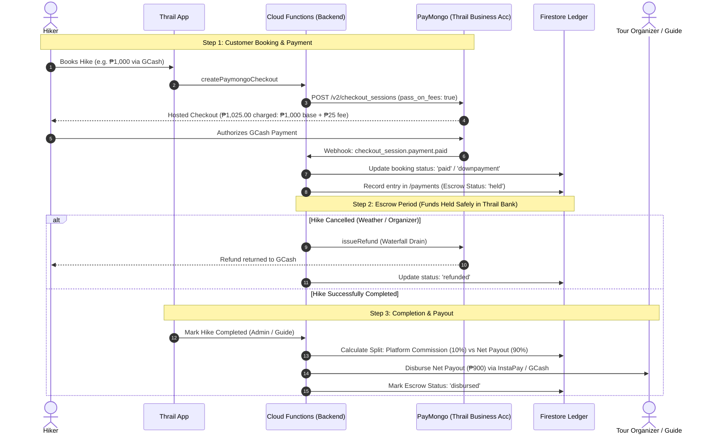

# Multi-Business Payment, Escrow & Organizer Payout Architecture

## 1. Executive Summary & Purpose

This architectural blueprint outlines how Thrail transitions from a single-developer test environment (using a personal PayMongo test account) into a scalable, enterprise-grade **Multi-Business Marketplace** connecting thousands of hikers with multiple independent tour organizers, travel agencies, and mountain guides.

### Core Objectives:
1. **Transition from Personal to Platform**: Safely move from personal PayMongo test credentials to an official **Thrail Business Merchant Account**.
2. **Multi-Vendor Money Management**: Provide a battle-tested financial architecture where customer payments are collected centrally, held in escrow until hike completion, and disbursed to organizers net of platform commission.
3. **Zero Capital Risk & Automated Refunds**: Guarantee that weather cancellations, typhoon emergencies, or guide no-shows can be refunded instantly via Thrail's **Waterfall Refund Engine** without needing to recover funds from organizers.
4. **Scalable Payout Pipeline**: Define a phased path from manual batch bank transfers (MVP) to fully automated API-driven disbursements (InstaPay / PESONet / GCash).

---

## 2. Current Architecture Scalability Audit

An audit of Thrail’s active codebase reveals that the application was **already engineered with multi-tenant business isolation from day one**.

```
Firestore Root
│
├── businesses/ (Multi-Tenant Core)
│   └── {businessId}/
│       ├── profile (Business Name, DTI, Contact)
│       ├── offers/ (Hike Packages & Itineraries)
│       ├── bookings/ (Hiker Reservations)
│       └── reschedules/ (Reschedule Requests)
│
├── payments/ (Global Double-Entry Financial Ledger)
│   └── {paymentId} (Tagged with business.id, bookingId, gatewayId)
│
└── users/ (Hikers, Guides, Organizers, SuperAdmins)
```

### What is Already Built & Scalable Today:
* **Tenant Data Separation**: Every offer, booking, and reschedule is partitioned under `/businesses/{businessId}`.
* **Payment Tagging**: In [`PaymentRepository.ts`](file:///d:/thrail_app/src/core/models/Payment/repositories/PaymentRepository.ts#L68), transactions are indexed and queried via `where("business.id", "==", businessId)`.
* **Provider Strategy Pattern**: [`PaymentManager.js`](file:///d:/thrail_app/functions/services/PaymentManager.js) abstracts the payment gateway logic. PayMongo is registered as a strategy, allowing future payout providers or alternate gateways (e.g., Xendit, Maya) to be plugged in with zero rewrites to the booking engine.
* **Zero Net Merchant Loss (`pass_on_fees: true`)**: With PayMongo v2 Pass-On Fees active, the platform collects the **exact 100% net base price**. Hiker convenience fees (GCash 2.5%, Maya 2.0%) are absorbed by the customer, ensuring clean mathematics when dividing revenue with organizers.
* **Waterfall Refund Engine**: The multi-installment drain engine handles partial refunds, voids, and custom deductions accurately on a per-booking basis.

---

## 3. Marketplace Financial Models Comparison

When building a multi-vendor platform in the Philippines, there are two primary payment architectures:

| Evaluation Dimension | Model A: Platform Escrow & Payouts ⭐ *(Selected for Thrail)* | Model B: Connected Sub-Accounts (PayMongo Platforms) |
| :--- | :--- | :--- |
| **How it Works** | Thrail collects 100% of funds centrally, holds money until hike completion, deducts commission, and pays out to the organizer's bank or GCash. | Each organizer sets up a child PayMongo account. Payments are automatically split at checkout via PayMongo Split API. |
| **Real-World Examples** | **Airbnb, Grab, Shopee, Klook, Foodpanda** | Stripe Connect platforms (Shopify, Substack) |
| **Organizer Onboarding Friction** | **Zero Friction.** Local guides only need to supply their personal GCash number or local bank account (BDO, BPI, UnionBank). | **Very High Friction.** Every guide/organizer must submit DTI/SEC registration, BIR Certificate of Registration (2303), and valid IDs to PayMongo. |
| **Refunds & Cancellation Control** | **100% Controlled.** If a typhoon cancels a hike, Thrail still holds the money and issues immediate full/partial refunds via the Waterfall engine. | **High Risk.** If funds were already split to the guide's sub-wallet and the guide withdrew the money, the platform must chase the guide for refund capital. |
| **Suitability for Freelance Mountain Guides** | **Ideal.** 85%+ of Philippine mountain guides are informal or freelance operators without formal corporation credentials. | **Poor.** Freelance guides will abandon onboarding if forced to go through full corporate fintech KYC. |

> [!IMPORTANT]
> **Model A (Platform Escrow)** is the definitive model for Thrail. It protects hikers from organizer insolvency/fraud, enables automated weather cancellation refunds, and removes onboarding friction for freelance mountain guides.

---

## 4. End-to-End Money Flow Lifecycle



---

## 5. Mathematical Revenue Split Matrix

Because `pass_on_fees: true` guarantees that the merchant account receives **100.00% of the base offer price**, the commission split calculation is deterministic, transparent, and exact.

### Example Scenario: 10 Hikers on a Mt. Pulag Expedition (₱2,500/pax)
* **Gross Base Booking Total**: `10 × ₱2,500 = ₱25,000.00`
* **Gateway Fees (GCash 2.5%)**: Paid directly by hikers (`₱625.00`). Deducted from hikers, **₱0.00** loss to platform.
* **Net Base Deposited in Thrail Bank**: **`₱25,000.00`**

| Entity | Revenue Share (%) | Calculation Formula | Net Amount Received | Method of Transfer |
| :--- | :---: | :--- | :---: | :--- |
| **Thrail Platform** | **10%** | `₱25,000 × 0.10` | **₱2,500.00** | Retained in Thrail Business Bank Account |
| **Tour Organizer** | **90%** | `₱25,000 × 0.90` | **₱22,500.00** | Transferred to Organizer's GCash / Bank via InstaPay |
| **PayMongo** | Processing Fee | `2.5% pass_on_fees` | `₱625.00` | Collected directly by PayMongo from hikers |

---

## 6. Firestore Database Schema Extensions

To support multi-business payouts, the following additive fields should be included in the database:

### A. Business Payout Profile (`/businesses/{businessId}`)
```typescript
interface BusinessPayoutProfile {
  payoutConfig: {
    channel: 'gcash' | 'maya' | 'bank';
    accountName: string;         // e.g. "JUAN DELA CRUZ"
    accountNumber: string;       // e.g. "09171234567" or "1234567890"
    bankCode?: string;           // e.g. "BDO", "BPI", "UBP", "MBTC"
    isVerified: boolean;         // Verified by Thrail SuperAdmin
    commissionRateOverride?: number; // Optional custom rate (default 0.10)
  };
}
```

### B. Global Disbursements Ledger (`/disbursements/{disbursementId}`)
```typescript
interface DisbursementRecord {
  id: string;
  businessId: string;
  offerId: string;
  hikeTitle: string;
  completedAt: FirebaseFirestore.Timestamp;
  grossAmount: number;           // e.g. 25000
  platformCommissionRate: number;// e.g. 0.10
  platformFee: number;           // e.g. 2500
  netPayoutAmount: number;       // e.g. 22500
  payoutChannel: 'gcash' | 'bank';
  destinationAccount: string;    // Masked: "0917****567"
  status: 'pending' | 'processing' | 'completed' | 'failed';
  referenceNumber: string | null;// InstaPay / Bank reference code
  processedAt: FirebaseFirestore.Timestamp | null;
  processedBy: string;           // 'system_automated' or 'superadmin_uid'
}
```

---

## 7. Phased Implementation Roadmap

### Phase 1: MVP / Beta Launch (Operational Payouts)
* **Goal**: Launch commercial bookings with zero upfront disbursement API integration complexity.
* **Mechanism**:
  1. All customer payments flow into Thrail’s central merchant account.
  2. Organizers fill in their GCash or Bank Account details in their Business Profile.
  3. SuperAdmin dashboard displays a **"Completed Hikes & Payouts Due"** table.
  4. Admin executes batch transfers via online banking (BPI/BDO/UnionBank InstaPay) once weekly.
  5. Admin clicks **"Mark as Paid"** in Thrail Admin and attaches the bank reference number.

### Phase 2: Automated Disbursements API
* **Goal**: Eliminate manual banking tasks as booking volume scales.
* **Mechanism**:
  1. Integrate PayMongo’s **Outward Transfers / Disbursements API** (or Xendit Payouts).
  2. When a hike status transitions to `'completed'`, a scheduled Cloud Function triggers real-time InstaPay disbursement.
  3. Webhook confirms transfer receipt and updates `/disbursements` status to `'completed'`.

### Phase 3: Organizer Financial Portal & Analytics
* **Goal**: Provide organizers with full transparency over their revenue.
* **Mechanism**:
  1. In-app Organizer Earnings Tab showing:
     * *Total Earnings to Date*
     * *Funds Currently in Escrow (Upcoming Hikes)*
     * *Completed Payouts History with Downloadable Receipts*
  2. Automated monthly PDF statements sent to organizers for their tax and accounting records.

---

## 8. Legal, Tax & Regulatory Compliance in the Philippines

1. **Merchant of Record (MoR)**:
   * Thrail operates as the MoR. Thrail is responsible for payment gateway security, card brand compliance, and primary customer refund handling.
2. **BIR Revenue Regulation No. 16-2023 (Marketplace Withholding Tax)**:
   * The Bureau of Internal Revenue (BIR) mandates online platform merchants to withhold **1% of gross remittances** to sellers/merchants if their annual gross remittances exceed ₱500,000.
   * Thrail’s double-entry `/payments` and `/disbursements` ledger ensures exact financial tracking to generate BIR Form 2307 (Certificate of Creditable Tax Withheld at Source) when required.
3. **Escrow Consumer Protection**:
   * Holding funds until hike completion ensures compliance with the Department of Trade and Industry (DTI) and Department of Tourism (DOT) consumer protection standards for tour and travel booking platforms.

---

### 🏁 Conclusion
Thrail's current architecture is **100% capable of supporting multi-business scaling**. Because your database already isolates businesses under `/businesses/{businessId}`, your payments use an abstracted `PaymentManager`, and PayMongo v2 eliminates transaction fee losses, you can scale to hundreds of tour organizers without refactoring your payment core.
