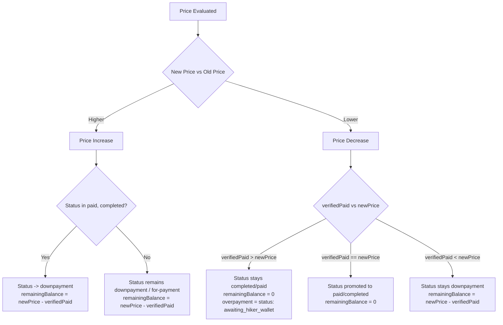

# Phase-by-Phase Implementation Plan: Admin Update Offer Cloud Function

## Executive Summary
This document specifies the technical design, domain rules, state machine transitions, and phased implementation steps for the `updateOffer` (or `adminUpdateOffer`) Firebase Cloud Function in **thrail_app**.

### Core Domain Context
* **Per-Hiker Pricing:** Each booking in `users/{userId}/bookings/{bookingId}` represents an individual hiker (`user: IUserBooking`). Therefore, `offer.price` represents the exact total price for that booking.
* **Payment Model:** All payments are manual QR (GCash/Maya) verified by the admin. There is no automated gateway capture (PayMongo removed).
* **Capacity Limit:** Each offer is capped at a maximum of 30 bookings/slots. This guarantees all reads and writes execute safely within a single atomic **Firestore Transaction** ($\le 31$ operations, well below the 500-write limit).
* **Schema Integrity:** `"overpayment"` is **not** a valid value in `BookingStatus`. Overpayments are tracked in `booking.overpayment` (`IOverpaymentDetails`), while the booking status remains confirmed (`'paid'` or `'completed'`).

---

## Phase 1: Authentication, Tenant Scoping & Lead-Time Validation

### Objectives
Ensure the request is securely authenticated, the caller has legitimate admin rights to the business owning the offer, and all temporal/financial boundaries are satisfied.

### Step-by-Step Logic
1. **Authentication Check:**
   * Reject unauthenticated requests: `if (!context.auth) throw new HttpsError('unauthenticated', ...)`.
2. **Fetch Target Offer:**
   * Read the offer document: `businesses/{businessId}/offers/{offerId}`.
   * Verify existence: Throw `'not-found'` if document is missing.
   * Verify status: Check `offer.status === 'active'`. Inactive, archived, or cancelled offers cannot be updated.
3. **Tenant & Owner Access Verification:**
   * Bypass check if `context.auth.token.role === 'superadmin'`.
   * Otherwise, query `businesses/{businessId}/admins` where the field `id == context.auth.uid` with `.limit(1)`:
     ```javascript
     const adminSnap = await db.collection('businesses')
       .doc(businessId)
       .collection('admins')
       .where('id', '==', context.auth.uid)
       .limit(1)
       .get();

     if (adminSnap.empty) {
       throw new HttpsError('permission-denied', 'You are not an authorized admin or owner of this business.');
     }
     ```
   * *Why this works:* Covers both regular admin documents and the owner document (where document ID is `'owner'` but `data.id === context.auth.uid`).
4. **Hike Date Validation (If Date Changed):**
   * Only run if `newDate` is provided and differs from `offer.date`.
   * Parse both dates with `Asia/Manila` timezone pinning (`luxon.DateTime`).
   * **Rule 1 (10-Day Rule):** Current hike date must be at least 10 days away from `now`:
     ```javascript
     const daysUntilCurrentHike = currentHikeDate.diff(now, 'days').days;
     if (daysUntilCurrentHike < 10) {
       throw new HttpsError('failed-precondition', 'Hike date can only be modified at least 10 days before the scheduled date.');
     }
     ```
   * **Rule 2 (7-Day Rule):** Proposed new hike date must be at least 7 days from `now`:
     ```javascript
     const daysUntilNewHike = proposedNewDate.diff(now, 'days').days;
     if (daysUntilNewHike < 7) {
       throw new HttpsError('invalid-argument', 'New hike date must be at least 7 days from today.');
     }
     ```
5. **Price Format Validation (If Price Changed):**
   * If `newPrice` is provided and differs from `offer.price`:
     * Validate: `typeof newPrice === 'number' && Number.isFinite(newPrice) && newPrice > 0`.
     * Round/normalize to 2 decimal places: `Math.round(newPrice * 100) / 100`.

---

## Phase 2: Blocker Detection & Integrity Checks

### Objectives
Prevent financial discrepancies and race conditions by verifying that no pending admin tasks or unresolved refund loops exist before allowing price changes.

### Step-by-Step Logic
1. **Query Active Bookings:**
   * Query all active bookings for this offer using a Collection Group Query:
     ```javascript
     const bookingsQuery = db.collectionGroup('bookings')
       .where('offer.id', '==', offerId)
       .where('status', 'in', [
         'for-reservation',
         'approved-docs',
         'for-payment',
         'downpayment',
         'paid',
         'completed',
         'for-cancellation',
         'for-reschedule'
       ]);
     ```
2. **Evaluate Financial Blockers (Only if Price Changed):**
   * *Note: If only non-price info (itinerary, description, gear checklist) changed, skip these blocker checks.*
   * Loop through each active booking and enforce:
     1. **Pending Cancellations:** If `booking.status === 'for-cancellation'`, reject with:
        `'Cannot change price: There are pending cancellation requests awaiting resolution.'`
     2. **Pending Reschedules:** If `booking.status === 'for-reschedule'`, reject with:
        `'Cannot change price: There are pending reschedule requests awaiting resolution.'`
     3. **Unverified Payment Proofs:** If `booking.paymentVerificationStatus === 'pending_verification'`, reject with:
        `'Cannot change price: There are unverified manual payment receipts awaiting admin review.'`
     4. **Unsettled Overpayments:** If `booking.overpayment && booking.overpayment.status !== 'completed'`, reject with:
        `'Settle overpayments first.'`

---

## Phase 3: Atomic Transaction & State Transitions

### Objectives
Atomically calculate payment ledgers, adjust booking statuses, and update the offer document in a single Firestore transaction.

### State Transition Matrix

$$\text{verifiedPaid} = \sum_{p \in \text{booking.payment}, p.\text{status} == \text{'captured'}} (p.\text{amount} - (p.\text{refundedAmount} \ || \ 0))$$



### Transaction Implementation Details
```javascript
await db.runTransaction(async (transaction) => {
  // 1. Read fresh Offer within transaction
  const freshOfferSnap = await transaction.get(offerRef);
  if (!freshOfferSnap.exists) throw new HttpsError('not-found', 'Offer no longer exists.');

  // 2. Fetch fresh Bookings
  const freshBookingsSnap = await transaction.get(bookingsQuery);

  // 3. Stage Updates for each Booking
  for (const doc of freshBookingsSnap.docs) {
    const booking = doc.data();
    const updates = { updatedAt: FieldValue.serverTimestamp() };

    if (isPriceChanged) {
      updates['offer.price'] = newPrice;

      const payments = booking.payment || [];
      const verifiedPaid = payments
        .filter(p => p.status === 'captured')
        .reduce((sum, p) => sum + (p.amount || 0) - (p.refundedAmount || 0), 0);

      if (newPrice > offer.price) {
        // --- PRICE INCREASE ---
        const newBalance = Math.max(0, newPrice - verifiedPaid);
        updates.remainingBalance = newBalance;

        if (['paid', 'completed'].includes(booking.status) && newBalance > 0) {
          updates.status = 'downpayment';
          updates.paymentVerificationStatus = 'downpayment';
        }
      } else {
        // --- PRICE DECREASE ---
        if (verifiedPaid > newPrice) {
          const excessAmount = verifiedPaid - newPrice;
          updates.remainingBalance = 0;
          updates.overpayment = {
            excessAmount,
            originalVerifiedAmount: verifiedPaid,
            hikeAmountCaptured: newPrice,
            status: 'awaiting_hiker_wallet', // Handshake stage 1
            createdAt: FieldValue.serverTimestamp(),
            updatedAt: FieldValue.serverTimestamp()
          };
        } else if (verifiedPaid === newPrice) {
          updates.remainingBalance = 0;
          if (booking.status === 'downpayment') {
            updates.status = 'paid';
            updates.paymentVerificationStatus = 'fully_paid';
          }
        } else {
          // Downpayment still partially unpaid
          updates.remainingBalance = newPrice - verifiedPaid;
        }
      }
    }

    if (isDateChanged) {
      updates['offer.date'] = Timestamp.fromDate(new Date(newDate));
    }

    transaction.update(doc.ref, updates);
  }

  // 4. Stage Update for the Offer Document
  const offerUpdatePayload = {
    ...cleanOfferFields(newOfferData),
    updatedAt: FieldValue.serverTimestamp()
  };
  transaction.update(offerRef, offerUpdatePayload);
});
```

---

## Phase 4: Notifications & Hiker Communication

### Objectives
Inform affected hikers immediately after the transaction commits, prompting required actions (paying the balance or providing e-wallet details).

### Notification Dispatch Matrix (Post-Commit)

| Scenario | In-App / Push Title | Message Body | Target Action / Screen |
| :--- | :--- | :--- | :--- |
| **Price Increased (Paid $\to$ Downpayment)** | `Offer Price Updated` | `The price for [Trail] was updated to ₱[New]. You have an outstanding balance of ₱[Balance].` | Booking Details $\to$ Upload Balance Proof |
| **Price Decreased (Overpayment)** | `Excess Payment Refund Available` | `Good news! The price for [Trail] decreased to ₱[New]. You have an excess refund of ₱[Excess]. Tap to provide your GCash/Maya number.` | Booking Details $\to$ `submitOverpaymentWallet` form |
| **Price Decreased (Deposit Now Covers Full)** | `Booking Fully Paid! 🎉` | `The price for [Trail] decreased to ₱[New]. Your deposit now covers 100% of the tour fee!` | Booking Details |
| **Date Rescheduled** | `Hike Date Rescheduled` | `The hike date for [Trail] has been moved to [NewDate]. Please review your itinerary.` | Booking Details / Group Chat |

### Notification Code Pattern
Uses the existing `notifyUser(db, userId, payload)` helper:
```javascript
for (const notification of postCommitNotifications) {
  await notifyUser(db, notification.userId, {
    title: notification.title,
    body: notification.body,
    inAppTitle: notification.title,
    inAppMessage: notification.body,
    type: notification.type,
    metadata: {
      bookingId: notification.bookingId,
      offerId,
      ...notification.metadata
    },
    data: {
      bookingId: notification.bookingId,
      offerId
    }
  });
}
```

---

## Phase 5: Testing Scenarios & Verification Matrix

| Test Case | Inputs / State | Expected Result |
| :--- | :--- | :--- |
| **1. Unauthorized Caller** | Caller UID not present in `businesses/{id}/admins` | Fails with `permission-denied` |
| **2. Date Change $< 10$ Days** | Current hike is 8 days away | Fails with `failed-precondition` |
| **3. New Date $< 7$ Days** | Proposed date is 4 days from now | Fails with `invalid-argument` |
| **4. Unsettled Overpayment** | 1 booking has `overpayment.status: 'awaiting_hiker_wallet'` | Fails with `'Settle overpayments first.'` |
| **5. Unverified Receipts** | 1 booking has `paymentVerificationStatus: 'pending_verification'` | Fails with `'Review pending payment receipts first.'` |
| **6. Non-Price Update with Overpayment** | Change itinerary description while overpayment is unsettled | **Succeeds** (Blocker check skipped) |
| **7. Price Increase on Paid Booking** | Hike was ₱1,000, new price ₱1,200; user paid ₱1,000 | Status $\to$ `downpayment`, `remainingBalance: 200` |
| **8. Price Decrease on Downpayment** | Hike was ₱2,500, new price ₱2,000; user paid ₱1,000 deposit | Status stays `downpayment`, `remainingBalance: 1000` |
| **9. Price Decrease on Full Payment** | Hike was ₱2,500, new price ₱2,000; user paid ₱2,500 | `remainingBalance: 0`, `overpayment.excessAmount: 500`, status `awaiting_hiker_wallet` |
| **10. Concurrent Request Race** | Admin updates offer while user submits cancellation | Handled by Firestore Transaction retry/abort |

---

## Required Firestore Index
Ensure this composite index is present in `firestore.indexes.json`:
```json
{
  "collectionGroup": "bookings",
  "queryScope": "COLLECTION_GROUP",
  "fields": [
    { "fieldPath": "offer.id", "order": "ASCENDING" },
    { "fieldPath": "status", "order": "ASCENDING" }
  ]
}
```

