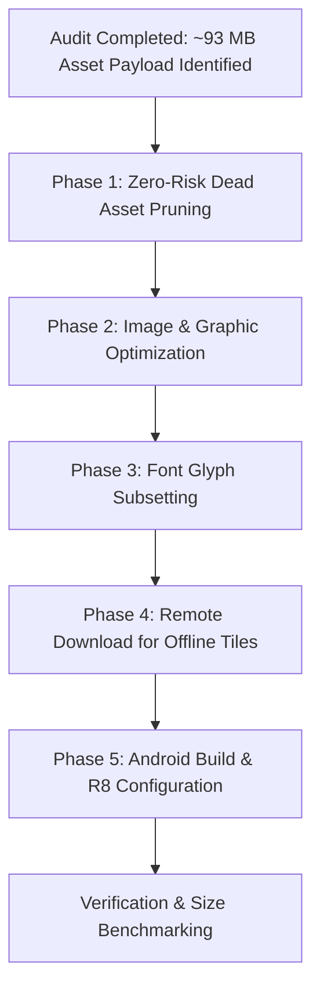

# Application Size Optimization & Asset Pruning Plan

**Document Path:** `plans/APP_SIZE_OPTIMIZATION_PLAN.md`  
**Target Project:** Thrail Mobile App (`thrail_app`)  
**Estimated Savings:** **~80 MB to 90 MB** (bundle payload) + **50–60% reduction** in native binary download size.

---

## 1. Executive Summary & Root Cause Analysis

An asset and build configuration audit revealed that **individual trail GeoJSON files (`batulao.geojson` @ 49 KB, `sembrano.geojson` @ 23 KB, `daraitan.geojson` @ 16 KB) are NOT the cause of the app's large size**. 

The application size explosion is caused by **~93 MB of bundled raw assets**, including unused historical datasets, uncompressed multi-megapixel camera photos, non-Latin map font glyphs, and bundled offline vector tiles. Furthermore, build settings package all CPU architectures and leave code shrinking disabled.

### Asset Weight Breakdown

| Asset Category | File Path / Description | Raw Size | Status & Issue | Projected Savings |
| :--- | :--- | :--- | :--- | :--- |
| **Offline Vector Tiles** | `src/assets/tiles/thrail-offline-map.pmtiles` | **35.4 MB** | Bundled in binary + duplicated to `documentDirectory` at runtime (70.8 MB device footprint). | **35.4 MB** (from download bundle) |
| **Dead GeoJSON Data** | `src/assets/map_data/trails_3D_final.geojson` | **21.6 MB** | **Completely unused**. Code uses `trails_3D_final_v2.geojson` (2.7 MB). Bundled due to `expo-asset`. | **21.6 MB** |
| **Unused Photos** | `src/assets/images/MT1.jpg` – `MT5.jpg` | **9.8 MB** | **Completely unused** camera photos left in repository. | **9.8 MB** |
| **Uncompressed Photo** | `src/assets/images/Mt.Tagapo.jpg` | **5.58 MB** | Single raw camera photo used for landing hero & default thumbnail. | **~5.3 MB** |
| **Offline Font Glyphs** | `src/assets/fonts/` (512 `.pbf` glyph files) | **12.5 MB** | Bundles worldwide glyphs (CJK, Cyrillic, Arabic) for MapLibre offline maps. | **~12.0 MB** |
| **Trail Maps PNGs** | `src/assets/trail-maps/*.png` (8 files) | **5.7 MB** | Uncompressed raster PNG graphics. | **~5.0 MB** |
| **Dead Metadata / Reports**| `trails.json`, `*_report.json` in `map_data` | **~2.2 MB** | Scratch scripts & CLI reports bundled into app. | **~2.2 MB** |
| **Android Fat Binary** | All 4 ABIs (`armeabi-v7a`, `arm64-v8a`, `x86`, `x86_64`) in universal APK | Multi-arch | Universal APK contains 4 copies of MapLibre, Hermes, and React Native C++ libraries. | **~50–60% of native code** |

---

## 2. Phased Implementation Roadmap



---

## 3. Phase 1: Zero-Risk Dead Asset Pruning

**Goal:** Instantly recover **~33.6 MB** without changing a single line of business logic.

### 1.1 Delete Unused Datasets in `src/assets/map_data/`
- [ ] Remove `src/assets/map_data/trails_3D_final.geojson` (**21.6 MB**):
  - Confirmed: Active code in `src/core/models/Trail/utils/GeoJSONProcessor.ts` imports `trails_3D_final_v2.geojson`.
- [ ] Remove `src/assets/map_data/trails.json` (**2.07 MB**):
  - Confirmed: Only used by developer scratch script `tmp_script.js`.
- [ ] Remove `src/assets/map_data/trail_names_report.json` (**114 KB**).
- [ ] Remove `src/assets/map_data/map_data_report.json` (**10 KB**).

### 1.2 Delete Unused Images in `src/assets/images/`
- [ ] Remove `src/assets/images/MT1.jpg` (3.31 MB).
- [ ] Remove `src/assets/images/MT2.jpg` (330 KB).
- [ ] Remove `src/assets/images/MT3.jpg` (3.74 MB).
- [ ] Remove `src/assets/images/MT4.jpg` (1.55 MB).
- [ ] Remove `src/assets/images/MT5.jpg` (924 KB).
  *(Confirmed: Search across `src/` yields zero references to `MT1` through `MT5`).*

### 1.3 Update `app.json` Asset Directives
Instead of indiscriminately bundling directory contents, specify the precise assets required:
```json
// app.json
"plugins": [
  [
    "expo-asset",
    {
      "assets": [
        "src/assets/tiles/thrail-offline-map.pmtiles",
        "src/assets/fonts",
        "src/assets/map_data/trails_3D_final_v2.geojson",
        "src/assets/map_data/batulao.geojson",
        "src/assets/map_data/sembrano.geojson",
        "src/assets/map_data/daraitan.geojson",
        "src/assets/map_data/kulis.geojson",
        "src/assets/map_data/sambong.geojson"
      ]
    }
  ]
]
```

---

## 4. Phase 2: Image & Graphic Optimization

**Goal:** Shrink image payload from **~11.3 MB down to < 1 MB** (**~10.3 MB savings**).

### 2.1 Compress Hero Image `Mt.Tagapo.jpg` (5.58 MB -> ~150 KB)
- **Current state:** Raw 4000x3000 camera resolution image.
- **Action:** 
  1. Resize to max dimension of 1440px wide (standard mobile 3x density).
  2. Compress to WebP or quality 80 JPEG (`Mt.Tagapo.webp` or `Mt.Tagapo.jpg`).
  3. Expected file size: **~120 KB – 200 KB**.
- **Files to update:**
  - `src/features/Auth/screens/LandingScreen.tsx`
  - `src/features/Trail/utils/TrailDetailsHelpers.ts`
  - `src/features/Trail/tabs/TrailDetailsTab.tsx`

### 2.2 Convert & Compress Trail Map Thumbnails (5.7 MB -> ~500 KB)
- **Current state:** 8 uncompressed PNG files in `src/assets/trail-maps/`:
  - `mt-daraitan.png` (988 KB)
  - `mt-makiling.png` (921 KB)
  - `mt-kulis.png` (895 KB)
  - `mt-marami.png` (829 KB)
  - `mt-batulao.png` (824 KB)
  - `mt-maculot.png` (627 KB)
  - `mt-tagapo.png` (295 KB)
  - `placeholder-map.png` (295 KB)
- **Action:**
  1. Convert all 8 PNG images to lossy WebP at 80% quality.
  2. Each file drops from ~900 KB to ~50–70 KB.
  3. Update references in `src/features/Map/trailMapAssets.ts`.

---

## 5. Phase 3: Font Glyph Subsetting

**Goal:** Shrink font glyph payload from **12.5 MB down to < 500 KB** (**~12 MB savings**).

### 3.1 Understanding MapLibre PBF Glyphs
- MapLibre uses pre-rendered Protocol Buffer glyphs (`.pbf`) in 256-character ranges (e.g. `0-255.pbf`, `256-511.pbf`).
- `src/assets/fonts/Noto Sans Medium` and `Noto Sans Regular` each contain **256 files** ranging up to `65280-65535.pbf` (covering CJK Ideographs, Cyrillic, Hebrew, Arabic, Tibetan, etc.).
- For Philippine trail maps, the required characters are:
  - Basic Latin (English) & Latin-1 Supplement: `0-255.pbf`
  - Latin Extended-A / B (Tagalog/Filipino diacritics / names): `256-511.pbf`
  - General Punctuation & Currency: `8192-8447.pbf`

### 3.2 Action Plan
1. Delete unused ranges from both `Noto Sans Medium/` and `Noto Sans Regular/`, retaining only ranges `0-255.pbf` and `256-511.pbf` (and optional punctuation ranges).
2. Number of files drops from **512 files down to ~4–8 files**.
3. In `src/utils/resolveOfflineFonts.ts`, the parallel copying logic (`ctx.keys().map(...)`) will execute nearly instantly on app startup rather than iterating over 512 filesystem checks.

---

## 6. Phase 4: Remote Download Architecture for Offline PMTiles

**Goal:** Remove **35.4 MB** from initial app download and eliminate the **35.4 MB disk duplicate penalty**.

### 4.1 The Current Problem
- `TrailMap.native.tsx` packages `thrail-offline-map.pmtiles` inside the APK/IPA bundle.
- On first launch, `resolveOfflineMap()` reads this 35.4 MB asset and writes it to `${FileSystem.documentDirectory}thrail-offline-map.pmtiles`.
- **Result:** The user downloads 35.4 MB with the app, and the app consumes an *additional* 35.4 MB of storage on the device (70.8 MB total).

### 4.2 Proposed Strategy: On-Demand Download & Caching
1. **Host `thrail-offline-map.pmtiles` on Cloud Storage / CDN:**
   - Upload the `.pmtiles` file to Firebase Storage or Supabase Storage bucket with public cache headers.
2. **Download On Demand:**
   - Instead of bundling, check if `${FileSystem.documentDirectory}thrail-offline-map.pmtiles` exists and passes `isPmtilesValid()`.
   - If not present, prompt the user with a download dialog or initiate a background download via `FileSystem.createDownloadResumable(...)`.
   - Provide a visual progress indicator.
3. **App Bundle Impact:**
   - APK / IPA download drops by an immediate **35.4 MB**.

---

## 7. Phase 5: Android Build & Native Binary Optimization

**Goal:** Shrink Android download size by **50–60%** for end users.

### 7.1 Build Android App Bundle (`.aab`) instead of Universal APK
In `android/gradle.properties`:
```properties
reactNativeArchitectures=armeabi-v7a,arm64-v8a,x86,x86_64
```
- A universal APK packages MapLibre native C++ libraries (`libmaplibre.so`), Hermes engine, and React Native native code for **all four ABIs** simultaneously.
- When generating a release build, build an `.aab` (`./gradlew bundleRelease`) or use EAS Build:
  - Google Play / App Store distributes an optimized device-specific APK containing **only the architecture matching the user's phone** (almost always `arm64-v8a`), cutting native code size by ~65%.

### 7.2 Enable R8 Code & Resource Shrinking
In `android/gradle.properties`, enable R8 minification:
```properties
# Enable R8 Proguard & Resource Shrinking
android.enableMinifyInReleaseBuilds=true
android.enableShrinkResourcesInReleaseBuilds=true
```
- Inspect `android/app/proguard-rules.pro` to ensure rules are defined for:
  - `@maplibre/maplibre-react-native`
  - `@react-native-firebase`
  - Sentry SDK

---

## 8. Summary of Projected Savings

| Phase | Description | Pre-Optimization Size | Post-Optimization Size | Net Savings |
| :--- | :--- | :--- | :--- | :--- |
| **Phase 1** | Dead Assets (`trails_3D_final.geojson`, `MT*.jpg`, reports) | 33.6 MB | 0 MB | **-33.6 MB** |
| **Phase 2** | Image Optimization (`Mt.Tagapo.jpg`, trail-maps) | 11.3 MB | ~0.7 MB | **-10.6 MB** |
| **Phase 3** | Font Glyphs Pruning (`assets/fonts/`) | 12.5 MB | ~0.3 MB | **-12.2 MB** |
| **Phase 4** | Offline Map Tiles to Remote Storage | 35.4 MB | 0 MB (in bundle) | **-35.4 MB** |
| **Phase 5** | Native Architecture Split (AAB) & R8 Minification | ~60 MB native | ~20 MB native | **~60% native reduction** |
| **Total** | **Combined Asset & Bundle Payload** | **> 120 MB+** | **< 20–25 MB** | **~80–90 MB Saved** |

---

## 9. Step-by-Step Execution Checklist

```markdown
- [ ] 1. Phase 1: Dead Asset Pruning
  - [ ] Delete `src/assets/map_data/trails_3D_final.geojson`
  - [ ] Delete `src/assets/map_data/trails.json` and report files
  - [ ] Delete `src/assets/images/MT1.jpg` through `MT5.jpg`
  - [ ] Update `app.json` expo-asset plugin paths

- [ ] 2. Phase 2: Image Compression
  - [ ] Resize and convert `Mt.Tagapo.jpg` to WebP
  - [ ] Convert `src/assets/trail-maps/*.png` to WebP
  - [ ] Update image require statements in code

- [ ] 3. Phase 3: Font Pruning
  - [ ] Keep only Latin character `.pbf` ranges (0-255, 256-511)
  - [ ] Verify `resolveOfflineFonts.ts` initializes cleanly on simulator/device

- [ ] 4. Phase 4: Offline PMTiles Architecture
  - [ ] Upload `thrail-offline-map.pmtiles` to remote bucket
  - [ ] Add download manager flow in `TrailMap.native.tsx`
  - [ ] Remove `src/assets/tiles/` from `app.json` asset bundle

- [ ] 5. Phase 5: Android Build Configuration
  - [ ] Test `./gradlew assembleRelease` with R8 enabled in `gradle.properties`
  - [ ] Verify no ProGuard class missing warnings for Firebase or MapLibre
  - [ ] Generate `.aab` bundle and analyze with Android Studio APK Analyzer
```
