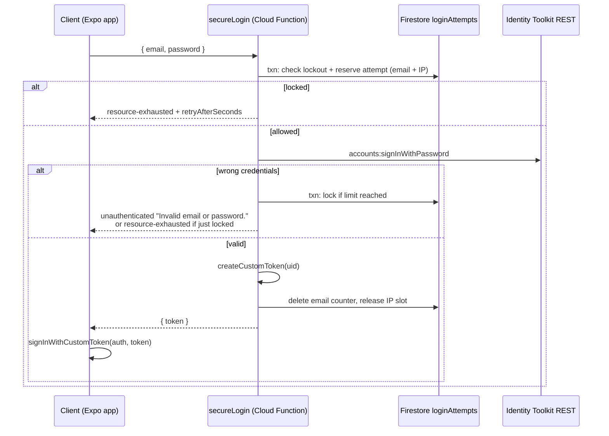

# Login Attempt Limiter (Brute-Force Protection)

**Issue / Branch:** `132-featuresecurity-missing-custom-login-attempt-limiter-lockout-mechanism-in-backend`
**Date:** 2026-10-13
**Status:** Implemented, not yet deployed or tested end-to-end

---

## 1. Summary

Email/password login used to go straight from the client to Firebase Auth (`signInWithEmailAndPassword`), with no app-level limit on failed attempts. Login now goes through a Cloud Function, `secureLogin`, which:

1. Checks the email and IP counters for an active lockout.
2. Checks the password through the Identity Toolkit REST API.
3. Records failures and locks the email or IP when it reaches its limit.
4. On success, returns a **custom token**. The client exchanges it with `signInWithCustomToken`.

| Rule | Value |
|---|---|
| Max failures per email | **5** within 15 min |
| Max failures per IP | **20** within 15 min |
| Lockout duration | **15 min** (fixed, hard lock) |
| Counter doc lifetime | 24 h after last activity (Firestore TTL) |

Google sign-in is **not affected**.

---

## 2. Steps taken

### 2.1 Reviewing the original plan

The first proposal was **client-gated**:

1. The client calls a function to check its attempt count.
2. If allowed, the client calls `signInWithEmailAndPassword` itself.
3. The client reports failures back.

**Why it was rejected:** the server never sees the actual login result.

| Problem | Effect |
|---|---|
| Failures are reported by the client | An attacker skips reporting, so the counter never increases |
| The check is advisory | An attacker skips the check and calls Firebase Auth directly |
| Race window | Parallel requests all pass the check before any failure is recorded |

It would stop honest users who mistype, but not an attacker.

### 2.2 Choosing server-side login

The Admin SDK can't verify passwords; there's no `signInWithEmailAndPassword` on the server. The workaround:

- Verify the password with the **Identity Toolkit REST API** (`accounts:signInWithPassword`).
- Create a session with `admin.auth().createCustomToken(uid)`.
- The client calls `signInWithCustomToken`.

### 2.3 Decisions made during review

| Topic | Decision | Reason |
|---|---|---|
| Thresholds | 5 per email, 20 per IP, then 15 min lockout | Confirmed by developer |
| Lockout type | Hard lock (no captcha) | Simpler for now; captcha may come later |
| Where counters live | Top-level `loginAttempts` collection, **not** `/users/{uid}/attempts` | See below |
| `beforeSignIn` blocking function | **Not implemented** | Leaks a "correct password" signal (see §4.2) |
| Doubling lockout length | Dropped | Fixed 15 min requested |
| IAM role | Service Account Token Creator added by developer | Required for `createCustomToken` on Gen2 |

**Why the counters aren't under `/users/{uid}/attempts`:**
- **It reveals which emails are registered.** Unregistered emails would never show a lockout, so getting "Too many attempts" would prove the account exists.
- **The per-IP counter can't live there.** It covers many emails, so it doesn't belong to any one user document.
- **Rules risk.** Users have write access under their own `/users/{uid}`, so a rules mistake could let a user reset their own counter.

### 2.4 Implementation steps

1. Created the `functions/services/LoginLimiter.js` module.
2. Registered the `secureLogin` callable in `functions/index.js`, using a `defineString('AUTH_WEB_API_KEY')` param.
3. Added a deny-all rule for `loginAttempts` in `firestore.rules`.
4. Added a TTL policy for `loginAttempts.expiresAt` in `firestore.indexes.json`.
5. Changed `UserRepository.logIn` to call `secureLogin`, then `signInWithCustomToken`.
6. Added `functions/*` error codes to `autherror.ts`.
7. Checked that the functions code loads and has no syntax errors (`node --check index.js`, `require('./services/LoginLimiter')`).

---

## 3. Current setup

### 3.1 Flow

### 3.2 Files changed

| File | Change |
|---|---|
| [functions/services/LoginLimiter.js](../functions/services/LoginLimiter.js) | **New.** All limiter logic |
| [functions/index.js](../functions/index.js) | `exports.secureLogin`, `AUTH_WEB_API_KEY` param, `defineString` import |
| [firestore.rules](../firestore.rules) | `match /loginAttempts/{attemptId} { allow read, write: if false; }` |
| [firestore.indexes.json](../firestore.indexes.json) | TTL field override on `loginAttempts.expiresAt` |
| [src/core/models/User/repositories/UserRepository.ts](../src/core/models/User/repositories/UserRepository.ts) | `logIn` uses `secureLogin` + `signInWithCustomToken`; removed the unused `signInWithEmailAndPassword` import |
| [src/core/error/autherror.ts](../src/core/error/autherror.ts) | Maps `functions/*` error codes |

`authStoreCreator.ts` didn't need changes; it still calls `UserRepo.logIn({ email, password })`.

### 3.3 Data model: `loginAttempts/{key}`

- **Document IDs:**
  - `email_<sha256(lowercased trimmed email)>`
  - `ip_<sha256(client ip)>`
- No raw emails or IPs are stored.

| Field | Type | Meaning |
|---|---|---|
| `count` | number | Attempts reserved in the current window |
| `firstAttemptAt` | Timestamp | Start of the current 15 min window |
| `lockedUntil` | Timestamp \| null | When the lockout ends, if locked |
| `updatedAt` | Timestamp | Last write |
| `expiresAt` | Timestamp | TTL deletion time: max(now, lockedUntil) + 24 h |

### 3.4 Core logic (`LoginLimiter.js`)

| Function | Role |
|---|---|
| `getClientIp` | Takes the **last** `X-Forwarded-For` entry. Google adds it, so the client can't fake it. Falls back to `rawRequest.ip` |
| `resolveState` | Resets the counter when the 15 min window or the lockout has expired |
| `reserveAttempt` | **Transaction.** Rejects if locked. Locks right away if in-flight attempts already used up the limit. Otherwise adds 1 to both counters. Checked **before** the password |
| `verifyPassword` | REST call. Uses the Auth emulator automatically when `FIREBASE_AUTH_EMULATOR_HOST` is set |
| `recordFailure` | **Transaction.** Sets `lockedUntil = now + 15 min` when `count >= max` |
| `recordSuccess` | Deletes the email counter and gives back one IP slot |
| `releaseAttempt` | Gives back a reserved slot (never below 0) on infrastructure errors |
| `handleSecureLogin` | Orchestrates the above and maps outcomes to `HttpsError` |

**Error mapping:**

| Situation | Server `HttpsError` | Client message |
|---|---|---|
| Bad input | `invalid-argument` | "Please enter a valid email address." / "Please enter a valid password." |
| Wrong email or password (registered or not) | `unauthenticated` | "Invalid email or password." |
| Locked (email or IP) | `resource-exhausted` + `{ retryAfterSeconds }` | "Too many failed login attempts. Please try again in N minutes." |
| Firebase Auth throttled the request | `resource-exhausted` | "Too many login attempts. Please try again later." |
| Account disabled | `permission-denied` | "This account has been disabled." |
| REST call failed, token creation failed, or unknown error | `unavailable` / `internal` | "Something went wrong. Please try again later." |

**How attempts are counted:**
- Wrong credentials and disabled accounts count toward the limit.
- Firebase throttling also counts.
- Infrastructure errors give the attempt back.
- A successful login resets the email counter.

### 3.5 Configuration and infrastructure

| Item | Status |
|---|---|
| `AUTH_WEB_API_KEY` param | **To do.** Create `functions/.env.thrail` and `functions/.env.thrail-sandbox` containing the matching `EXPO_PUBLIC_FIREBASE_APIKEY` value. Otherwise the CLI asks on deploy. The value is public, so it's safe to commit |
| Service Account Token Creator role on the functions runtime service account | Added by developer. Confirm it's on **both** `thrail` and `thrail-sandbox` |
| Email enumeration protection (Console → Auth → Settings) | **Recommended.** Confirm it's enabled |
| Deploy | `firebase deploy --only functions:secureLogin,firestore:rules,firestore:indexes` |

Deploy order doesn't matter: older app builds still use direct sign-in and keep working.

---

## 4. Known gaps and risks

### 4.1 Calling Firebase Auth directly is still possible (main remaining gap)

The Firebase Web API key is public, so an attacker can call `identitytoolkit.googleapis.com/v1/accounts:signInWithPassword` directly and **skip `secureLogin` entirely**. Custom code can't close this path. Current defenses:

- Firebase Auth's built-in throttling (per IP and per account), which is always on.
- Email enumeration protection, if enabled.

The custom limiter protects the app's login path and adds per-account lockout. It doesn't replace the protections above.

### 4.2 Why there's no `beforeSignIn` blocking function

A `beforeSignIn` blocking function could enforce lockout on direct REST sign-ins too. But it runs **after** Firebase has checked the password:
- a wrong password returns `INVALID_LOGIN_CREDENTIALS`;
- a correct password on a locked account returns a blocking error.

An attacker could tell those two responses apart and learn the password is correct. It was dropped for that reason.

### 4.3 An attacker can lock real users out

Anyone who knows a user's email can trigger 5 failures and lock that user out for 15 minutes, again and again. The per-IP limit slows this down from a single IP, but not from a botnet.

### 4.4 Shared IPs and Firebase Auth throttling

- **The functions share one source.** All password checks now come from Cloud Functions' egress IPs, so Firebase's per-IP throttling sees one caller instead of many users. Under heavy load this could cause `TOO_MANY_ATTEMPTS_TRY_LATER` for everyone. That's unlikely at current scale.
- **Mobile carriers share IPs (CGNAT).** Many users behind one IP share the 20-per-IP budget.
- **A proxy in front would break IP detection.** If Firebase Hosting or a CDN is ever placed in front of the function, the last `X-Forwarded-For` entry becomes a proxy IP, and **every user would share one IP counter**.

### 4.5 Account enumeration is already possible elsewhere

The existing `checkEmail` callable (used in sign-up) returns `emailAvailable` to anyone, without authentication. That reveals registered emails no matter what the login flow does.

### 4.6 Other notes

- **Slower login:** one extra network round trip (function → REST → token → client).
- **Sign-in provider in the ID token:** `firebase.sign_in_provider` is now `custom` instead of `password`. Firestore rules don't rely on it today. Analytics or future rules that check it would need updating.
- **Not tested yet:** no automated tests have been written, and the flow hasn't been run end-to-end on the emulators or a deployed project.
- **Input checks are loose:** email format is a simple regex, and passwords are only checked for 1–4096 characters.

---

## 5. Recommendations and future changes

### Short term (before or right after deploy)

1. **Create the `AUTH_WEB_API_KEY` env files** and deploy the function, rules and indexes.
2. **Turn on email enumeration protection** in Firebase Console.
3. **Write emulator tests** (`firebase-functions-test` + Auth/Firestore emulators):
   - 5 wrong passwords → 6th attempt returns `resource-exhausted`, even with the correct password
   - Lockout expires → correct login succeeds and the counter resets
   - Unknown email behaves the same as a wrong password
   - 21 failures from one IP across different emails → IP lockout
   - Parallel requests can't get more than 5 password checks
4. **Check IP detection after deploy:** temporarily log the parsed IP (or compare request logs) to confirm it's the real client IP and not a Google proxy.
5. **Watch the logs** for `LoginLimiter:` messages, especially `createCustomToken failed` and `Firebase Auth throttled`.

### Medium term

6. **Show a countdown in the UI** using `retryAfterSeconds` from the error details, and disable the login button while locked.
7. **Limit or protect `checkEmail`** so it doesn't reveal registered emails (§4.5). For example, rate-limit it with the same IP counter.
8. **Add a captcha challenge** after N failures (e.g. 3) before the hard lock. This reduces the lockout abuse in §4.3.
9. **Notify users of lockouts:** email them when their account is locked, with a "this wasn't me / reset password" link.
10. **Make the limits configurable** through Remote Config or env params instead of hard-coded constants.

### Long term

11. **Firebase App Check** on `secureLogin` (`enforceAppCheck: true`) so only real app builds can call it.
12. **Identity Platform reCAPTCHA Enterprise for email/password.** Firebase enforces it on the server, so it also covers direct REST calls (§4.1). Check Expo / React Native support first.
13. **Lock out progressively** (15 min → 1 h → 24 h) if attacks repeat.
14. **Multi-factor authentication** for admin and superadmin accounts.
15. **An admin tool** to look up a user's lockout and clear it.

---

## 6. Rollback

1. Revert `UserRepository.logIn` to `signInWithEmailAndPassword(auth, email, password)` and restore the import.
2. Optionally remove `exports.secureLogin`. The rules, TTL policy and `loginAttempts` collection are harmless to leave in place.
