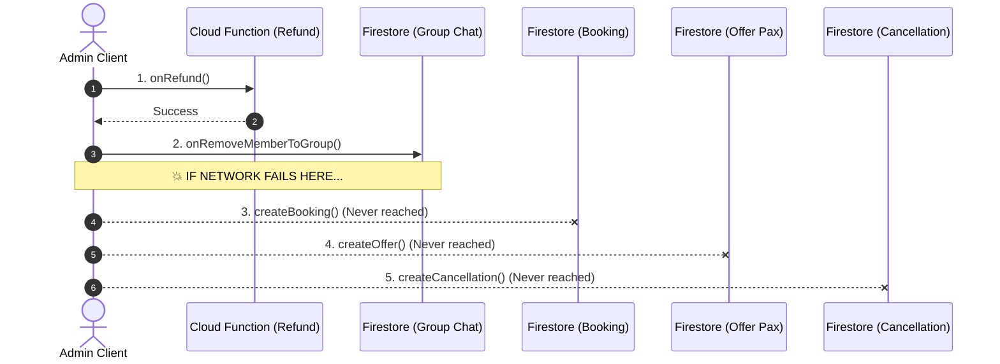
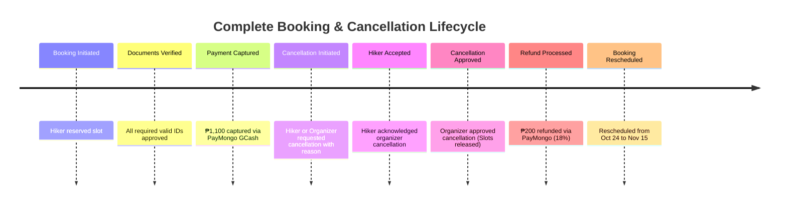
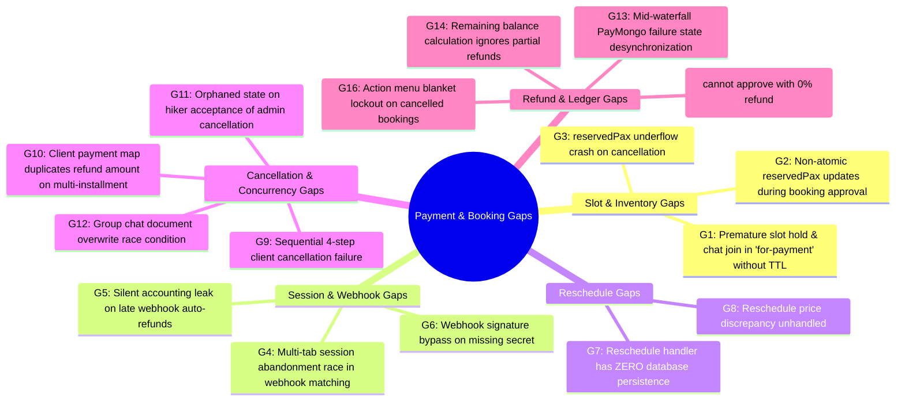
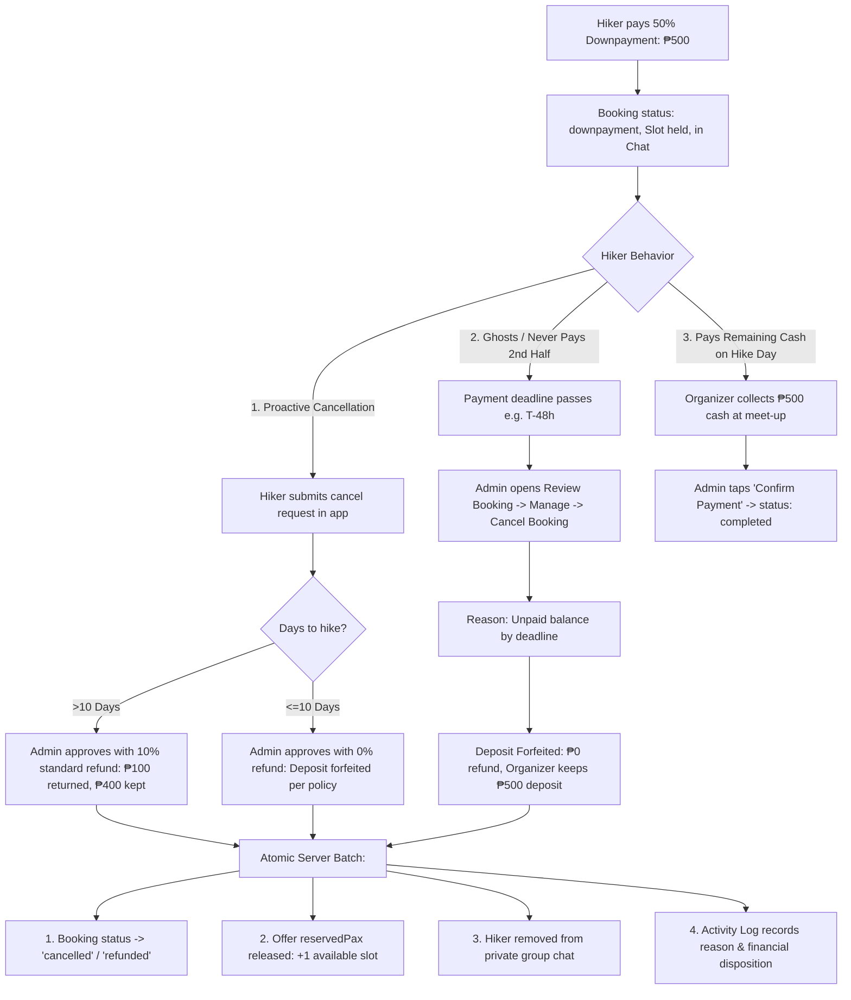
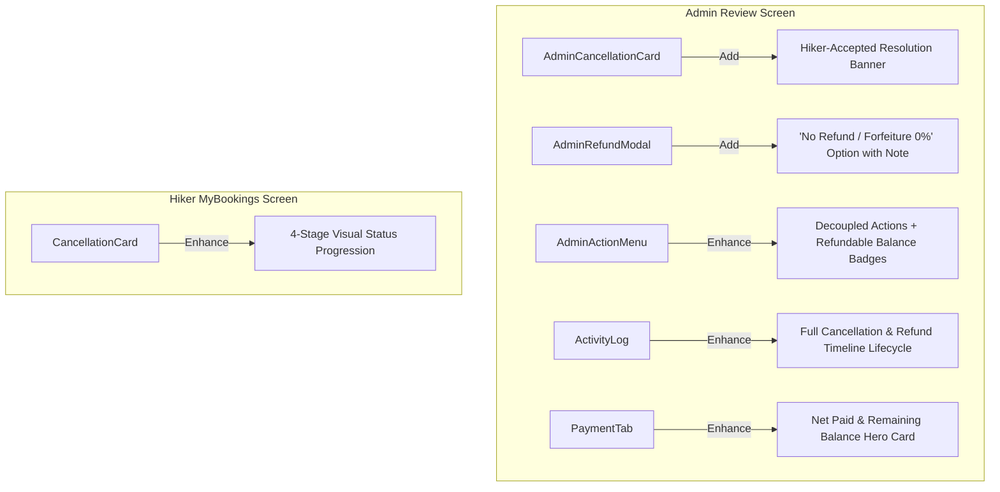

# Architecture & Implementation Plan: Issue #154
## Atomic Cloud Function Cancellation Approval, Action Menu Decoupling, and Activity Log Overhaul

- **Branch**: `raven-add-custom-refund-amount`
- **Date**: October 20, 2026
- **Status**: Implemented & Ready for Testing
- **Target File**: `plans/issue-154.md`

---

## 1. Executive Summary & Core Constraints

### 1.0 Core Constraint: Zero Workflow Alteration (In-Place Function Hardening Only)
> [!IMPORTANT]
> **Guiding Principle**: There is **NO alteration of user-facing workflows, navigation flows, or business processes**.
> - Admins and hikers continue interacting with the **exact same screens, modals, cards, and buttons** they are already familiar with.
> - We are **NOT** redesigning or introducing new complex flows.
> - We are **strictly improving existing functions in-place** to plug the identified architectural gaps (e.g. replacing fragile client-side multi-step calls with an all-or-nothing server batch, fixing balance calculation math, and correcting button enable/disable conditions).

### 1.1 The Current Problem: Fragile Sequential Client Execution
Currently in [`useCancellationAdmin.ts`](file:///d:/thrail_app/src/core/models/Cancellation/hooks/useCancellationAdmin.ts), when an organizer approves a booking cancellation request, the application executes **four separate operations sequentially from the mobile/web client**:
1. **Refund Execution**: Calls Cloud Function `refundBooking` (calls PayMongo API, updates payments, updates booking status).
2. **Group Chat Removal**: Calls `onRemoveMemberToGroup` (fetches group, updates Firestore members array).
3. **Booking Persistence**: Calls `createBooking` (overwrites booking in Firestore).
4. **Offer Inventory Update**: Calls `createOffer` (decrements `reservedPax` in Firestore).
5. **Cancellation Request Status**: Calls `createCancellation` (marks request as `approved` in Firestore).



#### The Gap Matrix (Failure Consequences):
| Failure Point | Consequence / Data Corruption Gap |
| :--- | :--- |
| **Network drops after Step 1 (Refund)** | Hiker gets money back, but booking remains active, reserved pax is not released to the public, and hiker remains in private group chat. |
| **Network drops after Step 2 (Group Chat)** | Money refunded, user removed from chat, but booking status is stuck in `for-cancellation` and offer slot is permanently blocked. |
| **Network drops after Step 3 (Booking update)** | Booking marked cancelled, but offer `reservedPax` is not decremented (lost inventory) and cancellation request stays `pending`. |
| **Network drops after Step 4 (Offer update)** | All database docs updated, but cancellation doc remains `pending`, showing up indefinitely on admin review queues. |

### 1.2 Additional Core Requirements
1. **All-or-Nothing Cloud Function Architecture**:
   Move all four processes into a single server-side Cloud Function (`processCancellationApproval`). If any validation or payment step fails, no state changes take effect.
2. **Interactive Refund Choice for Admin-Initiated Cancellations**:
   When an admin cancels a booking and the hiker approves/accepts it, the admin must be explicitly prompted whether to issue a refund or close without refund.
3. **Interactive Refund Choice for Hiker-Initiated Cancellations**:
   When the admin approves a hiker's cancellation request, the admin must be given the explicit choice to:
   - Refund 100% Full
   - Refund 10% Standard Policy
   - Refund Custom Amount (₱X.XX)
   - Approve **Without Refund** (0% refund / slot release only with explanation).
4. **Action Menu Decoupling (Reschedule, Refund, Cancel)**:
   Currently in [`AdminActionMenu.tsx`](file:///d:/thrail_app/src/features/Admin/screens/Booking/components/AdminActionMenu.tsx), approving a cancellation locks the entire menu (`canRefund: false`, `canReschedule: false`, `canCancel: false`). All three actions must remain independently available where logically viable (e.g. issuing a refund on a cancelled booking, or rescheduling a cancelled booking to a future date).
5. **Activity Log Overhaul**:
   The [`ActivityLog.tsx`](file:///d:/thrail_app/src/features/Admin/screens/Booking/components/ActivityLog.tsx) timeline must accurately log each distinct lifecycle transition (Admin Cancellation Requested, Hiker Accepted, Admin Approved, Refund Issued with Amount, or Cancellation Declined with note).

---

## 2. All-or-Nothing Cloud Function Architecture

### 2.1 Proposed Server-Side Function: `processCancellationApproval`
Instead of 5 separate client round trips, the client makes **one single callable invocation**:

```typescript
const processCancellationApproval = httpsCallable(functions, 'processCancellationApproval');

await processCancellationApproval({
    cancellationId: request.id,
    bookingId: booking.id,
    userId: booking.user.id,
    offerId: booking.offer.id,
    approved: true, // or false if declining
    shouldRefund: true, // or false if no-refund approval
    refundType: 'custom', // 'full' | 'partial' | 'custom' | 'none'
    customAmount: 200,
    adminNote: 'Cancellation approved per weather advisory'
});
```

### 2.2 Server-Side Execution Flow (`functions/index.js`)
```mermaid
flowchart TD
    A[Client calls processCancellationApproval] --> B[Verify Admin Auth & Business Ownership]
    B --> C[Fetch Booking, Offer, Group, and Cancellation docs]
    C --> D{Is Approved?}
    
    D -- No (Decline) --> E[Update Cancellation to 'rejected' with adminNote]
    E --> F[Atomic Commit & Return]
    
    D -- Yes (Approve) --> G{Should Refund?}
    G -- Yes (shouldRefund && totalPaid > 0) --> H[Execute PayMongo Waterfall Drain Refund]
    H -- PayMongo Failed --> I[Abort: Throw HttpsError, 0 Firestore writes]
    H -- PayMongo Succeeded --> J[Prepare Firestore Batch Write]
    G -- No (No Refund / Unpaid) --> J
    
    J --> K[1. bookingRef: status 'refunded'/'cancelled', payment metadata]
    J --> L[2. offerRef: reservedPax increment -paxCount]
    J --> M[3. groupRef: members arrayRemove userId]
    J --> N[4. cancellationRef: status 'approved', adminNote]
    J --> O[5. payments collection: sync refund entry]
    
    K & L & M & N & O --> P[batch.commit() - Atomic All-or-Nothing]
    P --> Q[Return Success Payload to Client]
```

### 2.3 Atomic Firestore Batch Specifications
Within `processCancellationApproval`:
```javascript
const batch = db.batch();

// 1. Booking Document
batch.update(bookingRef, {
    status: isRefundIssued ? 'refunded' : 'cancelled',
    cancellationReason: adminNote || cancellationData.reason,
    cancelledBy: cancellationData.cancelledBy || caller.uid,
    payment: updatedPayments,
    updatedAt: FieldValue.serverTimestamp()
});

// 2. Offer Document (Release slots)
batch.update(offerRef, {
    reservedPax: FieldValue.increment(-paxToRelease),
    updatedAt: FieldValue.serverTimestamp()
});

// 3. Group Chat Document (Remove member)
batch.update(groupRef, {
    members: FieldValue.arrayRemove(userId),
    updatedAt: FieldValue.serverTimestamp()
});

// 4. Cancellation Request Document
batch.update(cancellationRef, {
    status: 'approved',
    adminNote: adminNote || null,
    refundAmount: isRefundIssued ? actualRefundedAmount : 0,
    refundedAt: isRefundIssued ? FieldValue.serverTimestamp() : null,
    updatedAt: FieldValue.serverTimestamp()
});

// 5. Global Payments Collection (if refunded)
if (isRefundIssued && paymentsQuerySnap) {
    paymentsQuerySnap.docs.forEach(docSnap => {
        batch.update(docSnap.ref, {
            status: 'refunded',
            'receipt.refundedAmount': FieldValue.increment(actualRefundedAmount),
            refundedAt: FieldValue.serverTimestamp(),
            updatedAt: FieldValue.serverTimestamp()
        });
    });
}

// ATOMIC COMMIT: Everything commits together or nothing does
await batch.commit();
```

---

## 3. Interactive Refund Choice Workflows

### 3.1 Workflow A: Admin Cancels Booking -> Hiker Accepts -> Admin Prompted for Refund
1. **Admin Initiates Cancellation**:
   - Admin opens "Manage Booking" -> "Cancel Booking" ([`AdminCancelBookingModal.tsx`](file:///d:/thrail_app/src/features/Admin/screens/Booking/components/AdminCancelBookingModal.tsx)).
   - Enters reason (e.g. Typhoon warning).
   - Cancellation created with `cancelledBy: 'admin'`, `status: 'pending'`.
2. **Hiker Accepts**:
   - In [`CancellationCard.tsx`](file:///d:/thrail_app/src/features/Book/screens/MyBookings/components/CancellationCard.tsx), hiker sees "Hike Cancelled by Organizer".
   - Hiker taps "Accept Cancellation".
   - Status transitions to `accepted_by_user`.
3. **Admin Prompt in Review Screen**:
   - When Admin views the booking in [`ReviewScreen.tsx`](file:///d:/thrail_app/src/features/Admin/screens/Booking/ReviewScreen.tsx), [`AdminCancellationCard.tsx`](file:///d:/thrail_app/src/features/Admin/screens/Booking/components/AdminCancellationCard.tsx) detects `cancellation.status === 'accepted_by_user'` (or approved without refund yet).
   - Card presents a highlighted action prompt:
     > **Hiker Accepted Cancellation**  
     > The hiker has acknowledged the cancellation. Choose how to finalize this booking:
     > - **[Issue Refund via PayMongo]** (Opens [`AdminRefundModal.tsx`](file:///d:/thrail_app/src/features/Admin/screens/Booking/components/AdminRefundModal.tsx))
     > - **[Close Without Refund]** (Opens confirmation modal with note, e.g. voucher/reschedule agreed offline)

### 3.2 Workflow B: Hiker Asks for Cancellation -> Admin Chooses Refund or No-Refund
1. Hiker submits cancellation request with reason.
2. In [`ReviewScreen.tsx`](file:///d:/thrail_app/src/features/Admin/screens/Booking/ReviewScreen.tsx), Admin taps "Approve Cancellation".
3. An updated modal or prompt gives the admin two distinct pathways:
   - **Approve with Refund**: Admin selects 100% Full, 10% Partial, or Custom Amount (₱X.XX).
   - **Approve without Refund**: Admin releases the slot and closes the booking with ₱0 refund (e.g., if cancellation is outside policy or no-show), requiring an admin explanation note.

---

## 4. Action Menu Decoupling Architecture

### 4.1 The Current Problem in [`AdminActionMenu.tsx`](file:///d:/thrail_app/src/features/Admin/screens/Booking/components/AdminActionMenu.tsx)
Currently:
```typescript
const canReschedule = !isCancelledStatus;
const canRefund = !isCancelledStatus && totalAmountPaid > 0;
const canCancel = !isCancelledStatus && !hasPendingCancellation;
```
When a booking is cancelled or refunded, `isCancelledStatus` evaluates to `true`. This locks **all three** buttons simultaneously, preventing:
- Issuing a refund after a booking was already cancelled.
- Rescheduling a cancelled hiker to an alternative hike date.

### 4.2 New Decoupled Rules
```typescript
// 1. REFUND: Available whenever there is collected money that hasn't been 100% refunded yet
const remainingRefundable = Math.max(0, totalAmountPaid - totalRefundedAmount);
const canRefund = remainingRefundable > 0.01;

// 2. RESCHEDULE: Available on active bookings AND cancelled bookings (unless past/finished)
const isHikeFinished = ['finished', 'expired'].includes(currentStatus);
const canReschedule = !isHikeFinished;

// 3. CANCEL: Available on active bookings that are not already cancelled or refunded
const isAlreadyClosed = ['cancelled', 'refund', 'refunded', 'finished', 'expired'].includes(currentStatus);
const canCancel = !isAlreadyClosed && !hasPendingCancellation;
```

#### Capability Matrix:
| Booking State | Total Paid | Remaining Refundable | Can Reschedule? | Can Refund? | Can Cancel? |
| :--- | :--- | :--- | :---: | :---: | :---: |
| **Confirmed / Paid** | ₱1,100 | ₱1,100 | ✅ Yes | ✅ Yes | ✅ Yes |
| **Cancelled (No Refund Yet)** | ₱1,100 | ₱1,100 | ✅ Yes (Rebook hiker) | ✅ Yes (Refund money) | ❌ No (Already cancelled) |
| **Partially Refunded** | ₱1,100 | ₱900 | ✅ Yes (Rebook hiker) | ✅ Yes (Refund remainder) | ❌ No (Already cancelled) |
| **Fully Refunded** | ₱1,100 | ₱0 | ✅ Yes (Rebook hiker) | ❌ No (₱0 remaining) | ❌ No (Already closed) |
| **Draft / Unpaid Cancelled** | ₱0 | ₱0 | ✅ Yes | ❌ No (Unpaid) | ❌ No (Already closed) |

---

## 5. Activity Log Timeline Overhaul

### 5.1 Component Props Update ([`ActivityLog.tsx`](file:///d:/thrail_app/src/features/Admin/screens/Booking/components/ActivityLog.tsx))
Update `ActivityLog` to accept the `cancellation` document:
```typescript
interface ActivityLogProps {
    booking: Booking;
    currentStatus: string;
    cancellation?: Cancellation | null;
}
```

### 5.2 Chronological Event Lifecycle
The updated `ActivityLog` will assemble and chronologically sort the following timeline events:



#### Detailed Timeline Item Specifications:
1. **Organizer Cancellation Initiated**:
   - Title: `"Cancellation Initiated by Organizer"`
   - Time: `cancellation.createdAt`
   - Description: `"Organizer requested to cancel this reservation."`
   - Reason: `cancellation.reason`
   - Badge: `"CANCELLING"` (Warning color)
2. **Hiker Accepted Organizer Cancellation**:
   - Title: `"Cancellation Accepted by Hiker"`
   - Time: `cancellation.updatedAt`
   - Description: `"Hiker acknowledged and accepted the organizer cancellation."`
   - Badge: `"ACCEPTED"` (Primary color)
3. **Hiker Cancellation Requested**:
   - Title: `"Cancellation Requested by Hiker"`
   - Time: `cancellation.createdAt`
   - Description: `"Hiker submitted cancellation request awaiting organizer decision."`
   - Reason: `cancellation.reason`
   - Badge: `"REVIEW REQUIRED"` (Action color)
4. **Cancellation Approved (With or Without Refund)**:
   - Title: `isRefunded ? "Cancellation Approved & Refunded" : "Cancellation Approved"`
   - Time: `cancellation.updatedAt`
   - Description: `isRefunded ? "Cancellation approved and refund issued via PayMongo." : "Cancellation approved. Reserved slots released to tour inventory."`
   - Reason: `cancellation.adminNote || cancellation.reason`
   - Badge: `"APPROVED"` (Success color)
5. **Payment Refunded (Each Refund Transaction)**:
   - Title: `"Payment Refunded"`
   - Time: `paymentRecord.refundedAt`
   - Description: `"Refunded ₱X.XX via PayMongo (Channel: GCash/Maya). Reason: Others"`
   - Badge: `"REFUNDED"` (Primary/Error color)
6. **Cancellation Declined**:
   - Title: `"Cancellation Request Declined"`
   - Time: `cancellation.updatedAt`
   - Description: `"Organizer declined request. Slot remains reserved."`
   - Reason: `cancellation.adminNote`
   - Badge: `"DECLINED"` (Error color)

---

## 6. Implementation Roadmap & File Changes

| Phase | File | Primary Responsibility |
| :--- | :--- | :--- |
| **Phase 1** | [`functions/index.js`](file:///d:/thrail_app/functions/index.js) | Implement atomic callable `processCancellationApproval` (validations + PayMongo refund + Firestore batch of booking, offer, group, cancellation, payments). |
| **Phase 2** | [`useCancellationAdmin.ts`](file:///d:/thrail_app/src/core/models/Cancellation/hooks/useCancellationAdmin.ts) | Replace client-side sequential calls (`retrieveDocuments`, `onRemoveMemberToGroup`, `createBooking`, `createOffer`) with single `processCancellationApproval` call. |
| **Phase 3** | [`useCancellationUser.ts`](file:///d:/thrail_app/src/core/models/Cancellation/hooks/useCancellationUser.ts) | In `proceedToAdminCancellation`, transition cancellation status to `accepted_by_user` and trigger atomic slot/chat updates. |
| **Phase 4** | [`AdminActionMenu.tsx`](file:///d:/thrail_app/src/features/Admin/screens/Booking/components/AdminActionMenu.tsx) | Decouple `canRefund`, `canReschedule`, and `canCancel` using independent eligibility logic. |
| **Phase 5** | [`ReviewScreen.tsx`](file:///d:/thrail_app/src/features/Admin/screens/Booking/ReviewScreen.tsx) | Add interactive prompt banner for accepted cancellations; wire decoupled menu actions; pass `cancellation` to `ActivityLog`. |
| **Phase 6** | [`AdminCancellationCard.tsx`](file:///d:/thrail_app/src/features/Admin/screens/Booking/components/AdminCancellationCard.tsx) | Render interactive choice buttons (Refund vs Close Without Refund) when user accepts organizer cancellation. |
| **Phase 7** | [`ActivityLog.tsx`](file:///d:/thrail_app/src/features/Admin/screens/Booking/components/ActivityLog.tsx) | Add `cancellation` prop and render complete, rich chronological events for cancellation requests, acceptances, and refunds. |

---

## 7. Verification & Testing Matrix

### 7.1 Test Scenarios
1. **Atomic Cancellation with Full Refund**:
   - Trigger `processCancellationApproval` with `refundType: 'full'`.
   - Verify booking is `'refunded'`, offer `reservedPax` decremented by pax, user removed from group chat, and cancellation marked `'approved'`.
2. **Atomic Cancellation with Partial/Custom Refund (e.g. ₱200 on ₱1,100)**:
   - Trigger with `customAmount: 200`.
   - Verify PayMongo refunds ₱200, booking is `'refunded'`, `p.refundedAmount = 200`, offer pax decremented, and user removed from group chat.
3. **Atomic Cancellation Without Refund (0% refund)**:
   - Trigger with `shouldRefund: false`.
   - Verify booking is `'cancelled'`, offer pax decremented, user removed from chat, no PayMongo API calls made.
4. **Network Drop / Simulated Failure Safety**:
   - Simulate PayMongo failure (e.g. invalid payment ID or gateway downtime).
   - Verify Cloud Function throws error and **zero Firestore documents are touched** (booking, offer, group, and cancellation remain completely unaltered).
5. **Admin Cancels -> Hiker Accepts -> Admin Prompt**:
   - Organizer cancels -> Hiker taps "Accept Cancellation".
   - Admin opens Review Booking -> prompted with "Issue Refund" or "Close Without Refund".
   - Admin issues refund -> UI reflects `REFUNDED` and updates Activity Log.
6. **Decoupled Action Menu Testing**:
   - Cancel a booking without refund.
   - Open Manage Booking -> verify "Issue Refund" and "Reschedule Booking" are **both available**.
   - Issue refund -> verify "Reschedule Booking" is **still available**.

---

## 8. Comprehensive Payment & Booking Flow Gap Analysis

A deep architectural audit of the payment and booking lifecycles revealed **14 critical gaps and failure vectors** across client hooks, store creators, and Firebase Cloud Functions.



---

### 8.1 Inventory & Slot Reservation Lifecycle Gaps

#### Gap 1: Slot Reservation & Early Group Admission in `'for-payment'` Status
- **Files Involved**: [`useBookingAdmin.ts:60-86`](file:///d:/thrail_app/src/core/models/Booking/hooks/useBookingAdmin.ts), [`CreateBookingFlow.ts:140-146`](file:///d:/thrail_app/src/core/flows/CreateBookingFlow.ts)
- **Design Clarification (Intentional Feature)**:
  Admitting the hiker to the private group chat immediately upon document approval (`for-payment`) is a **deliberate and intended product design choice**. This enables hikers to ask organizers and tour guides questions regarding hike preparation, gear requirements, or meet-up details before finalizing their payment.
- **Operational Consideration**:
  Because the slot is reserved and group chat joined prior to payment, if a hiker completely abandons the booking at the `'for-payment'` stage and never pays:
  - The slot remains counted in `offer.reservedPax`.
  - The unpaid hiker stays in the group chat.
- **Resolution**:
  No architectural change needed for group chat admission. Organizers retain the ability in `AdminActionMenu` -> **"Cancel Booking"** to cancel abandoned reservations, which will release the slot and remove the inactive user from the chat. Optional milestone reminders (e.g. 24h before hike) can prompt unpaid hikers.

#### Gap 2: Non-Atomic Offer `reservedPax` Updates on Approval
- **Files Involved**: [`useBookingAdmin.ts:73`](file:///d:/thrail_app/src/core/models/Booking/hooks/useBookingAdmin.ts), [`offerStoreCreator.ts:79`](file:///d:/thrail_app/src/core/models/Offer/stores/offerStoreCreator.ts)
- **The Gap**:
  In `useBookingAdmin.ts`, `updateReservedPaxInOffer(booking.offer.id, 'add')` fetches the offer document into local state, computes `offer.reservedPax + 1`, and writes the entire document back using `OfferRepo.writeOffer(offer)`.
- **Consequence**:
  If two administrators approve bookings concurrently, or an organizer edits offer inclusions while a booking is approved, the two writes overwrite each other. An increment can be lost, causing `reservedPax` to desynchronize from actual confirmed bookings, leading to overbooking beyond `maxPax`.
- **Architectural Fix**:
  Replace client-side fetch-and-put with Firestore server-side atomic increment: `FieldValue.increment(1)` inside a transaction or batch.

#### Gap 3: Offer `reservedPax` Underflow Throw Crash
- **Files Involved**: [`OfferUtilities.ts:6-7`](file:///d:/thrail_app/src/core/models/Offer/utils/OfferUtilities.ts)
- **The Gap**:
  ```typescript
  if (offer.reservedPax <= 0 && originalBooking.status !== 'for-reservation') {
      throw new Error("Illegal cancellation due to reservedPax being less than or equal to zero.");
  }
  ```
- **Consequence**:
  If an out-of-order race condition or database desynchronization causes `offer.reservedPax` to temporarily equal `0`, the helper throws an unhandled error. In the current sequential client flow, this throws *after* the refund is processed, immediately crashing the app and leaving the booking stuck in `for-cancellation` with the user still in the group chat.
- **Architectural Fix**:
  Use clamped atomic updates on the server: `reservedPax: FieldValue.increment(-1)` with a check or `Math.max(0, currentReserved - 1)`.

---

### 8.2 Payment Processing & Checkout Session Gaps

#### Gap 4: Multi-Tab Session Abandonment Race in Webhook Matching
- **Files Involved**: [`functions/index.js:787-805`](file:///d:/thrail_app/functions/index.js), [`functions/index.js:1047-1078`](file:///d:/thrail_app/functions/index.js)
- **The Gap**:
  When a user creates a new PayMongo checkout session via `createPaymongoCheckout`:
  ```javascript
  const updatedPayments = currentPayments.map(p => {
      if (p.status === 'pending') {
          return { ...p, status: 'abandoned' };
      }
      return p;
  });
  ```
  All previous pending sessions are marked `'abandoned'`.
  However, in `paymentWebhook`:
  ```javascript
  const pendingIdx = payments.findLastIndex(p => p.status === 'pending');
  ```
  The webhook assumes the paid event belongs to the *latest pending* payment.
- **Consequence**:
  If a hiker opens checkout on Mobile Safari (Session A), switches to Desktop Chrome, clicks "Pay with GCash" (Session B, marking Session A as abandoned), but then completes payment on Session A in Safari:
  1. The webhook receives Session A.
  2. `findLastIndex(p => p.status === 'pending')` matches Session B instead of Session A.
  3. Session A's reference code and metadata are recorded against Session B's entry, or if Session B was already completed, `pendingIdx` is `-1`, pushing a duplicate payment record and potentially double-counting the paid amount.
- **Architectural Fix**:
  The webhook must locate the exact payment entry by matching `p.sessionId === sessionId` or `p.gatewayId === gatewayId`. Only fall back to `pendingIdx` if no explicit ID match exists.

#### Gap 5: Silent Accounting Leak on Late Payment Webhooks for Cancelled Bookings
- **Files Involved**: [`functions/index.js:1124-1130`](file:///d:/thrail_app/functions/index.js)
- **The Gap**:
  When a payment webhook arrives for a booking whose status is already `'cancelled'`:
  ```javascript
  } else {
      // Booking was already cancelled, issue automatic refund!
      try {
          await provider.issueRefund(gatewayId, finalAmount, 'others', 'Auto-refund for cancelled booking');
          console.log(`Auto-refunded late payment for cancelled booking: ${bookingDoc.id}`);
      } catch (e) {
          console.error("Failed to auto-refund cancelled booking", e);
      }
  }
  ```
- **Consequence**:
  PayMongo processes the refund, but **`bookingDoc` is never updated and no entry is written to `/payments`!**
  The booking ledger shows zero record of this payment or its refund. When organizers reconcile their PayMongo payout statements against Thrail booking reports, there is an untracked debit and credit of funds.
- **Architectural Fix**:
  Even for late auto-refunds, update `bookingDoc.ref` to append the payment entry with `status: 'refunded'`, `refundedAmount: finalAmount`, and insert a synchronized receipt into the global `/payments` collection with `status: 'auto-refunded'`.

#### Gap 6: Webhook Signature Verification Bypass Vulnerability
- **Files Involved**: [`functions/index.js:921-929`](file:///d:/thrail_app/functions/index.js)
- **The Gap**:
  ```javascript
  if (WEBHOOK_SECRET && signature) {
      const isValid = provider.verifyWebhookSignature(req.rawBody, signature);
      if (!isValid) return res.status(400).send('Invalid Signature');
  } else {
      console.warn('[paymentWebhook] Processing webhook without secret/signature verification.');
  }
  ```
- **Consequence**:
  If the `paymongoWebhookSecret` secret is not bound in production, or if an attacker sends a POST request without a `paymongo-signature` header, the function falls through and executes the entire payment capture logic without authentication. An attacker could forge payment events and confirm bookings for free.
- **Architectural Fix**:
  Enforce strict signature verification: if `!signature || !WEBHOOK_SECRET`, reject immediately with `401 Unauthorized` / `400 Bad Request`.

---

### 8.3 Booking Reschedule & Modification Gaps

#### Gap 7: Reschedule Handlers Have ZERO Database Persistence
- **Files Involved**: [`useBookingAdmin.ts:196-223`](file:///d:/thrail_app/src/core/models/Booking/hooks/useBookingAdmin.ts), [`useRescheduleUser.ts:11-34`](file:///d:/thrail_app/src/core/models/Reschedule/hooks/useRescheduleUser.ts)
- **The Gap**:
  In `useBookingAdmin.ts`:
  ```typescript
  const onRescheduleBooking = (newOffer: Offer, booking?: Booking) => {
      // ...
      const rescheduledBook = newBooking({
          ...booking,
          offer: { date: newOffer.date, price: newOffer.price, id: newOffer.id }
      });
      logger('useBookingAdmin', 'New rescheduled offer', rescheduledBook.offer);
      // Function exits here! No createBooking, no Firestore update!
  }
  ```
  In `useRescheduleUser.ts`:
  ```typescript
  console.log("TODO: Backend Reschedule Integration", { oldBooking, newOffer });
  Alert.alert("Reschedule Requested", msg);
  // Function exits here! Pure placeholder!
  ```
- **Consequence**:
  When an admin or hiker goes through the reschedule modal and selects a new date, the UI closes and alerts success, but **nothing is ever saved to Firestore**. The old offer slot remains occupied, the new offer slot is never reserved, the hiker remains in the old group chat, and the booking date never changes.
- **Architectural Fix**:
  Implement an atomic reschedule workflow (Callable Cloud Function or atomic batch):
  1. Decrement old offer `reservedPax`.
  2. Increment new offer `reservedPax`.
  3. Remove user from old group chat, add user to new group chat.
  4. Update `booking.offer` and record reschedule event in `booking.status` / `activityLog`.

#### Gap 8: Unhandled Price Differential on Reschedule
- **Files Involved**: [`useBookingAdmin.ts:205-207`](file:///d:/thrail_app/src/core/models/Booking/hooks/useBookingAdmin.ts)
- **The Gap**:
  ```typescript
  if (newOffer.price !== booking.offer.price) {
      Alert.alert(`The new offer costs ${newOffer.price} while the old one is ${booking.offer.price}`);
  }
  ```
- **Consequence**:
  If a hiker reschedules from a weekday hike (₱1,000) to a weekend hike (₱1,500), or vice versa, the system merely displays an informational alert. There is no mechanism to charge the ₱500 difference or refund the surplus.
- **Architectural Fix**:
  If `newPrice > oldPrice`, set booking to `downpayment` / `for-payment` for the remaining balance. If `newPrice < oldPrice`, trigger a partial refund for the differential.

---

### 8.4 Cancellation Approval & Concurrency Gaps

#### Gap 9: Fragile Sequential Client Execution (Core Issue #154)
- **Files Involved**: [`useCancellationAdmin.ts:150-176`](file:///d:/thrail_app/src/core/models/Cancellation/hooks/useCancellationAdmin.ts)
- **The Gap**:
  Approving a cancellation executes 5 sequential client-side network calls:
  1. `processRefund()` (PayMongo API)
  2. `onRemoveMemberToGroup()` (Firestore write)
  3. `createBooking()` (Firestore write)
  4. `createOffer()` (Firestore write)
  5. `createCancellation()` (Firestore write)
- **Consequence**:
  A network disconnect or app suspension between any of these steps leaves the booking in an unrecoverable corrupted state (money refunded, but slot still locked and hiker still in chat; or slot released, but cancellation request stuck in pending).
- **Architectural Fix**:
  Single atomic Cloud Function `processCancellationApproval` wrapping PayMongo drain + Firestore atomic batch commit.

#### Gap 10: Client Payment Array Map Duplicates Refund Amount on Multi-Installment Bookings
- **Files Involved**: [`useCancellationAdmin.ts:99-111`](file:///d:/thrail_app/src/core/models/Cancellation/hooks/useCancellationAdmin.ts)
- **The Gap**:
  ```typescript
  updatedBooking.payment = (updatedBooking.payment || []).map(p => {
      if (p.status === 'captured') {
          return { 
              ...p, 
              status: refundAmt >= (p.amount - 0.01) ? 'refunded' : 'captured',
              refundedAmount: (p.refundedAmount || 0) + refundAmt,
              refundedAt: new Date(),
          };
      }
      return p;
  });
  ```
- **Consequence**:
  If a hiker paid Downpayment (₱500) and Balance (₱500), both installments have `status === 'captured'`.
  When an admin issues a custom partial refund of ₱200, the client-side `.map()` runs on **both** payments and adds ₱200 to each!
  `payment[0].refundedAmount` becomes 200, and `payment[1].refundedAmount` becomes 200.
  The client then calls `createBooking(updatedBooking)`, overwriting Firestore with a recorded refund of **₱400 instead of ₱200**, corrupting financial ledgers!
- **Architectural Fix**:
  Remove all client-side payment mapping. The backend Cloud Function already calculates the exact waterfall drain per installment and updates Firestore directly.

#### Gap 11: Orphaned State on Hiker Acceptance of Admin Cancellation
- **Files Involved**: [`useCancellationUser.ts:190-225`](file:///d:/thrail_app/src/core/models/Cancellation/hooks/useCancellationUser.ts)
- **The Gap**:
  When a hiker clicks "Accept Cancellation" for an organizer-initiated hike cancellation:
  ```typescript
  const updatedBooking = newBooking({
      ...booking,
      status: 'cancelled',
      cancelledBy: 'admin',
      updatedAt: new Date(),
  });
  Promise.all([
      await createBooking(updatedBooking, false, true),
      await write({ cancellation: updatedRequest, oldCancellation: request, isAdmin: false })
  ]);
  ```
- **Consequence**:
  1. `offer.reservedPax` is **never decremented** (inventory permanently lost).
  2. The hiker is **never removed from the group chat**.
  3. No refund is triggered, and no alert or prompt is surfaced to the organizer.
  4. Because `booking.status` is now `'cancelled'`, `AdminActionMenu` locks the organizer out (`canRefund: false`), leaving the hiker's money permanently trapped.
- **Architectural Fix**:
  Transition cancellation to `accepted_by_user`. In `AdminCancellationCard`, present the organizer with an explicit action banner: **[Issue Refund]** or **[Close Without Refund]**, and execute slot decrement and group chat removal atomically.

#### Gap 12: Group Chat Document Overwrite Race Condition
- **Files Involved**: [`HandleGroupMemberFlow.ts:85-115`](file:///d:/thrail_app/src/core/flows/HandleGroupMemberFlow.ts)
- **The Gap**:
  `onRemoveMemberToGroup` reads the group chat doc, filters `participantsIds` and `members` arrays in JS memory, and writes the entire document back using `setDoc`.
- **Consequence**:
  If two hikers cancel at the same time, or an admin assigns a tour guide while a cancellation is processing, the two full-document writes overwrite each other. The second write will restore the member removed by the first write, or remove the newly assigned guide.
- **Architectural Fix**:
  Execute member removal via Firestore field transforms:
  ```javascript
  batch.update(groupRef, {
      participantsIds: FieldValue.arrayRemove(userId),
      members: FieldValue.arrayRemove(memberObj),
      updatedAt: FieldValue.serverTimestamp()
  });
  ```

---

### 8.5 Refund Waterfall & Financial Ledger Gaps

#### Gap 13: Mid-Waterfall PayMongo Failure State Rollback Desynchronization
- **Files Involved**: [`functions/index.js:1478-1502`](file:///d:/thrail_app/functions/index.js)
- **The Gap**:
  In `refundBooking`:
  ```javascript
  for (const payment of capturedPayments) {
      // ... drains PayMongo payment ...
      refundResults.push({ gatewayId, amount: amountToDrain });
  }
  // bookingRef is updated AFTER the loop finishes
  ```
  If Installment 1 (₱500) successfully drains on PayMongo, but Installment 2 throws an error (e.g. gateway timeout or PayMongo 500), the loop aborts and triggers the `catch` block.
  The catch block reads `freshDoc` and resets all payments with `status === 'processing_refund'` back to `'captured'`.
- **Consequence**:
  Firestore resets Installment 1 back to `captured` with `refundedAmount = 0`, even though PayMongo actually refunded the ₱500!
  Firestore and PayMongo are now completely out of sync. When the admin retries the refund, PayMongo rejects it with `"Payment already refunded"`, leaving the booking in an unresolvable error state.
- **Architectural Fix**:
  The loop must commit each successful installment drain to Firestore immediately, or the rollback logic must check `refundResults` and persist any already-executed drains before throwing the error.

#### Gap 14: Remaining Balance Calculation Ignores Partial Refunds
- **Files Involved**: [`PaymentScreen.tsx:98-108`](file:///d:/thrail_app/src/features/Book/screens/Payment/PaymentScreen.tsx), [`BookingDetailsScreen.tsx:218-221`](file:///d:/thrail_app/src/features/Book/screens/MyBookings/BookingDetailsScreen.tsx)
- **The Gap**:
  ```typescript
  const amountPaidAlready = payments.reduce((sum: number, p: IPayment<Date>) => {
      if (p.status === 'captured') return sum + (p.amount || 0);
      return sum;
  }, 0);
  const remainingBalance = totalPrice - amountPaidAlready;
  ```
- **Consequence**:
  `amountPaidAlready` sums the initial captured amount without subtracting `p.refundedAmount`.
  If a hiker booked a ₱1,000 hike, paid a ₱500 downpayment, and was granted a ₱200 partial refund:
  - Actual net paid: ₱300.
  - Actual remaining balance: ₱700.
  - **Code calculates**: `1000 - 500 = ₱500`!
  The customer is undercharged by ₱200 when paying their remaining balance.
- **Architectural Fix**:
  Compute net paid:
  ```typescript
  const netPaidAlready = payments.reduce((sum, p) => {
      if (p.status === 'captured') {
          return sum + ((p.amount || 0) - (p.refundedAmount || 0));
      }
      return sum;
  }, 0);
  const remainingBalance = Math.max(0, totalPrice - netPaidAlready);
  ```

---

### 8.6 Action Menu & UI Lockout Gaps

#### Gap 15: Forced Refund on Cancellation Approval (Cannot Approve with 0% Refund)
- **Files Involved**: [`ReviewScreen.tsx:344-355`](file:///d:/thrail_app/src/features/Admin/screens/Booking/ReviewScreen.tsx)
- **The Gap**:
  In `ReviewScreen.tsx`:
  ```typescript
  title: totalAmountPaid > 0 ? "Approve & Refund" : "Approve Cancellation",
  onPress: () => {
      if (totalAmountPaid > 0) {
          setShowRefundModal(true);
      } else {
          setIsConfirmCancellationVisible(true);
      }
  }
  ```
- **Consequence**:
  If a booking has captured payments, the ONLY button available to the organizer is "Approve & Refund".
  If the cancellation request was submitted on the day of the hike (violating refund policy) or the customer agreed offline to receive a discount voucher instead of cash, the organizer has **no way to approve the cancellation without refunding money**. Their only options are issuing an unwanted refund or declining the request.
- **Architectural Fix**:
  Provide two explicit approval options when reviewing paid cancellations:
  1. **Approve with Refund** (Full, Partial 10%, or Custom).
  2. **Approve Without Refund** (0% refund, releases inventory slot with mandatory admin note).

#### Gap 16: Action Menu Blanket Lockout on Cancelled Bookings
- **Files Involved**: [`AdminActionMenu.tsx:56-58`](file:///d:/thrail_app/src/features/Admin/screens/Booking/components/AdminActionMenu.tsx)
- **The Gap**:
  ```typescript
  const canReschedule = !isCancelledStatus;
  const canRefund = !isCancelledStatus && totalAmountPaid > 0;
  const canCancel = !isCancelledStatus && !hasPendingCancellation;
  ```
- **Consequence**:
  Once a booking is cancelled (whether by admin, user, or weather), all three actions vanish simultaneously:
  - An organizer cannot refund a cancelled booking if they chose not to refund immediately.
  - An organizer cannot reschedule a cancelled hiker to a future tour date.
- **Architectural Fix**:
  Decouple the three actions using independent eligibility criteria as detailed in [Section 4.2](#42-new-decoupled-rules).

---

### 8.7 Complete Mitigation & Architectural Fix Matrix

| Gap ID | Area | Severity | Root Cause | Proposed Solution |
| :--- | :--- | :---: | :--- | :--- |
| **G1** | Inventory | 🟢 By Design | Early chat admission allows hiker inquiries before payment | Deliberate feature; admin cancels if abandoned. |
| **G2** | Inventory | 🟠 High | Non-atomic read-modify-write on `offer.reservedPax` | Use `FieldValue.increment(1)` inside Firestore batch/transaction. |
| **G3** | Inventory | 🟡 Medium | Hardcoded throw on `reservedPax <= 0` during cancellation | Use clamped `FieldValue.increment(-1)` with zero-floor check. |
| **G4** | Webhook | 🟠 High | Webhook matches by `findLastIndex(p => p.status === 'pending')` | Match explicitly by `sessionId` or `gatewayId`. |
| **G5** | Webhook | 🔴 Critical | Webhook auto-refund on cancelled booking omits Firestore ledger | Record payment & auto-refund in `booking.payment` and write to `/payments`. |
| **G6** | Webhook | 🔴 Critical | Missing signature verification when secret is omitted | Enforce strict signature verification; reject if header/secret missing. |
| **G7** | Reschedule | 🔴 Critical | Reschedule functions are console logs / placeholders with 0 persistence | Implement atomic reschedule callable updating booking, offers, and groups. |
| **G8** | Reschedule | 🟡 Medium | Reschedule price discrepancies unhandled | Collect balance for price increases; issue partial refund for price drops. |
| **G9** | Cancellation | 🔴 Critical | Fragile 4-step sequential client execution | Consolidate into atomic Cloud Function `processCancellationApproval`. |
| **G10** | Cancellation | 🔴 Critical | Client `.map()` duplicates refund amount across multiple installments | Remove client mapping; let Cloud Function be single source of truth. |
| **G11** | Cancellation | 🔴 Critical | Hiker acceptance of admin cancellation leaves slots/chat orphaned | Transition to `accepted_by_user` and prompt admin to refund or close. |
| **G12** | Concurrency | 🟠 High | Group chat updated via full-document overwrite | Use `FieldValue.arrayRemove(userId)` inside Firestore batch. |
| **G13** | Refund | 🟠 High | Mid-waterfall PayMongo failure reverts in-flight lock, losing record | Persist each successful drain immediately before processing subsequent payments. |
| **G14** | Payment | 🟠 High | Remaining balance ignores `refundedAmount` on downpayments | Calculate balance based on `netPaidAlready = p.amount - p.refundedAmount`. |
| **G15** | UI Flow | 🟡 Medium | Organizer forced to refund when approving paid cancellations | Add "Approve Without Refund" (0% refund) option with admin note. |
| **G16** | UI Flow | 🟠 High | Action menu locks all actions when `isCancelledStatus` is true | Decouple `canRefund`, `canReschedule`, and `canCancel` independently. |

---

### 8.8 Mitigation Architecture: Unpaid Second Installment & Abandoned Downpayments

#### 1. The Scenario
1. Hiker reserves a ₱1,000 hike and pays the initial 50% downpayment (₱500) via PayMongo GCash/Maya.
2. Booking status transitions to `'downpayment'`.
3. 1 slot is deducted from `offer.reservedPax`, and the hiker is in the tour group chat.
4. **The hiker subsequently changes their mind, ghosts the organizer, and never settles the remaining ₱500 balance.**



#### 2. What Should Happen: The 4 Mitigation Pathways

##### Pathway A: Hiker Proactively Cancels (Self-Reported)
- If the hiker knows they cannot attend, they open `BookingDetailsScreen` and tap **"Request Cancellation"**.
- The organizer reviews the request in `ReviewScreen.tsx`:
  - **If >10 days before hike (Standard Policy)**: Organizer approves with a 10% refund (₱100 returned to hiker, ₱400 retained by organizer as cancellation fee).
  - **If ≤10 days before hike (Late Cancellation)**: Organizer selects **"Approve Without Refund"** (0% refund). The ₱500 deposit is retained by the organizer.
- **In both outcomes**: The slot is released back to the public immediately (`reservedPax` decremented by 1), and the hiker is removed from the private group chat.

##### Pathway B: Hiker Ghosts & Abandons (Organizer Admin Forfeiture)
- When a hiker stops responding and never pays the second installment:
  1. **Automated Reminders**: Push notification sent at T-7 days and T-3 days reminding the hiker of the outstanding ₱500 balance.
  2. **Payment Cutoff Deadline**: Philippine tour operations typically enforce a balance settlement cutoff (e.g. 48 or 24 hours prior to hike date).
  3. **Admin Cancellation for Non-Payment**: If the deadline passes without payment, the organizer opens `ReviewScreen.tsx` -> `AdminActionMenu` -> **"Cancel Booking"**.
  4. **Organizer Selects Reason**: *"Non-payment of remaining balance / Ghosting"*.
  5. **Deposit Forfeiture**:
     - The ₱500 downpayment is **forfeited** to the organizer as liquidated damages for holding the slot.
     - **No PayMongo refund is triggered** (₱0 refund).
     - Booking status transitions to `'cancelled'`.
     - `offer.reservedPax` is decremented by 1, instantly reopening the slot for waitlisted hikers or walk-ins.
     - The ghosting hiker is automatically removed from the group chat.
     - Activity Log records: *"Booking cancelled by Organizer due to non-payment of balance. Deposit forfeited per policy."*

##### Pathway C: In-Person / On-Site Cash Settlement Support
- In Philippine mountaineering, many organizers explicitly allow hikers who paid the 50% downpayment online to pay the remaining 50% in cash during meet-up/assembly.
- For legitimate hikers using this arrangement, the booking correctly remains in `'downpayment'` until the hike day.
- At jump-off, the organizer collects the ₱500 cash, opens the booking, and taps **"Confirm Payment"** ([`useBookingAdmin.ts:95-136`](file:///d:/thrail_app/src/core/models/Booking/hooks/useBookingAdmin.ts)).
- The booking status transitions to `'completed'`.

##### Pathway D: Automated Auto-Cancellation Cron (Optional Platform Safeguard)
- To eliminate manual admin tracking for large volume organizers, a scheduled background function can run at T-24h:
  - Finds bookings where `status === 'downpayment'` and `paymentDeadline < now` (where the organizer has not marked "Cash on Arrival").
  - Automatically cancels the reservation, forfeits the deposit, decrements `reservedPax`, removes the user from the group chat, and notifies both hiker and organizer.

#### 3. Complete Disposition Matrix for Abandoned Downpayments

| Case | Action Initiator | PayMongo Refund? | Organizer Retains | Slot Disposition | Group Chat | Final Booking Status |
| :--- | :--- | :---: | :---: | :---: | :---: | :---: |
| **Hiker cancels > 10 days** | Hiker in app | ₱100 (10% policy) | ₱400 fee | Released (+1 slot) | Removed | `refunded` |
| **Hiker cancels ≤ 10 days** | Hiker in app | ₱0 (0% policy) | ₱500 deposit | Released (+1 slot) | Removed | `cancelled` |
| **Hiker ghosts / never pays 2nd half** | Organizer Admin | ₱0 (Forfeiture) | ₱500 deposit | Released (+1 slot) | Removed | `cancelled` |
| **Hiker pays 2nd half in cash on-site** | Organizer Admin | N/A (Collects cash) | ₱1,000 total | Maintained | Retained | `completed` |

---

## 9. UI Enhancements & Missing Components Specification

To fully support the hardened backend processes and resolve edge-case states, the following UI components will be enhanced or introduced in-place:



---

### 9.1 UI Enhancement 1: Hiker-Accepted Resolution Banner ([`AdminCancellationCard.tsx`](file:///d:/thrail_app/src/features/Admin/screens/Booking/components/AdminCancellationCard.tsx))
- **Current State**: The card does not handle `cancellation.status === 'accepted_by_user'` and provides **no interactive buttons** for an admin when a hiker accepts an organizer-initiated cancellation.
- **Enhanced UI**:
  - When `cancellation.status === 'accepted_by_user'`:
    - **Header Badge**: `ACCEPTED BY HIKER` (in Primary color).
    - **Subtitle**: `"The hiker has acknowledged the hike cancellation. Finalize the reservation below:"`
    - **Action Button Row**:
      - **[Issue Refund via PayMongo]** (Primary button with `corner-up-left` icon -> opens `AdminRefundModal`).
      - **[Finalize Without Refund]** (Outline button with `check` icon -> opens confirmation dialog requiring an admin note explaining the offline agreement or policy forfeiture).

---

### 9.2 UI Enhancement 2: "Approve Without Refund (0%)" Option in [`AdminRefundModal.tsx`](file:///d:/thrail_app/src/features/Admin/screens/Booking/components/AdminRefundModal.tsx)
- **Current State**: `AdminRefundModal` only offers `full`, `partial` (10%), or `custom`. Entering ₱0 or selecting no-refund triggers a validation error (`Minimum refund amount is ₱1.00`). In `ReviewScreen`, the button is locked to `"Approve & Refund"`.
- **Enhanced UI**:
  - Add a 4th selectable card option in `AdminRefundModal`:
    - **Option 4: "No Refund / Deposit Forfeited (₱0.00)"**
    - Subtitle: *"Release tour slot back to public inventory without transferring funds back to customer."*
    - Badge: `"POLICY FORFEITURE"`
  - When selected:
    - Custom amount input is hidden.
    - A mandatory text input appears: *"Admin Note / Policy Basis (Required, e.g. Cancelled on hike day / Offline voucher issued)"*.
    - The action button reads: **"Approve & Release Slot (₱0.00)"**.

---

### 9.3 UI Enhancement 3: Decoupled Action Menu with Live Badges ([`AdminActionMenu.tsx`](file:///d:/thrail_app/src/features/Admin/screens/Booking/components/AdminActionMenu.tsx))
- **Current State**: `canRefund` and `canReschedule` are hard-locked whenever `isCancelledStatus` is true, displaying a generic lock message.
- **Enhanced UI**:
  - **Remaining Refundable Badge**:
    - Compute `remainingRefundable = Math.max(0, totalAmountPaid - totalRefundedAmount)`.
    - If `remainingRefundable > 0.01`, "Issue Refund" is **ENABLED**, even if the booking was already marked `'cancelled'`.
    - Display sub-label: `"₱X.XX refundable balance remaining"`.
  - **Reschedule on Cancelled Bookings**:
    - "Reschedule Booking" is **ENABLED** on cancelled bookings if the hike has not concluded, displaying sub-label: `"Move hiker to a different hike date"`.
  - **Cancel Booking**:
    - Only enabled on active, unclosed bookings (`!isAlreadyClosed && !hasPendingCancellation`).

---

### 9.4 UI Enhancement 4: Complete Chronological Activity Log ([`ActivityLog.tsx`](file:///d:/thrail_app/src/features/Admin/screens/Booking/components/ActivityLog.tsx))
- **Current State**: Component does not accept `cancellation` and only renders generic booking status changes.
- **Enhanced UI**:
  - Pass `cancellation?: Cancellation | null` from `ReviewScreen`.
  - Render explicit timeline events with exact timestamps:
    1. **Organizer Initiated Cancellation**: Shows organizer's reason and date requested.
    2. **Hiker Acknowledged Cancellation**: Shows exact time hiker tapped accept.
    3. **Hiker Cancellation Requested**: Shows hiker's submitted reason.
    4. **Cancellation Approved**: Displays whether a refund was issued (e.g. `"₱200.00 refunded via PayMongo"`) or slot-release only.
    5. **Cancellation Declined**: Displays organizer's decline note.
    6. **Refund Transactions**: Each captured vs refunded installment itemized.

---

### 9.5 UI Enhancement 5: Net Paid & Remaining Balance Hero Card ([`PaymentTab.tsx`](file:///d:/thrail_app/src/features/Admin/screens/Booking/tabs/PaymentTab.tsx))
- **Current State**: `PaymentTab` calculates `remainingBalance = price - totalPaid` without subtracting refunds. If a hiker paid ₱500 and was refunded ₱200, it erroneously reports that ₱500 was paid.
- **Enhanced UI**:
  - Modern financial breakdown hero card:
    - **Gross Amount Collected**: `₱500.00`
    - **Amount Refunded**: `₱200.00` (highlighted with error/refund badge)
    - **Net Collected**: `₱300.00`
    - **Remaining To Collect**: `₱700.00` (accurate calculation)
    - Progress bar reflects `Net Collected / Total Price`.

---

### 9.6 UI Enhancement 6: Hiker-Side 4-Stage Cancellation Progression ([`CancellationCard.tsx`](file:///d:/thrail_app/src/features/Book/screens/MyBookings/components/CancellationCard.tsx))
- **Current State**: State transitions can be ambiguous once the hiker accepts an organizer cancellation.
- **Enhanced UI**:
  - **Stage 1 (Pending Hiker Acceptance)**: Card displays *"Hike Cancelled by Organizer"* with reason and **[Accept Cancellation]** button.
  - **Stage 2 (Accepted, Awaiting Finalization)**: Card updates to *"Cancellation Accepted — Waiting for organizer to process refund or finalize."*
  - **Stage 3 (Approved & Refunded)**: Card updates to green badge *"Cancellation Approved & Refunded — ₱X.XX returned to original payment method."*
  - **Stage 4 (Approved Without Refund)**: Card displays *"Cancellation Finalized — Reserved slot released per tour policy."*

---

> [!IMPORTANT]
> **Next Step**: Awaiting user review and approval of this plan and gap analysis before writing any code. Reply with your feedback or proceed instructions.


