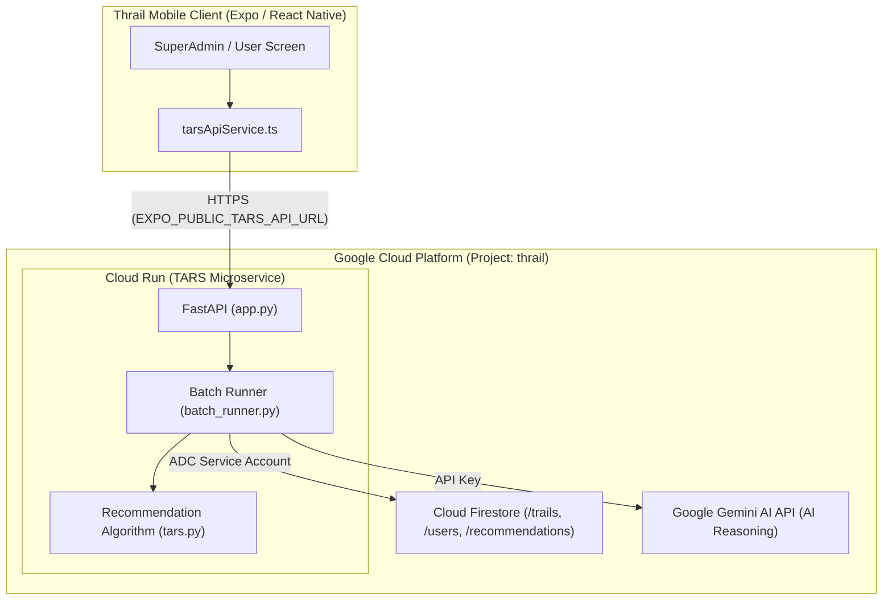

# THARESYS Recommendation Engine - Google Cloud Run Deployment Plan

## 1. Executive Summary

This implementation plan details the strategy and step-by-step procedures to deploy the **Thrail Recommendation Engine (THARESYS)** microservice (`/engine`) to **Google Cloud Run**. 

Currently, THARESYS runs on a local development server (`http://localhost:8000` or `http://10.0.2.2:8000`), requiring a developer's machine to be running for recommendation generation and administration. Transitioning to Google Cloud Run decouples the system from local environments, providing high availability, automated scaling, automated HTTPS, and native integration with the existing Firebase Firestore project (`thrail`).

---

## 2. Target Architecture & Flow



### Key Technical Advantages of Cloud Run
1. **Serverless & Cost Efficiency**: Instances scale down to 0 when idle. No baseline infrastructure cost when recommendations are not actively running.
2. **Built-in HTTPS**: Cloud Run issues TLS/SSL certificates automatically, fulfilling Android and iOS network security requirements out of the box.
3. **Application Default Credentials (ADC)**: When running inside the GCP project `thrail`, the service inherits permissions directly from the attached Google Cloud Service Account, eliminating the security risk of baking `serviceAccountKey.json` into production images.
4. **Cloud Build Integration**: Source code can be built directly in Google Cloud, eliminating the requirement for local Docker or high-spec developer machines.

---

## 3. Prerequisites & Environment Setup

* **GCP Project ID**: `thrail`
* **Google Cloud APIs Required**:
  * Cloud Run API (`run.googleapis.com`)
  * Cloud Build API (`cloudbuild.googleapis.com`)
  * Artifact Registry API (`artifactregistry.googleapis.com`)
* **Environment Variables & Secrets**:
  * `GEMINI_API_KEY`: API key for Gemini reasoning generation.
  * `PROJECT_ID`: `thrail`
  * `THARESYS_API_KEY`: (Recommended) Shared secret key to protect `/api/admin/*` and `/api/user/*` endpoints.
  * `PORT`: `8080` (automatically supplied by Cloud Run)

---

## 4. Phase-by-Phase Implementation Steps

### Phase 1: Service Containerization & Adaptation

#### 1.1 Create `engine/Dockerfile`
A multi-stage/optimized Dockerfile using `python:3.11-slim`:

```dockerfile
FROM python:3.11-slim

WORKDIR /app

ENV PYTHONDONTWRITEBYTECODE=1 \
    PYTHONUNBUFFERED=1 \
    PORT=8080

RUN apt-get update && apt-get install -y --no-install-recommends \
    build-essential \
    && rm -rf /var/lib/apt/lists/*

COPY requirements.txt .
RUN pip install --no-cache-dir -r requirements.txt

COPY . .

EXPOSE 8080

CMD exec uvicorn app:app --host 0.0.0.0 --port ${PORT}
```

#### 1.2 Create `engine/.dockerignore`
Exclude local virtual environments, test files, and sensitive credentials:

```dockerignore
venv/
__pycache__/
*.pyc
*.pyo
*.pyd
.env
serviceAccountKey.json
.git
.gitignore
test_*.py
```

#### 1.3 Update `engine/app.py`
Ensure the entrypoint dynamically respects the `$PORT` environment variable:

```python
if __name__ == "__main__":
    import uvicorn
    port = int(os.environ.get("PORT", 8080))
    uvicorn.run("app:app", host="0.0.0.0", port=port, reload=False)
```

---

### Phase 2: Cloud IAM & Security Hardening

In local environments, `firebase_client.py` uses `serviceAccountKey.json`. On Cloud Run, Google Application Default Credentials (ADC) should be used.

1. Locate the default Compute Service Account in GCP Console (**IAM & Admin** > **IAM**):
   * Pattern: `[PROJECT_NUMBER]-compute@developer.gserviceaccount.com`
2. Assign the following IAM roles:
   * **Cloud Datastore User** (`roles/datastore.user`): Allows reading and writing Firestore documents (`/users`, `/trails`, and `/recommendations`).
   * **Service Usage Consumer** (`roles/serviceusage.serviceUsageConsumer`): Permits API invocations under project quota.

3. **Cloud Build Deployment Permissions (Required for `gcloud run deploy --source .`)**:
   * Cloud Build service account (`[PROJECT_NUMBER]@cloudbuild.gserviceaccount.com`) must have:
     * **Cloud Run Admin** (`roles/run.admin`)
     * **Service Account User** (`roles/iam.serviceAccountUser`) on the Compute Service Account.

---

### Phase 3: Deployment Strategy Options

#### Approach A: Automated CI/CD via GitHub Actions (Recommended)
This repository includes a dedicated workflow at [`.github/workflows/deploy-engine.yml`](file:///.github/workflows/deploy-engine.yml). Whenever commits modifying `engine/**` are pushed to `main`, GitHub Actions automatically builds and deploys the updated engine to Cloud Run.

##### 1. Required GitHub Repository Secrets
Go to your GitHub repository: **Settings** > **Secrets and variables** > **Actions** > **New repository secret**:

| Secret Name | Description | Example / Source |
| :--- | :--- | :--- |
| `GCP_SA_KEY` *(or `FIREBASE_SERVICE_ACCOUNT_THRAIL`)* | JSON Key of GCP Service Account with Cloud Run & Cloud Build permissions. | Generated from GCP Console (**IAM** > **Service Accounts**). |
| `GEMINI_API_KEY` | Google Gemini AI API Key for mountaineering reasoning generation. | From Google AI Studio or GCP. |
| `THARESYS_API_KEY` | Shared secret token to secure `/api/admin/*` and `/api/user/*` endpoints. | Any random secure string (e.g. `thrail-secret-...`). |

##### 2. Service Account Roles for Deployment
The service account in `GCP_SA_KEY` requires the following IAM roles in project `thrail`:
* **Cloud Run Admin** (`roles/run.admin`)
* **Cloud Build Editor** (`roles/cloudbuild.builds.editor`)
* **Artifact Registry Writer** (`roles/artifactregistry.writer`)
* **Service Account User** (`roles/iam.serviceAccountUser`)
* **Storage Admin** (`roles/storage.admin`)

##### 3. How to Trigger Deployment
Simply commit and push your changes:
```bash
git add .
git commit -m "feat(engine): prepare and deploy THARESYS to Cloud Run"
git push origin main
```
Alternatively, open the **Actions** tab on GitHub, click **Deploy THARESYS to Google Cloud Run**, and select **Run workflow**.

---

#### Approach B: Google Cloud CLI (`gcloud`) - Manual Direct Deploy
If deploying directly from your local terminal:

```powershell
# 1. Authenticate and target project
gcloud auth login
gcloud config set project thrail

# 2. Deploy directly from the engine directory using Cloud Build
cd c:\Users\LENOVO\Documents\dev\thrail_app\engine

gcloud run deploy tars-recommendation-engine `
  --source . `
  --region asia-southeast1 `
  --allow-unauthenticated `
  --memory 1Gi `
  --cpu 1 `
  --timeout 300 `
  --set-env-vars GEMINI_API_KEY="<YOUR_KEY>",PROJECT_ID="thrail",THARESYS_API_KEY="<YOUR_SECRET_KEY>"
```

---

#### Approach C: Google Cloud Console UI (Manual UI Deploy)
1. Push the `/engine` updates to GitHub.
2. Go to [Google Cloud Run Console](https://console.cloud.google.com/run).
3. Click **Create Service**.
4. Configure service parameters:
   * **Service Name**: `tars-recommendation-engine`
   * **Region**: `asia-southeast1` (Singapore)
   * **Deployment type**: "Deploy one revision from an existing container image" or "Continuously deploy from a repository".
   * **Source Directory**: `/engine`
   * **Build Type**: Dockerfile (`/engine/Dockerfile`)
5. **Authentication**: Choose **"Allow unauthenticated invocations"**.
6. **Container Resource Allocation**: Memory: `1 GiB`, CPU: `1 vCPU`.
7. **Environment Variables**:
   * `GEMINI_API_KEY`: `<Your-Gemini-Key>`
   * `PROJECT_ID`: `thrail`
   * `THARESYS_API_KEY`: `<Your-Secret-Key>`
8. Click **Create** to trigger deployment.

---

### Phase 4: Client App Integration

Once Cloud Run finishes deployment, it assigns a permanent HTTPS URL:
`https://tars-recommendation-engine-[hash]-as.a.run.app`

#### 4.1 Update Client Environment
Add the assigned URL to your mobile app configuration:

In `.env`:
```env
EXPO_PUBLIC_TARS_API_URL=https://tars-recommendation-engine-[hash]-as.a.run.app
EXPO_PUBLIC_THARESYS_API_KEY=<YOUR_SECRET_KEY>
```

> [!NOTE]
> Whenever updating `EXPO_PUBLIC_*` environment variables in `.env`, restart the Expo development server with cache cleared:
> `npx expo start -c`

In `eas.json` (for remote cloud APK/AAB builds):
```json
{
  "build": {
    "production": {
      "env": {
        "EXPO_PUBLIC_TARS_API_URL": "https://tars-recommendation-engine-[hash]-as.a.run.app",
        "EXPO_PUBLIC_THARESYS_API_KEY": "<YOUR_SECRET_KEY>"
      }
    }
  }
}
```

The app's existing service (`src/features/SuperAdmin/services/tarsApiService.ts`) automatically sends this key in the `X-THARESYS-KEY` HTTP header.


---

## 5. Verification & Acceptance Testing

| Step | Action | Expected Result |
| :--- | :--- | :--- |
| **1. Health Check** | `GET https://<cloud-run-url>/` | Returns HTTP 200 with `{"status": "healthy", "service": "THARESYS Recommendation Engine"}`. |
| **2. Feature Registry** | `GET https://<cloud-run-url>/api/admin/features` | Returns the 32 canonical features with categories and default weights. |
| **3. Mobile App Connection** | Open SuperAdmin dashboard in Thrail App | THARESYS Status Indicator displays **"Online / Connected"** (green indicator). |
| **4. Batch Recommendation Execution** | Trigger "Run Monthly Recommendations" from SuperAdmin | Executes batch run, generates similarity matrices, requests Gemini AI reasoning, and writes recommendations to `/users/{userId}/recommendations/{YYYY-MM}` in Firestore without timeouts. |
| **5. Cold Start Verification** | Send request after 15 minutes of inactivity | Instance spins up within ~3-5 seconds and completes request successfully. |

---

## 6. Operational Considerations & Cost Estimation

* **Pricing**: Cloud Run offers a generous free tier every month (2 million requests, 360,000 GB-seconds memory, 180,000 vCPU-seconds).
* **Scaling Configuration**:
  * `Min Instances: 0` (keeps costs at zero when idle).
  * `Max Instances: 3` (prevents unexpected scaling costs during testing).
  * `Request Timeout: 300s` (sufficient time for complete batch recommendation calculations and Gemini reasoning calls across all users).
