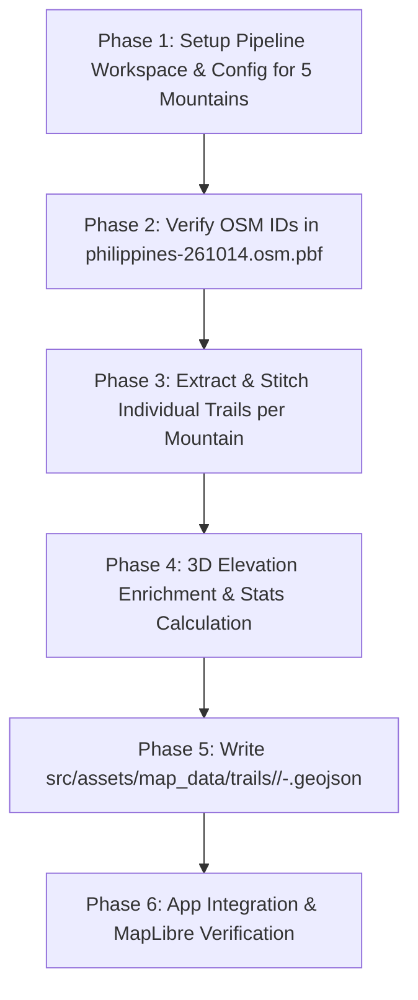

# Offline OSM Trail Extraction & Hierarchical GeoJSON Pipeline: Implementation Plan

## 1. Executive Summary & Objective

The objective of this pipeline is to establish a deterministic, offline-capable, and topological trail extraction workflow that extracts, repairs, enriches, and structures hiking trail geometries directly from the local OpenStreetMap (OSM) PBF archive ([`philippines-261014.osm.pbf`](file:///d:/thrail_app/src/assets/map_data/philippines-261014.osm.pbf)) into clean, production-ready GeoJSON assets for the **5 core target mountains** in the Thrail application:
1. **Mt. Batulao** (`batulao`) — Nasugbu, Batangas (`node/332020556`, 811 MASL)
2. **Mt. Kulis** (`kulis`) — Brgy. Cuyambay, Tanay, Rizal (`node/8258769217` Mount Kulis & `node/8258769317` Sambong Peak, 620–629 MASL)
3. **Mt. Daraitan** (`daraitan`) — Brgy. Daraitan, Tanay, Rizal (`node/12864070795` Summit & `node/4468090590` Tinipak River Rock Formation, 739 MASL)
4. **Mt. Tagapo** (`tagapo`) — Brgy. Janosa, Talim Island, Binangonan, Rizal (`node/967699246`, 438 MASL)
5. **Mt. Sembrano** (`sembrano`) — Brgy. Malaya, Pililla, Rizal (`node/332018952`, 745 MASL)

### The Problem with Previous Approaches:
* **Manual Overpass Turbo Exports:** Prone to rate limits, server timeouts, and generates disjointed `MultiLineString` or disconnected raw `way` segments (as seen in [`daraitan.geojson`](file:///d:/thrail_app/src/assets/map_data/daraitan.geojson) and [`kulis.geojson`](file:///d:/thrail_app/src/assets/map_data/kulis.geojson)).
* **Monolithic Single-File Bloat & Radius Bleed:** Storing all regional trails inside a single ~2.7 MB file ([`trails_3D_final_v2.geojson`](file:///d:/thrail_app/src/core/models/Trail/utils/GeoJSONProcessor.ts)) forced [`GeoJSONProcessor.ts`](file:///d:/thrail_app/src/core/models/Trail/utils/GeoJSONProcessor.ts) to parse thousands of coordinates at runtime, completely omitted **Mt. Sembrano**, and accidentally bled unrelated neighboring trails into mountain buckets (e.g., assigning Mt. Nagpatong's *Pinagpatong Rocks Trail* to Mt. Kulis, and concrete residential alleys in Brgy. Sapang to Mt. Tagapo).
* **Missing Trail Continuity & Disconnected Gaps:** Digitized OSM paths frequently split at trail forks, campsites, or river crossings, producing disjointed segments that break hike tracking, turn-by-turn navigation, and elevation statistics.

### The Target Hybrid Solution:
```
┌────────────────────────────────────────────────────────────────────────────────────────┐
│ 1. PBF AUDIT & VERIFICATION: Exact OSM Relation, Way, and Peak/Trailhead Node IDs      │
│    verified directly inside src/assets/map_data/philippines-261014.osm.pbf.            │
└───────────────────────────────────────────┬────────────────────────────────────────────┘
                                            ▼
┌────────────────────────────────────────────────────────────────────────────────────────┐
│ 2. STRUCTURED CONFIG: mountains_trails_config.json                                     │
│    Explicit definitions: mountain_id, trail_id, way_ids, relation_ids, reverse_ways    │
└───────────────────────────────────────────┬────────────────────────────────────────────┘
                                            ▼
┌────────────────────────────────────────────────────────────────────────────────────────┐
│ 3. OFFLINE PBF EXTRACTION & STITCHING: 02_extract_and_stitch.py (pyosmium + shapely)   │
│    Single-pass read of src/assets/map_data/philippines-261014.osm.pbf -> Gap healing   │
└───────────────────────────────────────────┬────────────────────────────────────────────┘
                                            ▼
┌────────────────────────────────────────────────────────────────────────────────────────┐
│ 4. ELEVATION ENRICHMENT: 03_append_elevation.py (SRTM / Copernicus 30m DEM)            │
│    Enriches 2D [lon, lat] -> 3D [lon, lat, ele] coordinates for accurate telemetry    │
└───────────────────────────────────────────┬────────────────────────────────────────────┘
                                            ▼
┌────────────────────────────────────────────────────────────────────────────────────────┐
│ 5. HIERARCHICAL OUTPUT: src/assets/map_data/trails/                                    │
│    ├── master_all_mountains.geojson                                                    │
│    ├── extraction_report.json                                                          │
│    └── {mountain}/                                                                     │
│        ├── {mountain}-all.geojson                                                      │
│        ├── {mountain}-{trail_1}.geojson   (e.g., batulao/batulao-old.geojson)          │
│        └── {mountain}-{trail_2}.geojson   (e.g., batulao/batulao-new.geojson)          │
└────────────────────────────────────────────────────────────────────────────────────────┘
```

---

## 2. Direct PBF Audit & Real-World Trail Verification (5 Target Mountains)

Every trail below has been verified both online (*Pinoy Mountaineer* / local trail registries) and by directly scanning [`src/assets/map_data/philippines-261014.osm.pbf`](file:///d:/thrail_app/src/assets/map_data/philippines-261014.osm.pbf) with `pyosmium` to obtain the exact OSM `relation`, `way`, and `node` IDs.

### 2.1. PBF & Real-World Audit Summary Table

| Mountain | Folder | Target Trail Files | Exact OSM Relation & Way IDs in `philippines-261014.osm.pbf` | Key OSM Nodes (Trailheads, Forks, Peaks) |
| :--- | :--- | :--- | :--- | :--- |
| **Mt. Batulao**<br>*(Nasugbu, Batangas)* | `batulao` | • `batulao-old.geojson`<br>• `batulao-new.geojson`<br>• `batulao-tuy.geojson` *(optional)*<br>• `batulao-toong.geojson` *(optional)*<br>• `batulao-all.geojson` | • **Old Trail:** `way/188934002` ("Batulao") + `way/51822692` ("Old Trail") + `way/188933995` ("Old Trail") + `way/188933999` ("Summit Trail")<br>• **New Trail:** `way/188934002` ("Batulao") + `way/51822351` ("New Trail") + `way/188933993` ("New Trail") + `way/188933994` ("New Trail")<br>• **Tuy Trail:** `way/577664710` ("Batulao Tuy Trail")<br>• **Toong Trail:** `relation/4483564` ("Toong Trail") / `way/321808919` ("Batulao to Toong") | • `node/661099448`: "Batulao Jumpoff" (`599m`)<br>• `node/1995658778`: Old/New Trail Fork (`Kubo 2`)<br>• `node/662722021`–`662722006`: Camps 1–9 (Old Trail)<br>• `node/662722025`–`1995657739`: Peaks 1–11 (New Trail)<br>• `node/332020556`: "Mount Batulao" Peak (`811m`)<br>• `node/5537284461`: "Batulao - Tuy Jump-off" |
| **Mt. Kulis**<br>*(Brgy. Cuyambay, Tanay, Rizal)* | `kulis` | • `kulis-summit.geojson`<br>• `kulis-sambong.geojson`<br>• `kulis-all.geojson` | • **Mount Kulis Trail:** `way/1112434840` + `way/1112434845` (or `way/1112434843` + `way/1112434842`) + `way/1112434844`<br>• **Sambong Peak Trail:** `way/1112434840` + `way/1112434843` + `way/1112434841` | • `node/8251099317`: "Fresno Agro Forestry & Eco Tourism Campsite" (`[121.364626, 14.604911]`)<br>• `node/8258769217`: "Mount Kulis" (`[121.366922, 14.608252]`, at end of `way/1112434844`)<br>• `node/8258769317`: "Sambong Peak" (`[121.368594, 14.608964]`, at end of `way/1112434841`) |
| **Mt. Daraitan**<br>*(Brgy. Daraitan, Tanay, Rizal)* | `daraitan` | • `daraitan-summit.geojson`<br>• `daraitan-tinipak.geojson`<br>• `daraitan-traverse.geojson`<br>• `daraitan-all.geojson` | • **Direct Summit Trail:** `way/1389728027` + `way/1389728026` *(+ mid-slope station loop `ways 1389728025, 1389728020, 1389728022, 1389728023, 1389728024`)*<br>• **Tinipak River Trail:** `way/367187493` + `way/516283213` + `way/677448626`<br>• **Summit-to-Tinipak Traverse:** `way/1389728021` | • `node/10177449733`: "Sangguniang Pambarangay ng Daraitan" (Barangay Hall)<br>• `node/12864070795`: Mt. Daraitan Summit Peak (`[121.438810, 14.613236]`)<br>• `node/4468090590`: "Tinipak River Rock Formation" (`[121.442216, 14.604427]`) |
| **Mt. Tagapo**<br>*(Brgy. Janosa, Talim Island, Rizal)* | `tagapo` | • `tagapo-janosa.geojson`<br>• `tagapo-janosa-west.geojson`<br>• `tagapo-all.geojson` | • **Main Tagapo Jump-off Trail (`tagapo-janosa`):** `way/1058835394` ("Mount Tagapo Trail", 21 pts) + `way/216453867` ("Mount Tagapo Trail", 141 pts)<br>• **West Coastal Branch (`tagapo-janosa-west`):** `way/942014933` (22 pts) + `way/216453867` ("Mount Tagapo Trail", 141 pts) | • `node/2257969877`: "Brgy Janosa Port Terminal"<br>• `node/2257963074`: "Tagapo Jump-off" (`highway=trailhead`, start of `way/1058835394`)<br>• `node/8723435006`: Trail Fork (`[121.220426, 14.352041]`)<br>• `node/967699246`: "Mount Tagapo" / "Mount Susong Dalaga" Peak (`[121.232529, 14.339277]`) |
| **Mt. Sembrano**<br>*(Brgy. Malaya, Pililla, Rizal)* | `sembrano` | • `sembrano-malaya.geojson`<br>• `sembrano-manggahan.geojson`<br>• `sembrano-all.geojson` | • **Malaya Summit Trail (`relation/3625700`, "Sembrano Trail"):** `way/671042992` + `way/892206089` + `way/111507676` ("To Mount Sembrano") + `way/111507667` ("To Mount Sembrano") + `way/111507665` + `way/111507675`<br>• **Manggahan Campsite Trail:** `way/671042992` + `way/892206089` + `way/111507676` + `way/271602335` ("To Mount Sembrano" Manggahan spur) | • `node/8910950527`: Brgy. Malaya (`[121.339060, 14.399633]`)<br>• `node/1270248686`: Manggahan Fork (`[121.354119, 14.392173]`, where `way/271602335` branches off)<br>• `node/332018952`: "Mount Sembrano" Peak (`743m`, `[121.365903, 14.385076]`) |

---

### 2.2. Detailed OSM Node-by-Node Topology per Mountain

#### 1. Mt. Batulao (`batulao/`)
In [`philippines-261014.osm.pbf`](file:///d:/thrail_app/src/assets/map_data/philippines-261014.osm.pbf), Mt. Batulao has **twohiking relations** (`relation/3350629` `"Mt. Batulao New to Old Trail"` and `relation/4483564` `"Toong Trail"`) plus individual named ways:
* **`batulao-old.geojson` (Mt. Batulao Old Trail — 375 vertices):**
  1. `way/188934002` (`name="Batulao"`, 59 pts): `node/661099497` (`[120.812909, 14.052876]`) $\rightarrow$ `node/1995658778` (`[120.806937, 14.051433]`, Kubo 2 Fork)
  2. `way/51822692` (`name="Old Trail"`, 275 pts, **reversed**): `node/1995658778` (`[120.806937, 14.051433]`) $\rightarrow$ `node/661102933` (`[120.802840, 14.040621]`, Camp 9)
  3. `way/188933995` (`name="Old Trail"`, 30 pts): `node/661102933` (`[120.802840, 14.040621]`) $\rightarrow$ `node/661102941` (`[120.802412, 14.040244]`, Rappel Point)
  4. `way/188933999` (`name="Summit Trail"`, 11 pts): `node/661102941` (`[120.802412, 14.040244]`) $\rightarrow$ `node/661099921` (`[120.802347, 14.039886]`, Mount Batulao Summit)
* **`batulao-new.geojson` (Mt. Batulao New Trail — 232 vertices):**
  1. `way/188934002` (`name="Batulao"`, 59 pts): `node/661099497` (`[120.812909, 14.052876]`) $\rightarrow$ `node/1995658778` (`[120.806937, 14.051433]`, Kubo 2 Fork)
  2. `way/51822351` (`name="New Trail"`, 28 pts): `node/1995658778` (`[120.806937, 14.051433]`) $\rightarrow$ `node/661099860` (`[120.804841, 14.048296]`, Peak 4)
  3. `way/188933993` (`name="New Trail"`, 140 pts): `node/661099860` (`[120.804841, 14.048296]`) $\rightarrow$ `node/1995657749` (`[120.802297, 14.039883]`)
  4. `way/188933994` (`name="New Trail"`, 5 pts): `node/1995657749` (`[120.802297, 14.039883]`) $\rightarrow$ `node/661099921` (`[120.802347, 14.039886]`, Mount Batulao Summit)
* *(Optional additional OSM-named trails in `philippines-261014.osm.pbf`:)*
  * `batulao-tuy.geojson`: `way/577664710` (`name="Batulao Tuy Trail"`, 135 pts from `node/5537284461` `"Batulao - Tuy Jump-off"` to `node/661099909` at Peak 11).
  * `batulao-toong.geojson`: `way/321808919` (`name="Batulao to Toong"`, 108 pts from Peak 8 `node/1995658341` to Toong `node/3285792848`).

#### 2. Mt. Kulis (`kulis/`)
In [`philippines-261014.osm.pbf`](file:///d:/thrail_app/src/assets/map_data/philippines-261014.osm.pbf), the Fresno Agro-Forestry Campsite (`node/8251099317` at `[121.364626, 14.604911]`) connects to the 6 ways in [`kulis.geojson`](file:///d:/thrail_app/src/assets/map_data/kulis.geojson), which terminate at two distinct labeled peak/POI nodes in OSM:
* **`kulis-summit.geojson` (Trail to `node/8258769217` `"Mount Kulis"`):**
  1. `way/1112434840` (reversed from Fresno side `node/10177708997` `[121.365451, 14.605750]` east along the ridge to `node/10177709047` `[121.370123, 14.606353]`)
  2. `way/1112434845` (reversed from `node/10177709047` `[121.370123, 14.606353]` north-west to `node/10177709062` `[121.368181, 14.608553]`, 17 pts)
  3. `way/1112434844` (reversed from `node/10177709062` `[121.368181, 14.608553]` west to `node/10177709069` `[121.366853, 14.608322]`, 8 pts — terminating right at **`node/8258769217` `"Mount Kulis"`**!)
* **`kulis-sambong.geojson` (Trail to `node/8258769317` `"Sambong Peak"`):**
  1. `way/1112434840` (from Fresno side `node/10177708997` `[121.365451, 14.605750]` to `node/10177709035` `[121.369812, 14.606096]`)
  2. `way/1112434843` (reversed from `node/10177709035` `[121.369812, 14.606096]` north-west to `node/10177709046` `[121.368579, 14.608362]`, 12 pts)
  3. `way/1112434841` (from `node/10177709046` `[121.368579, 14.608362]` north to `node/10177709033` `[121.368574, 14.608903]`, 3 pts — terminating right at **`node/8258769317` `"Sambong Peak"`**!)

#### 3. Mt. Daraitan (`daraitan/`)
In [`philippines-261014.osm.pbf`](file:///d:/thrail_app/src/assets/map_data/philippines-261014.osm.pbf), the Daraitan trail network consists of three connected parts:
* **`daraitan-summit.geojson` (Direct Summit Trail — 53 vertices, 1,614m):**
  1. `way/1389728027` (19 pts, **reversed**): `node/4810701385` (`[121.430587, 14.605226]`, Brgy. Daraitan trailhead) $\rightarrow$ `node/12864070869` (`[121.434145, 14.607086]`)
  2. `way/1389728026` (35 pts, **reversed**): `node/12864070869` (`[121.434145, 14.607086]`) $\rightarrow$ `node/12864070794` (`[121.438806, 14.613258]`, right at Summit Peak `node/12864070795`)
* **`daraitan-tinipak.geojson` (Tinipak River Trail — 54 vertices, 2,117m):**
  1. `way/367187493` (14 pts): `node/3711359472` (`[121.432598, 14.601032]`) $\rightarrow$ `node/2736964001` (`[121.437785, 14.601169]`)
  2. `way/516283213` (22 pts): `node/2736964001` (`[121.437785, 14.601169]`) $\rightarrow$ `node/3711359512` (`[121.440654, 14.605124]`)
  3. `way/677448626` (20 pts): `node/3711359512` (`[121.440654, 14.605124]`) $\rightarrow$ `node/3711359468` (`[121.444405, 14.600438]`, passing `node/4468090590` `"Tinipak River Rock Formation"`)
* **`daraitan-traverse.geojson` (Summit-to-Tinipak Traverse — 42 vertices, 1,546m):**
  1. `way/1389728021` (42 pts): `node/12864070785` (`[121.438673, 14.612262]`, Summit campsite) $\rightarrow$ `node/3711359507` (`[121.442697, 14.604764]`, joining `way/677448626` at `node/4468090590` `"Tinipak River Rock Formation"`).

#### 4. Mt. Tagapo (`tagapo/`)
In [`philippines-261014.osm.pbf`](file:///d:/thrail_app/src/assets/map_data/philippines-261014.osm.pbf), the hiking trails on Talim Island are located in **Brgy. Janosa** (`node/413903649`), where two trailhead branches converge at `node/8723435006` (`[121.220426, 14.352041]`) and climb to `"Mount Tagapo"` Peak (`node/967699246`, `[121.232529, 14.339277]`):
* **`tagapo-janosa.geojson` (Official `"Mount Tagapo Trail"` from `"Tagapo Jump-off"` — 161 vertices):**
  1. `way/1058835394` (`name="Mount Tagapo Trail"`, 21 pts, **reversed**): `node/2257963074` (`"Tagapo Jump-off"`, `[121.219334, 14.353377]`) $\rightarrow$ `node/8723435006` (`[121.220426, 14.352041]`)
  2. `way/216453867` (`name="Mount Tagapo Trail"`, 141 pts, **reversed**): `node/8723435006` (`[121.220426, 14.352041]`) $\rightarrow$ `node/2257962973` (`[121.232566, 14.339253]`, `"Mount Tagapo"` Summit)
* **`tagapo-janosa-west.geojson` (West Coastal Janosa Trailhead Branch — 162 vertices):**
  1. `way/942014933` (`highway="path"`, `surface="unpaved"`, 22 pts): `node/2261375902` (`[121.217961, 14.352368]`) $\rightarrow$ `node/8723435006` (`[121.220426, 14.352041]`)
  2. `way/216453867` (`name="Mount Tagapo Trail"`, 141 pts, **reversed**): `node/8723435006` (`[121.220426, 14.352041]`) $\rightarrow$ `node/2257962973` (`[121.232566, 14.339253]`, `"Mount Tagapo"` Summit)

#### 5. Mt. Sembrano (`sembrano/`)
In [`philippines-261014.osm.pbf`](file:///d:/thrail_app/src/assets/map_data/philippines-261014.osm.pbf), Mt. Sembrano is mapped via `relation/3625700` (`name="Sembrano Trail"`, `from="Malaya"`, `to="Mount Sembrano"`) plus a 20-point campsite spur (`way/271602335`) that branches off at `node/1270248686` (`[121.354119, 14.392173]`):
* **`sembrano-malaya.geojson` (Full Brgy. Malaya to Summit Trail — 305 vertices):**
  1. `way/671042992` + `way/892206089`: Brgy. Malaya (`[121.338897, 14.398123]`) $\rightarrow$ `node/1270248594` (`[121.348779, 14.395373]`)
  2. `way/111507676` (`name="To Mount Sembrano"`, 52 pts): `node/1270248594` $\rightarrow$ `node/1270248686` (`[121.354119, 14.392173]`, Manggahan junction)
  3. `way/111507667` (`name="To Mount Sembrano"`, 89 pts): `node/1270248686` $\rightarrow$ `node/1270248463` (`[121.359637, 14.389794]`)
  4. `way/111507665` (113 pts): `node/1270248463` $\rightarrow$ `node/1270248443` (`[121.365618, 14.386035]`, North/South Peak ridge)
  5. `way/111507675` (11 pts): `node/1270248443` $\rightarrow$ `node/1270248554` (`[121.365409, 14.385331]`, `"Mount Sembrano"` Summit)
* **`sembrano-manggahan.geojson` (Brgy. Malaya to Manggahan Campsite Spur — 116 vertices):**
  1. `way/671042992` + `way/892206089` + `way/111507676`: Brgy. Malaya (`[121.338897, 14.398123]`) $\rightarrow$ `node/1270248686` (`[121.354119, 14.392173]`)
  2. `way/271602335` (`name="To Mount Sembrano"`, 20 pts): `node/1270248686` (`[121.354119, 14.392173]`) $\rightarrow$ `node/1270248451` (`[121.355302, 14.391575]`, Manggahan Campsite).

---

## 3. Target Output Directory Structure & Schema

All extracted mountain folders and trail GeoJSONs are output inside `src/assets/map_data/trails/`, following the `<mountain>/<mountain>-<trail>.geojson` format plus `<mountain>-all.geojson`:

```text
src/assets/map_data/trails/
├── master_all_mountains.geojson              # Master FeatureCollection of all 5 mountains
├── extraction_report.json                    # Detailed QA & topological stitching report
│
├── batulao/
│   ├── batulao-all.geojson                   # Combined features for Mt. Batulao
│   ├── batulao-old.geojson                   # Trail 1: Old Trail (ways 188934002, 51822692, 188933995, 188933999)
│   └── batulao-new.geojson                   # Trail 2: New Trail (ways 188934002, 51822351, 188933993, 188933994)
│
├── kulis/
│   ├── kulis-all.geojson                     # Combined features for Mt. Kulis
│   ├── kulis-summit.geojson                  # Trail 1: To Mount Kulis node/8258769217 (ways 1112434840, 1112434845, 1112434844)
│   └── kulis-sambong.geojson                 # Trail 2: To Sambong Peak node/8258769317 (ways 1112434840, 1112434843, 1112434841)
│
├── daraitan/
│   ├── daraitan-all.geojson                  # Combined features for Mt. Daraitan
│   ├── daraitan-summit.geojson               # Trail 1: Direct Summit Trail (ways 1389728027, 1389728026)
│   ├── daraitan-tinipak.geojson              # Trail 2: Tinipak River Trail (ways 367187493, 516283213, 677448626)
│   └── daraitan-traverse.geojson             # Trail 3: Summit-to-Tinipak Traverse (way 1389728021)
│
├── tagapo/
│   ├── tagapo-all.geojson                    # Combined features for Mt. Tagapo
│   ├── tagapo-janosa.geojson                 # Trail 1: Main Tagapo Jump-off Trail (ways 1058835394, 216453867)
│   └── tagapo-janosa-west.geojson            # Trail 2: West Janosa Coastal Trail (ways 942014933, 216453867)
│
└── sembrano/
    ├── sembrano-all.geojson                  # Combined features for Mt. Sembrano
    ├── sembrano-malaya.geojson               # Trail 1: Malaya Summit Trail (relation 3625700: ways 671042992..111507675)
    └── sembrano-manggahan.geojson            # Trail 2: Manggahan Campsite Trail (ways 671042992..111507676, 271602335)
```

---

## 4. Structured Pipeline Configuration (`mountains_trails_config.json`)

Every trail in `scripts/trail_pipeline/mountains_trails_config.json` is defined using the exact, verified OSM `way_ids` and `relation_ids` from [`src/assets/map_data/philippines-261014.osm.pbf`](file:///d:/thrail_app/src/assets/map_data/philippines-261014.osm.pbf):

```json
{
  "$schema": "http://json-schema.org/draft-07/schema#",
  "version": "2.1.0",
  "source_pbf": "src/assets/map_data/philippines-261014.osm.pbf",
  "output_dir": "src/assets/map_data/trails",
  "dem_source": "data/dem/calabarzon_copernicus_30m.tif",
  "mountains": [
    {
      "mountain_id": "batulao",
      "mountain_name": "Mount Batulao",
      "province": "Batangas",
      "peak_node_id": 332020556,
      "trails": [
        {
          "trail_id": "batulao-old",
          "trail_name": "Mt. Batulao Old Trail",
          "difficulty": "Moderate",
          "technical_rating": "Class 2-3",
          "relation_ids": [],
          "way_ids": [188934002, 51822692, 188933995, 188933999],
          "reverse_ways": [51822692],
          "snap_tolerance_meters": 5.0
        },
        {
          "trail_id": "batulao-new",
          "trail_name": "Mt. Batulao New Trail",
          "difficulty": "Moderate",
          "technical_rating": "Class 2",
          "relation_ids": [],
          "way_ids": [188934002, 51822351, 188933993, 188933994],
          "reverse_ways": [],
          "snap_tolerance_meters": 5.0
        }
      ]
    },
    {
      "mountain_id": "kulis",
      "mountain_name": "Mount Kulis",
      "province": "Rizal",
      "peak_node_id": 8258769217,
      "trails": [
        {
          "trail_id": "kulis-summit",
          "trail_name": "Mt. Kulis Summit Trail",
          "difficulty": "Easy",
          "technical_rating": "Class 1",
          "relation_ids": [],
          "way_ids": [1112434840, 1112434845, 1112434844],
          "reverse_ways": [1112434840, 1112434845, 1112434844],
          "snap_tolerance_meters": 5.0
        },
        {
          "trail_id": "kulis-sambong",
          "trail_name": "Mt. Kulis — Sambong Peak & Noah's Ark Trail",
          "difficulty": "Easy",
          "technical_rating": "Class 1",
          "relation_ids": [],
          "way_ids": [1112434840, 1112434843, 1112434841],
          "reverse_ways": [1112434840, 1112434843],
          "snap_tolerance_meters": 5.0
        }
      ]
    },
    {
      "mountain_id": "daraitan",
      "mountain_name": "Mount Daraitan",
      "province": "Rizal",
      "peak_node_id": 12864070795,
      "trails": [
        {
          "trail_id": "daraitan-summit",
          "trail_name": "Mt. Daraitan Direct Summit Trail",
          "difficulty": "Difficult",
          "technical_rating": "Class 3",
          "relation_ids": [],
          "way_ids": [1389728027, 1389728026],
          "reverse_ways": [1389728027, 1389728026],
          "snap_tolerance_meters": 5.0
        },
        {
          "trail_id": "daraitan-tinipak",
          "trail_name": "Mt. Daraitan — Tinipak River Trail",
          "difficulty": "Easy",
          "technical_rating": "Class 1-2",
          "relation_ids": [],
          "way_ids": [367187493, 516283213, 677448626],
          "reverse_ways": [],
          "snap_tolerance_meters": 5.0
        },
        {
          "trail_id": "daraitan-traverse",
          "trail_name": "Mt. Daraitan Summit-to-Tinipak Traverse",
          "difficulty": "Difficult",
          "technical_rating": "Class 3",
          "relation_ids": [],
          "way_ids": [1389728021],
          "reverse_ways": [],
          "snap_tolerance_meters": 5.0
        }
      ]
    },
    {
      "mountain_id": "tagapo",
      "mountain_name": "Mount Tagapo",
      "province": "Rizal",
      "peak_node_id": 967699246,
      "trails": [
        {
          "trail_id": "tagapo-janosa",
          "trail_name": "Mt. Tagapo Main Trail (Brgy. Janosa Jump-off)",
          "difficulty": "Easy",
          "technical_rating": "Class 1-2",
          "relation_ids": [],
          "way_ids": [1058835394, 216453867],
          "reverse_ways": [1058835394, 216453867],
          "snap_tolerance_meters": 5.0
        },
        {
          "trail_id": "tagapo-janosa-west",
          "trail_name": "Mt. Tagapo West Coastal Trail (Brgy. Janosa Port)",
          "difficulty": "Easy",
          "technical_rating": "Class 1-2",
          "relation_ids": [],
          "way_ids": [942014933, 216453867],
          "reverse_ways": [216453867],
          "snap_tolerance_meters": 5.0
        }
      ]
    },
    {
      "mountain_id": "sembrano",
      "mountain_name": "Mount Sembrano",
      "province": "Rizal",
      "peak_node_id": 332018952,
      "trails": [
        {
          "trail_id": "sembrano-malaya",
          "trail_name": "Mt. Sembrano Summit Trail via Brgy. Malaya",
          "difficulty": "Moderate",
          "technical_rating": "Class 2",
          "relation_ids": [3625700],
          "way_ids": [671042992, 892206089, 111507676, 111507667, 111507665, 111507675],
          "reverse_ways": [],
          "snap_tolerance_meters": 5.0
        },
        {
          "trail_id": "sembrano-manggahan",
          "trail_name": "Mt. Sembrano — Manggahan Campsite Trail",
          "difficulty": "Easy",
          "technical_rating": "Class 1-2",
          "relation_ids": [],
          "way_ids": [671042992, 892206089, 111507676, 271602335],
          "reverse_ways": [],
          "snap_tolerance_meters": 5.0
        }
      ]
    }
  ]
}
```

---

## 5. Pipeline Architecture & Python Implementation

The extraction pipeline consists of three Python scripts in a dedicated `scripts/trail_pipeline/` directory:

```text
scripts/trail_pipeline/
├── requirements.txt                # osmium, shapely, geojson, rasterio, numpy
├── mountains_trails_config.json    # Verified OSM Way/Relation IDs for the 5 mountains
├── 01_inspect_pbf_and_geojson.py   # Audits PBF ways/relations & existing GeoJSONs
├── 02_extract_and_stitch.py        # Offline pyosmium + shapely graph stitcher -> writes per-mountain folders
├── 03_append_elevation.py          # 3D elevation enrichment ([lon, lat, ele])
└── run_pipeline.ps1                # End-to-end Windows PowerShell runner
```

### 5.1. Step 1: PBF & Existing GeoJSON Verification (`01_inspect_pbf_and_geojson.py`)
Scans [`src/assets/map_data/philippines-261014.osm.pbf`](file:///d:/thrail_app/src/assets/map_data/philippines-261014.osm.pbf) using a two-pass bounding-box node/way collector to verify that all configured `way_ids`, `relation_ids`, and `peak_node_id` entries exist in the PBF.

### 5.2. Step 2: Offline PBF Extraction & Per-Mountain Folder Output (`02_extract_and_stitch.py`)
Streams [`src/assets/map_data/philippines-261014.osm.pbf`](file:///d:/thrail_app/src/assets/map_data/philippines-261014.osm.pbf), extracts the exact ordered `way_ids` for each trail, trims shared trunk ways at junction nodes (such as `way/1112434840` on Mt. Kulis where `kulis-summit` and `kulis-sambong` branch at `node/10177709047` and `node/10177709035`), stitches segments into a single continuous `LineString`, and writes:
- `src/assets/map_data/trails/<mountain>/<mountain>-<trail>.geojson` for each individual trail
- `src/assets/map_data/trails/<mountain>/<mountain>-all.geojson` combining all trails of that mountain

```python
# scripts/trail_pipeline/02_extract_and_stitch.py
import os
import json
import osmium
from shapely.geometry import LineString, MultiLineString
from shapely.ops import linemerge

def write_mountain_outputs(output_dir, mountain_cfg, trail_features):
    """
    Writes:
      src/assets/map_data/trails/{mountain_id}/{trail_id}.geojson
      src/assets/map_data/trails/{mountain_id}/{mountain_id}-all.geojson
    """
    mt_id = mountain_cfg["mountain_id"]  # e.g., "batulao"
    mt_folder = os.path.join(output_dir, mt_id)
    os.makedirs(mt_folder, exist_ok=True)

    # 1. Write each individual trail file (e.g., batulao/batulao-old.geojson)
    for feat in trail_features:
        trail_id = feat["properties"]["trail_id"]
        trail_path = os.path.join(mt_folder, f"{trail_id}.geojson")
        with open(trail_path, "w", encoding="utf-8") as f:
            json.dump({
                "type": "FeatureCollection",
                "features": [feat]
            }, f, indent=2)

    # 2. Write combined mountain file (e.g., batulao/batulao-all.geojson)
    all_path = os.path.join(mt_folder, f"{mt_id}-all.geojson")
    with open(all_path, "w", encoding="utf-8") as f:
        json.dump({
            "type": "FeatureCollection",
            "features": trail_features
        }, f, indent=2)
```

### 5.3. Step 3: 3D Elevation Enrichment (`03_append_elevation.py`)
Enriches 2D coordinates `[lon, lat]` with digital elevation data into `[lon, lat, ele]` and computes `total_distance_m`, `elevation_gain_m`, and `elevation_loss_m`.

---

## 6. Integration with Thrail App

### 6.1. Modular Mountain & Trail Asset Registry
With the `<mountain>/<mountain>-<trail>.geojson` folder hierarchy under `src/assets/map_data/trails/`, [`TrailMap.native.tsx`](file:///d:/thrail_app/src/features/Map/TrailMap.native.tsx) and [`GeoJSONProcessor.ts`](file:///d:/thrail_app/src/core/models/Trail/utils/GeoJSONProcessor.ts) can resolve either a specific trail or all trails on one of the 5 mountains:

```typescript
// Target registry for the 5 mountains and their OSM-verified trails
export const MOUNTAIN_TRAIL_ASSETS = {
  batulao: {
    all: require("@/src/assets/map_data/trails/batulao/batulao-all.geojson"),
    trails: {
      "batulao-old": require("@/src/assets/map_data/trails/batulao/batulao-old.geojson"),
      "batulao-new": require("@/src/assets/map_data/trails/batulao/batulao-new.geojson"),
    },
  },
  kulis: {
    all: require("@/src/assets/map_data/trails/kulis/kulis-all.geojson"),
    trails: {
      "kulis-summit": require("@/src/assets/map_data/trails/kulis/kulis-summit.geojson"),
      "kulis-sambong": require("@/src/assets/map_data/trails/kulis/kulis-sambong.geojson"),
    },
  },
  daraitan: {
    all: require("@/src/assets/map_data/trails/daraitan/daraitan-all.geojson"),
    trails: {
      "daraitan-summit": require("@/src/assets/map_data/trails/daraitan/daraitan-summit.geojson"),
      "daraitan-tinipak": require("@/src/assets/map_data/trails/daraitan/daraitan-tinipak.geojson"),
      "daraitan-traverse": require("@/src/assets/map_data/trails/daraitan/daraitan-traverse.geojson"),
    },
  },
  tagapo: {
    all: require("@/src/assets/map_data/trails/tagapo/tagapo-all.geojson"),
    trails: {
      "tagapo-janosa": require("@/src/assets/map_data/trails/tagapo/tagapo-janosa.geojson"),
      "tagapo-janosa-west": require("@/src/assets/map_data/trails/tagapo/tagapo-janosa-west.geojson"),
    },
  },
  sembrano: {
    all: require("@/src/assets/map_data/trails/sembrano/sembrano-all.geojson"),
    trails: {
      "sembrano-malaya": require("@/src/assets/map_data/trails/sembrano/sembrano-malaya.geojson"),
      "sembrano-manggahan": require("@/src/assets/map_data/trails/sembrano/sembrano-manggahan.geojson"),
    },
  },
} as const;
```

---

## 7. Step-by-Step Execution Plan



### Phase 1: Setup Pipeline Workspace & Dependencies
* [x] Install `osmium` and `shapely` and scan [`src/assets/map_data/philippines-261014.osm.pbf`](file:///d:/thrail_app/src/assets/map_data/philippines-261014.osm.pbf).
* [x] Audit exact OSM `relation`, `way`, and `node` IDs for `batulao`, `kulis`, `daraitan`, `tagapo`, and `sembrano`.
* [ ] Create `scripts/trail_pipeline/` directory and `mountains_trails_config.json`.

### Phase 2: Topological Stitching & PBF Extraction
* [ ] Implement `02_extract_and_stitch.py`.
* [ ] Extract **Batulao** into `batulao-old.geojson` (`ways 188934002, 51822692, 188933995, 188933999`) and `batulao-new.geojson` (`ways 188934002, 51822351, 188933993, 188933994`).
* [ ] Extract **Kulis** into `kulis-summit.geojson` (`ways 1112434840, 1112434845, 1112434844` to `node/8258769217`) and `kulis-sambong.geojson` (`ways 1112434840, 1112434843, 1112434841` to `node/8258769317`).
* [ ] Extract **Daraitan** into `daraitan-summit.geojson` (`ways 1389728027, 1389728026`), `daraitan-tinipak.geojson` (`ways 367187493, 516283213, 677448626`), and `daraitan-traverse.geojson` (`way 1389728021`).
* [ ] Extract **Tagapo** into `tagapo-janosa.geojson` (`ways 1058835394, 216453867` from `"Tagapo Jump-off"`) and `tagapo-janosa-west.geojson` (`ways 942014933, 216453867`).
* [ ] Extract **Sembrano** into `sembrano-malaya.geojson` (`relation/3625700`) and `sembrano-manggahan.geojson` (via `way/271602335` Manggahan spur).

### Phase 3: Elevation Enrichment & Output Packaging
* [ ] Run `03_append_elevation.py` to attach 3D `[lon, lat, ele]` coordinates and compute `total_distance_m`, `elevation_gain_m`, and `elevation_loss_m`.
* [ ] Write `src/assets/map_data/trails/<mountain>/<mountain>-<trail>.geojson` and `<mountain>/<mountain>-all.geojson`.

---

## 8. Quality Assurance & Validation Matrix

| QA Check | Validation Rule | Pass Criteria |
| :--- | :--- | :--- |
| **Target Scope** | Only the 5 target mountains are generated. | Folders exist strictly for `batulao`, `kulis`, `daraitan`, `tagapo`, and `sembrano`. |
| **Folder & File Naming** | `<mountain>/<mountain>-<trail>.geojson` + `<mountain>/<mountain>-all.geojson`. | Matches format (e.g., `batulao/batulao-old.geojson`, `batulao/batulao-new.geojson`, `batulao/batulao-all.geojson`). |
| **Geometry Integrity** | Must be a single `LineString` per trail file (not fragmented `MultiLineString`). | Feature geometry type is strictly `LineString`. |
| **Node Continuity** | Shared OSM junction nodes (`node/1995658778`, `node/8723435006`, `node/1270248686`, etc.) align at `0.0m`. | Endpoint gaps $\le$ 5.0 meters are automatically healed; gaps $>$ 5.0m flagged in QA report. |
| **Coordinate Dimensionality** | All coordinates must be 3D `[lon, lat, ele]`. | Array length of each coordinate tuple is exactly 3; elevation is finite float. |
