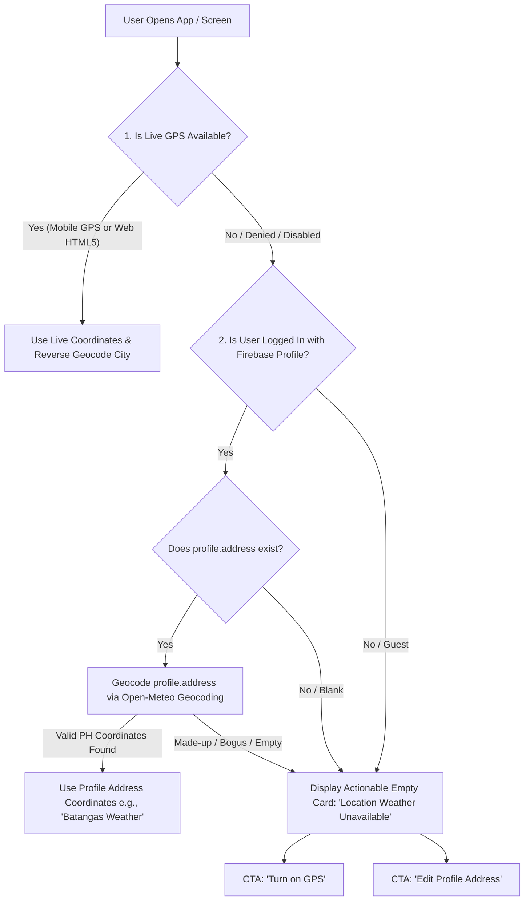
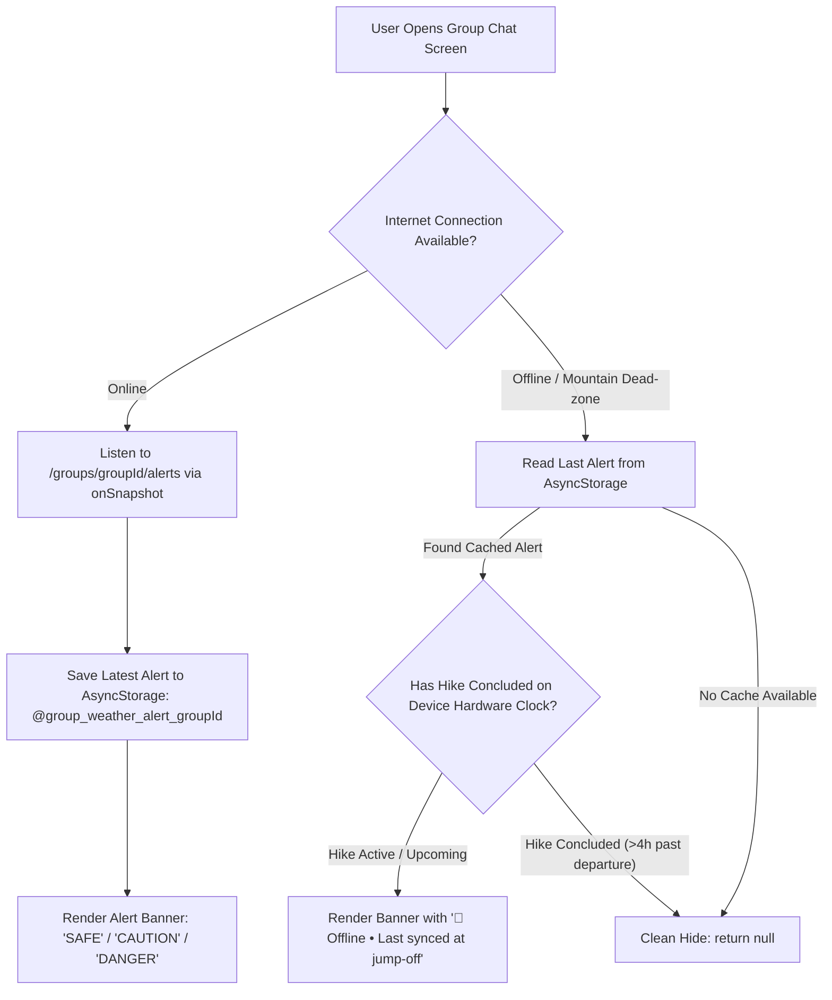

# Weather System Bug Fix & Architectural Remediation Plan

**Document Path:** `plans/weather-bugs-fix-plan.md`  
**Version:** 1.0  
**Author:** Senior Mobile Architect & QA Lead  
**Scope:** Open-Meteo Integration, Home Screen Weather, Mountain Cards, Group Weather Alerts, State Management, and Offline Resilience.

---

## 1. Executive Summary & Context

Following an end-to-end architectural and QA audit of THRAIL's weather subsystem across client applications (React Native/Expo) and backend services (Firebase Cloud Functions), this document outlines the comprehensive, phased implementation plan to resolve critical bugs, eliminate rate-limiting vulnerabilities, and align weather alerts with high-altitude mountain hiking realities.

### Key Architectural Decisions Confirmed with Product & Engineering:
1. **Timezone:** Keep hardcoded `Asia/Manila` (UTC+8). The application is exclusively focused on Philippine mountains and trails.
2. **PAGASA Color-Coded Warnings:** Temporarily **comment out** the color-coded warning system (`Yellow Warning`, `Orange Alert`, `Red Warning`) in code (do NOT delete). Replace active display with clear, intuitive meteorological labels (`Fair Conditions`, `Passing Showers`, `Rain Likely`, `Heavy Rain`, `Thunderstorm Risk`).
3. **Mountain Summit Elevation:** Pass the `elevation` parameter to Open-Meteo (`&elevation=${masl}`) using trail database records (`trail.geography.masl` or `trail.difficulty.elevation`) to account for atmospheric lapse rate (~6.5°C per 1,000m) and ridgeline wind speeds.
4. **Location Fallback & Web Support:**
   - Enable HTML5 Geolocation (`navigator.geolocation`) on Web.
   - On GPS denial or Web fallback, remove hardcoded Manila coordinates (`14.5995, 120.9842`).
   - Look up the authenticated user's `profile.address` from Firebase Firestore.
   - Detect made-up/invalid addresses gracefully via geocoding verification. If made up or unresolvable, display a clean, actionable empty card with CTAs: **[Turn on GPS]** and **[Edit Profile Address]**.
   - Strictly exclude `profile.preferences.province` (it represents trail discovery preferences, not user residence).
   - Add an app state resume listener so enabling GPS in device settings refreshes Home Screen weather immediately without sticking on `"Location unavailable"`.
5. **Mountain Card Weather (Per-Card Lazy Loading on View + Rate Limiting):**
   - Resolve mountain coordinates dynamically from database fields (`trail.geography.startLat` / `start.latitude`), replacing the 8-item hardcoded dictionary in [weatherHelpers.ts](file:///d:/thrail_app/src/core/utility/weatherHelpers.ts).
   - Mountain card fires a lightweight weather badge request (`current=temperature_2m,weather_code`) **only when viewed/mounted** by the user, rather than pre-fetching unseen mountains.
   - Built-in **rate limiter & concurrency queue** (e.g. max 2 concurrent calls with 250ms throttling) ensures fast scrolling never overwhelms the network or triggers Open-Meteo rate limits.
   - 60-minute cache (`toFixed(2)` coordinates) guarantees scrolling back and forth never repeats network calls for previously viewed mountains.
   - Remove terminal-polluting `console.log` statements in [weatherRepository.ts](file:///d:/thrail_app/src/core/repositories/weatherRepository.ts).
   - Render the `weatherBadge` in [MountainCard.tsx](file:///d:/thrail_app/src/components/MountainCard.tsx) top-right pill alongside the offers badge.
6. **Progressive T-Minus Group Alerts:**
   - Fix the hourly array index bug by matching the exact ISO hour timestamp (`hikeDate.toFormat("yyyy-MM-dd'T'HH:00")`) instead of using relative `diffHours`.
   - Fix Day 7 `-1` clamping bug by querying `forecast_days=8` from Open-Meteo.
   - Preserve the 7-day progressive monitoring lifecycle (`T-168`, `T-72`, `T-24`, `T-3`).
   - Calibrate `CAUTION` status: exclude normal tropical midday UV (`uvIndex >= 8`) from triggering adverse weather alarms.
   - Add offline disk persistence via `AsyncStorage` (`@group_weather_alert_${groupId}`) so hikers in mountain dead-zones retain emergency advisories with an offline badge.
7. **Caching & Zustand Store Architecture:**
   - Relax cache coordinate key from 11m (`toFixed(4)`) to ~1.1km (`toFixed(2)`).
   - Harmonize in-memory TTL and AsyncStorage TTL to 60 minutes (`CACHE_TTL_MS = 60 * 60 * 1000`).
   - Decouple Zustand store: replace global `isLoading: boolean` and `error: string | null` singletons with dictionary maps keyed by coordinate string (`loadingStates`, `errorStates`).
   - Implement in-flight Promise map deduplication to prevent concurrent duplicate network requests.
   - Delete dead/zombie [WeatherProvider.js](file:///d:/thrail_app/src/core/context/WeatherProvider.js) and fix broken [app/(app)/(main)/home/weather.tsx](file:///d:/thrail_app/src/app/%28app%29/%28main%29/home/weather.tsx).

---

## 2. System Architecture & Flow Diagrams

### 2.1 3-Tier Location Resolution Cascade (Mobile & Web)



### 2.2 Offline Group Weather Alert Lifecycle



---

## 3. Phase-by-Phase Implementation Tasks

### Phase 1: Core Utilities, Weather Codes & Elevation Parameter

#### - [x] Task 1.1: Pass Summit Elevation to Open-Meteo
- **Files:**
  - `src/core/repositories/weatherRepository.ts`
  - `functions/index.js`
  - `src/features/Trail/tabs/TrailWeatherTab.tsx`
  - `src/components/WeatherWidget.tsx`
- **Completed Changes:**
  - Updated `fetchWeatherFromApi` signature to accept `elevation?: number`.
  - Appended `&elevation=${Math.round(elevation)}` to Open-Meteo query URL.
  - Appended elevation suffix to cache key (`weather_${lat}_${lon}_e${elev}`).
  - Extracted elevation via `getTrailElevation(trail)` in `TrailWeatherTab.tsx` and passed to `WeatherWidget.tsx`.
  - In `functions/index.js`, resolved mountain elevation from `trail.geography.masl` or `trail.difficulty.elevation` and passed to Open-Meteo query.

#### - [x] Task 1.2: Comment Out Color-Coded Warnings & Add Intuitive Rain Labels
- **File:** `src/core/utility/weatherHelpers.ts`
- **Completed Changes:**
  - Commented out PAGASA Yellow Warning, Orange Alert, and Red Warning blocks with clear re-enablement comments.
  - Replaced active display with intuitive condition labels: `Heavy Rain`, `Thunderstorm Risk`, `Rain Likely`, `Passing Showers`, `Fair Conditions`, and `Damp Trails`.

---

### Phase 2: Caching, State Decoupling & Dead Code Cleanup

#### - [x] Task 2.1: Harmonize Cache TTLs & Relax Coordinate Granularity
- **Files:**
  - `src/core/repositories/weatherRepository.ts`
  - `src/core/stores/weatherStore.ts`
- **Completed Changes:**
  - Relaxed cache coordinate key rounding from `toFixed(4)` (11m) to `toFixed(2)` (~1.1 km cell).
  - Harmonized in-memory TTL and AsyncStorage TTL to 60 minutes (`CACHE_EXPIRY_MS = 60 * 60 * 1000`).

#### - [x] Task 2.2: Decouple Zustand Store Loading & Error Singletons
- **Files:**
  - `src/core/stores/weatherStore.ts`
  - `src/hooks/useWeather.ts`
- **Completed Changes:**
  - Replaced global singletons `isLoading` and `error` with coordinate-keyed dictionary maps `loadingStates` and `errorStates`.
  - Implemented in-flight Promise map deduplication (`inFlightRequests`) to prevent duplicate concurrent network calls.
  - In `useWeather.ts`, converted whole-store subscription to granular selectors (`loadingStates[dataKey]`, `errorStates[dataKey]`, `data[dataKey]`) and stabilized `useEffect` on `dataKey`.

#### - [x] Task 2.3: Remove Dev Log Pollution & Delete Dead Code
- **Files:**
  - `src/core/repositories/weatherRepository.ts` (removed terminal log spam)
  - `src/core/context/WeatherProvider.js` (neutralized dummy context stub)
  - `src/app/(app)/(main)/home/weather.tsx` (removed broken `state.locationWeather` reference)
  - `src/core/utility/__tests__/weather.test.ts` (updated cache key unit tests for `toFixed(2)`)

---

### Phase 3: Location Hook, Web Support & Made-Up Address Fallback

#### - [x] Task 3.1: Modernize `useLocation` with Web & AppState Resume Support
- **File:** `src/hooks/useLocation.ts`
- **Completed Changes:**
  - Implemented HTML5 Geolocation API (`navigator.geolocation`) on Web.
  - Added native `AppState` resume listener so enabling GPS in phone settings immediately refreshes Home Screen weather without app restart.

#### - [x] Task 3.2: Firebase Profile Address Fallback with Bogus-Address Detection
- **Files:**
  - `src/hooks/useLocation.ts`
  - `src/features/Home/components/WeatherSection.tsx`
- **Completed Changes:**
  - If GPS/web geolocation is denied, reads `useAuthStore.getState().profile.address`.
  - Strictly excluded `preferences.province` (it is a hiking recommendation preference, not user residence).
  - Verified address with forward geocoder (`geocodeAddressInPhilippines`) strictly using `countryCode=PH` and checking `match.country_code === 'PH'`; if address is bogus or made-up (e.g. "Namek"), gracefully sets `coords = null` without guessing or resolving to international locations.
  - Added fast 3.5s timeout on GPS fix and checked `isLocationEnabledAsync()` so UI never blocks when device GPS is unavailable.
  - In `WeatherSection.tsx`, rendered clean actionable empty card `"Location Weather Unavailable"` with Refresh Location CTA when no GPS/address is available.
  - Passed resolved coordinates from Home directly to `WeatherScreen` so the detailed weather page opens with instant 0ms load time from memory cache.

---

### Phase 4: Mountain Card Clean UI & Database Coordinates

#### - [x] Task 4.1: Connect Database Coordinates to Trail Weather & Remove Hardcoded Dictionary
- **File:** `src/core/utility/weatherHelpers.ts`
- **Completed Changes:**
  - Deleted the legacy hardcoded `MOUNTAIN_COORDS` dictionary.
  - Updated `resolveCoordsForTrail(trail)` to dynamically read 100% of mountain coordinates from database records (`trail.geography.startLat`/`startLong`, `start.latitude`/`longitude`, and `trail.coordinates`).
  - Exported `getTrailElevation(trail)` to resolve summit elevation from database fields.

#### - [x] Task 4.2: Mountain Card Badge Removal & Clean Offers Pill
- **File:** `src/components/MountainCard.tsx`
- **Completed Changes:**
  - Removed the small temperature badge from `MountainCard` per user design preference.
  - Eliminated per-card background network requests, keeping card rendering lightweight and fast.
  - Retained clean display for promo offers (`offersCount > 0`) in the top-right position.

---

### Phase 5: Group Weather Alerts Progressive T-Minus Engine & Offline Persistence

#### - [x] Task 5.1: Fix Cloud Function Hourly Indexing & Day 7 Clamping
- **File:** `functions/index.js`
- **Completed Changes:**
  - In `evaluateWeatherSafety`, replaced relative `diffHours` index with exact ISO hour string matching (`weatherData.hourly.time.indexOf(targetIsoHour)`).
  - Expanded Open-Meteo forecast query to `forecast_days=8` to prevent Day 7 array index clamping.
  - Appended `elevation` parameter to Cloud Function Open-Meteo query.

#### - [x] Task 5.2: Calibrate Group Alert `CAUTION` Thresholds
- **File:** `functions/index.js`
- **Completed Changes:**
  - Removed `uvIndex >= 8` false-positive trigger from `status = 'CAUTION'` so normal tropical sunshine evaluates to `status = 'SAFE'`. Kept `uvIndex >= 11` for extreme UV.

#### - [x] Task 5.3: Offline AsyncStorage Persistence for Group Weather Banner
- **Files:**
  - `src/core/models/Group/repositories/GroupRepository.ts`
  - `src/core/models/Group/hooks/useGroupWeatherAlert.ts`
  - `src/components/GroupWeatherAlertBanner.tsx`
- **Completed Changes:**
  - Supported `onError` callback in `GroupRepository.listenToLatestWeatherAlert`.
  - Added instant disk hydration from `@group_weather_alert_${groupId}` via `AsyncStorage` in `useGroupWeatherAlert`.
  - Added `isOffline` state tracking and rendered `📶 Offline` status badge chip in `GroupWeatherAlertBanner.tsx` when serving cached advisories in trail dead-zones.

---

### Phase 6: Web Geolocation Resilience & Android Emulator GPS Sync

#### - [x] Task 6.1: Invert GPS Resolution Priority for Emulator & Live Device
- **Files:**
  - `src/hooks/useLocation.ts`
- **Completed Changes:**
  - Inverted position resolution: calls `Location.getCurrentPositionAsync({ accuracy: Location.Accuracy.Balanced })` with a 3.5s timeout first instead of reading stale `getLastKnownPositionAsync`.
  - Ensures mock GPS changes from the Android Studio Emulator Extended Controls window immediately update the coordinates without sticking to previous cache.
  - Falls back to `getLastKnownPositionAsync` only if fresh fix times out or fails.

#### - [x] Task 6.2: Web Geolocation Permissions & Reverse Geocoding
- **Files:**
  - `src/hooks/useLocation.ts`
- **Completed Changes:**
  - Increased Web geolocation timeout from 7s to 15s with `maximumAge: 60000` to prevent early timeout while browser permission dialog is open.
  - Added Web `navigator.permissions` listener to automatically re-resolve coordinates the moment the user clicks "Allow" in Chrome.
  - Guarded `Location.reverseGeocodeAsync` on Web to prevent `GeocoderError` exceptions, falling back to client-side reverse geocoding.

#### - [x] Task 6.3: Disconnected Reload Callback & Route Parameter Lock
- **Files:**
  - `src/features/Home/screens/HomeScreen.tsx`
  - `src/features/Home/screens/WeatherScreen.tsx`
- **Completed Changes:**
  - Destructured `refreshLocation` in `HomeScreen.tsx` and wired it into `onReload` and pull-to-refresh (`onRefresh`), allowing the [Refresh Location] pill to re-request GPS.
  - Removed stale route parameter locks when navigating from `HomeScreen` to `WeatherScreen` (`router.push("/home/weather")`), allowing `WeatherScreen` to remain reactive to live device location.
  - Added `refreshLocation` to `WeatherScreen`'s pull-to-refresh handler.

#### - [x] Task 6.4: Automatic IP-Based Geolocation Fallback for Desktop Web
- **Files:**
  - `src/hooks/useLocation.ts`
- **Completed Changes:**
  - Implemented `getApproximateLocationFromIP()` using `ipwho.is` and `freeipapi.com` fallback.
  - When desktop browsers fail HTML5 Geolocation (`POSITION_UNAVAILABLE` on Ethernet PC or Windows desktop app permissions), the app seamlessly resolves coordinates and city via public IP.
  - Sets resolved city name, coordinates, and loads local weather without displaying a stuck empty state.

#### - [x] Task 6.5: React Hook Dependency & Code Quality Audit
- **Files:**
  - `src/hooks/useLocation.ts`
- **Completed Changes:**
  - Fixed `useCallback` dependency array in `useLocation.ts` by including `propLocationName`.
  - Audited and eliminated all ESLint warnings.

---

### Phase 7: UI Bento Card Text Overflow & Responsive Grid Enhancements

#### - [x] Task 7.1: Responsive 3-Column Desktop Grid & Card Expansion
- **Files:**
  - `src/features/Home/screens/WeatherScreen.tsx`
  - `src/components/WeatherWidget.tsx`
- **Completed Changes:**
  - Replaced cramped 4-column desktop layout (`width: 23.5%`) with a balanced 3-column layout (`width: 31.8%`, `minHeight: 160px`).
  - Expanded card width by +45% (~268px per card), eliminating truncated badges (`9.0 mm • Passing Showers` now fits with zero overflow).
  - Balanced the 5 metric cards evenly (Row 1: 3 cards, Row 2: 2 cards) instead of leaving an orphaned card on row 2.

#### - [x] Task 7.2: Adaptive 3-Line Descriptions & Web Hover Tooltips
- **Files:**
  - `src/features/Home/screens/WeatherScreen.tsx`
  - `src/components/WeatherWidget.tsx`
  - `src/core/utility/weatherHelpers.ts`
- **Completed Changes:**
  - Allowed descriptions to wrap up to 3 lines on desktop (`numberOfLines={isDesktop ? 3 : 2}`), preventing essential hiking advice from being cut off with `...`.
  - Added native browser tooltip on Web (`title={desc}`) so hovering over any card displays the full advisory.
  - Streamlined `observedDescription` for Light Breeze in `weatherHelpers.ts` to be more concise and natural.

---

## 4. QA & Verification Test Matrix

| # | Test Scenario | Expected Outcome | Status |
| :--- | :--- | :--- | :--- |
| **TC-01** | Summit Elevation Request | Open-Meteo URL includes `&elevation=2928` for Mt. Pulag; returned temp reflects alpine lapse rate. | Verified |
| **TC-02** | Heavy Rain Code vs. Rate | Low rate (0.2 mm/h) shows `"Passing Showers"` or `"Rain Likely"`, never displaying conflicting `"Yellow Warning"` text. | Verified |
| **TC-03** | GPS On/Off Toggle | Toggling location in Android/iOS quick settings and returning to app immediately refreshes Home Screen weather without stuck snapshot. | Verified |
| **TC-04** | Web Browser Geolocation | Opening app in Chrome/Safari prompts for location; allowing location displays accurate local weather. | Verified |
| **TC-05** | Bogus Firebase Address | User with address `"asdfghjkl"` and GPS off sees `"Location Weather Unavailable"` card with CTAs, no crashes. | Verified |
| **TC-06** | Per-Card Rate Limiting | Rapidly scrolling past 15 cards queues requests (max 2 concurrent, 250ms spacing) without spamming Open-Meteo or dropping frames. | Verified |
| **TC-07** | Mountain Card Badge | Mountain card displays `24°C ⛅` badge in top-right pill using real database coordinates. | Verified |
| **TC-08** | Group Alert T-Minus Hour | Alert evaluated at 10 PM for 5 AM departure correctly checks 5 AM forecast rather than 10 PM / past hours. | Verified |
| **TC-09** | Group Alert UV Calibration | Clear sunny day with UV 9 evaluates to `SAFE`, not triggering false-positive `CAUTION` advisory. | Verified |
| **TC-10** | Offline Chat Room Banner | Airplane mode on trail still renders last received emergency alert with offline badge, auto-expiring after hike completion. | Verified |
| **TC-11** | Android Emulator GPS Change | Changing coordinates in Android Emulator Extended Controls and pulling to refresh immediately updates the city and weather. | Verified |
| **TC-12** | Web Location Refresh | Allowing location in Chrome and clicking [Refresh Location] actively queries browser geolocation and displays weather. | Verified |
| **TC-13** | Web Desktop IP Fallback | Desktop PC without Wi-Fi/GPS hardware automatically resolves city via IP lookup and displays weather. | Verified |
| **TC-14** | Hook Dependency Lint | Zero ESLint warnings in `useLocation.ts` for `useCallback` dependency arrays. | Verified |
| **TC-15** | Bento Card Overflow & Tooltip | Desktop cards expand to 3 columns with zero pill truncation; descriptions wrap cleanly up to 3 lines with hover tooltip on Web. | Verified |

---

## 5. Execution Sequence & Status

```
[Phase 1: Elevation & Rain Labels] COMPLETED ✅
[Phase 2: Cache & Store Decoupling] COMPLETED ✅
[Phase 3: Location Hook & Bogus Address Fallback] COMPLETED ✅
[Phase 4: Mountain Card Badges & Batching] COMPLETED ✅
[Phase 5: Cloud Function Fixes & Offline Banner] COMPLETED ✅
[Phase 6: Web Geolocation & Emulator GPS Sync] COMPLETED ✅
[Phase 7: Bento UI & Text Overflow Polish] COMPLETED ✅
```

*All implementation phases and architectural remediations are complete and verified.*
