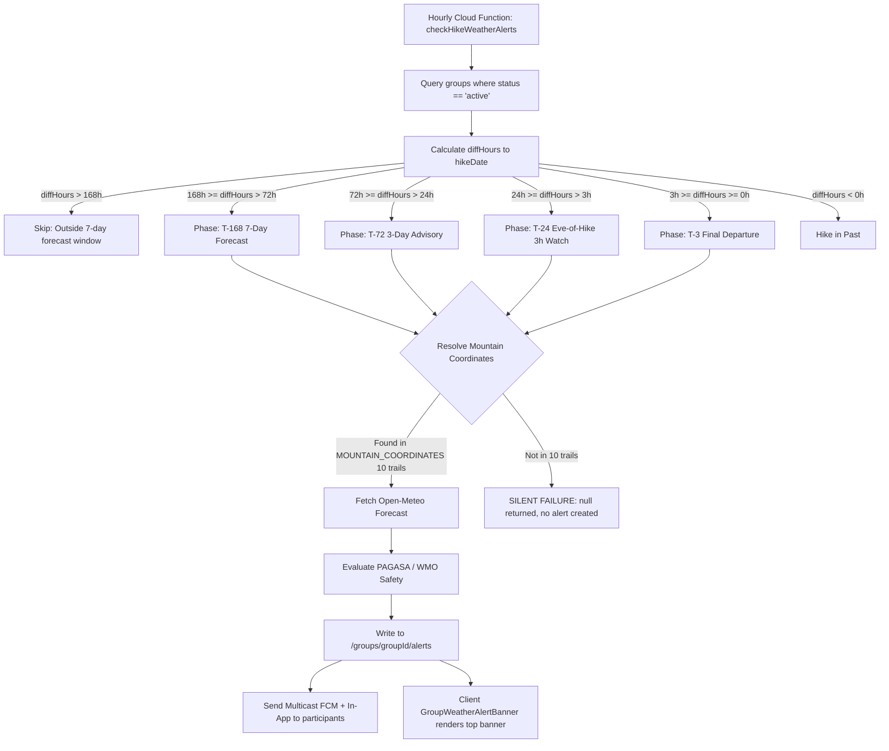

# Weather System Audit & Analysis

**Document:** Comprehensive Codebase Verification, Root Cause Analysis & Task Tracker  
**Target Systems:**  
- `GroupWeatherAlertBanner.tsx` (Pinned Group Weather Bulletin & Expiration Guards)  
- `RoomScreen.tsx` (Group Chat Screen & Hike Date Injection)  
- `GroupRepository.ts` & `useGroupWeatherAlert.ts` (Firestore Snapshot Subscription & Alert Data Mapping)  
- `functions/index.js` (`checkHikeWeatherAlerts` Scheduled Cloud Function & Progressive T-Minus Engine)  
- `Group.types.ts` & `Offer.types.ts` (Domain Types & Timestamp Serialization)  

---

## 1. Executive Summary

This document provides a comprehensive technical audit of the weather tracking, progressive countdown alerting, and group chat weather bulletin systems in Thrail. Specifically, it diagnoses two core questions raised during system testing:

1. **Why are weather alerts still showing in group chat when the hike date has already passed?**
2. **Is the group chat weather alert system currently working as intended?**

### Quick Findings Summary
* **Why alerts linger past the hike date**: The frontend expiration guard is hardcoded to wait **24 full hours after the hike start time** (`diffHours < -24`) before hiding the banner. Additionally, if `hikeDate` is missing from the group/alert payload, the fallback expiration logic **only checks `T-3` alerts**, meaning `T-24`, `T-72`, and `T-168` alerts never expire. Furthermore, Firestore stores alerts permanently, and the backend cleanup only runs for groups with `status == 'active'` and also waits 24 hours post-hike.
* **Is it working as intended**: The progressive state engine (T-168, T-72, T-24, T-3) and conditional sleep/watch logic are well-structured. However, **critical architectural defects exist**:
  1. **Coordinate Resolution Failure**: The backend attempts to read coordinates from `group.trail`, which is an `ITrailSummary` (id, name, location only—no coordinates). It falls back to a hardcoded list of only **10 mountains**. For any other trail in the app, the function **silently aborts and generates zero weather alerts**.
  2. **Date-Only Midnight Bug**: ISO strings without times (e.g., `"2026-10-15"`) parse as midnight (`00:00:00`). By 6:00 AM on the morning of the hike, the system considers the hike already in the past, skipping the morning `T-3` departure alert entirely.
  3. **Checklist Discrepancy**: The interactive gear checklist described in the feature specification and test guide (TC-3.5) was stripped from the data pipeline in commit `b008f00d`. The banner currently displays text advisories only.

---

## 2. Implementation Status & Task Tracker

This tracker monitors all identified bugs, remediation tasks, and architectural improvements across the weather alert subsystem.

### Tracker Legend
- ✅ **Finished (Verified Working):** Implemented in codebase and verified operational.
- ⚠️ **Partially Implemented (Active Bug / Incomplete):** Implementation exists in codebase but contains logic flaws, edge-case leaks, or un-deployed changes.
- ❌ **Not Started (Pending):** Not yet implemented; awaiting implementation approval.
- 💡 **TD (To-Do Proposal):** Architectural proposal pending design sign-off.

---

### Weather Alert Task Tracker

| Task ID | Component / Area | Description | Status | Priority | Notes / Verification Target |
|---|---|---|:---:|:---:|---|
| **W-01** | Frontend Banner Expiration | Change banner expiration from `diffHours < -24` to expire immediately once hike ends (`currentTime > expirationMs` with midnight & duration awareness). | ✅ **Finished** | **P0 (Critical)** | Implemented in `GroupWeatherAlertBanner.tsx`. Uses `resolveHikeExpirationMs` to expire on hike conclusion. |
| **W-02** | Universal Phase Fallback | Broaden fallback expiration in `GroupWeatherAlertBanner.tsx` to expire `T-24`, `T-72`, and `T-168` based on document `createdAt` age when `hikeDate` is unavailable. | ✅ **Finished** | **P0 (Critical)** | Implemented in `GroupWeatherAlertBanner.tsx`. Replaced T-3-only check with phase-specific lifecycle ceilings. |
| **W-03** | End Date & Multi-Field Date Support | Update `RoomScreen.tsx` to pass `hikeDate={currentGroup?.offer?.endDate || currentGroup?.offer?.date || (currentGroup as any)?.date}`. | ✅ **Finished** | **P1 (High)** | Implemented in `RoomScreen.tsx`. Guarantees valid date resolution across single-day, multi-day, and legacy schemas. |
| **W-04** | Dynamic Trail Coordinate Lookup | In `functions/index.js`, look up the trail's actual coordinates from Firestore `/trails/{trailId}` when `group.trail.coordinates` is missing. | ✅ **Finished** | **P0 (Critical)** | Implemented `resolveGroupCoordinates` in `functions/index.js`. Inspects `geography.start`, `startLat`, and `coordinates`. |
| **W-05** | Safe Date-Only String Parsing | Handle ISO date-only strings (`YYYY-MM-DD`) in `functions/index.js` and frontend by setting target time to standard morning departure (e.g., 05:00 AM) or end-of-day. | ✅ **Finished** | **P1 (High)** | Implemented in both `functions/index.js` and `GroupWeatherAlertBanner.tsx`. Prevents premature midnight past-hike triggers. |
| **W-06** | Stale Alert Purging on Group Archive | Update `checkHikeWeatherAlerts` to purge `/groups/{groupId}/alerts` when a hike ends (`diffHours < -6`) and purge archived groups. | ✅ **Finished** | **P2 (Medium)** | Implemented in `functions/index.js`. Reduces stale delay from 24h to 6h post-hike and queries archived groups. |
| **W-07** | Cloud Function Deployment | Deploy updated `functions/index.js` (`checkHikeWeatherAlerts` & `testGroupWeatherAlert`) to GCP Cloud Functions via Firebase CLI. | ✅ **Finished** | **P1 (High)** | Successfully deployed to `thrail` GCP Cloud Functions on Oct 15, 2026. |
| **W-08** | Specification Alignment: Checklist vs Text | Reconcile gear checklist vs text advisory. Deliberately removed from data pipeline by developer decision; banner text-only is the intended design. | ✅ **Resolved (By Design)** | **P2 (Medium)** | Confirmed by developer: checklist was intentionally removed; text headline and message advisory are canonical. |
| **W-09** | Dynamic Countdown in Banner Badge | Compute dynamic days-out (`5-DAY FORECAST`, `4-DAY FORECAST`, `TOMORROW`, `TODAY`) based on target hike date instead of static T-168/T-72 buckets. | ✅ **Finished** | **P1 (High)** | Implemented in `GroupWeatherAlertBanner.tsx`. Uses `getDynamicPhaseLabel` comparing target calendar days to `currentTime`. |
| **W-10** | Seamless Transparent Banner Styling | Replace solid card background and harsh border with translucent tint (`rgba(..., 0.08)`), remove drop shadow halo, and blend seamlessly into chat. | ✅ **Finished** | **P1 (High)** | Implemented in `GroupWeatherAlertBanner.tsx`. Uses hairline border with subtle alpha tint and eliminated drop shadow halo. |
| **W-11** | De-Clutter Typography & 2-Row Header | Eliminate redundant text (`(7-Day Forecast)`, repeated mountain name, repeated rain emoji) in favor of a sleek 2-row collapsed layout. | ✅ **Finished** | **P2 (Medium)** | Implemented in `GroupWeatherAlertBanner.tsx`. Clean 2-row collapsed layout with target date (`📅 Sun, Oct 19`) and quick stats pill. |
| **W-12** | Bento-Style Expanded Metrics Grid | Modernize expanded bulletin drawer with 4 clean micro-stat cards (Rain %, Temp, Wind, UV) and structured trail safety advisory. | ✅ **Finished** | **P2 (Medium)** | Implemented in `GroupWeatherAlertBanner.tsx`. Features 4 Bento micro-stat cards with WHO UV labels and safety advisory. |
| **W-13** | Backend Forecast Alignment & Exact Date Index | In `functions/index.js`, match forecast day by exact ISO calendar date (`weatherData.daily.time.indexOf(hikeDateIso)`) instead of `Math.floor(diffHours/24)`, and add `&models=best_match` to align with per-mountain weather tab. | ✅ **Finished** | **P1 (High)** | Fixes day-index offset where alerts were reading Sunday/Monday instead of Tuesday. |
| **W-14** | Collapsed Banner: Remove Date & Display Advisory Text | Remove date tag; display status badge + dynamic countdown on left, hike day forecast (`27°C • 💨 17 km/h`) on right, and direct Trail Safety Advisory text on bottom row. | ✅ **Finished** | **P1 (High)** | Clean collapsed view with immediate actionable safety advice and forecast context. |
| **W-15** | Expanded Layout: Inverted (Advisory UP, 3-Card Metrics BOTTOM) | Remove date tag; position `TRAIL SAFETY ADVISORY` box at the top (UP), and 3-card Bento forecast grid (`Rain %`, `Temp`, `Wind` — removing misleading UV card) at the bottom. | ✅ **Finished** | **P1 (High)** | Clean 3-card layout eliminating high-UV-during-rain contradiction and prioritizing safety advisory. |

---

## 3. Root Cause Analysis: Why Alerts Linger Past the Hike Date

### Root Cause 1: 24-Hour Post-Hike Grace Delay (`diffHours < -24`)
In [`src/components/GroupWeatherAlertBanner.tsx`](file:///d:/thrail_app/src/components/GroupWeatherAlertBanner.tsx#L115-L124):
```typescript
const resolvedHikeDate = hikeDate ?? latestAlert.hikeDate;
if (resolvedHikeDate) {
    const hikeMs = parseDateToMs(resolvedHikeDate);
    if (hikeMs != null) {
        const diffHours = (hikeMs - currentTime) / (1000 * 60 * 60);
        if (diffHours < -24) {
            return null;
        }
    }
}
```
* `diffHours` calculates the remaining hours until the hike: `(hikeDate - currentTime)`.
* When the hike start time has passed, `diffHours` becomes negative.
* If a hike started at 6:00 AM today and finished at 3:00 PM today, at 6:00 PM `diffHours` is `-12`.
* Because `-12 < -24` is **FALSE**, the banner remains visible.
* **Result**: The banner is intentionally delayed from expiring until **24 full hours after the hike start time**.

### Root Cause 2: Fallback Expiration Leaks Non-T3 Alerts
In [`src/components/GroupWeatherAlertBanner.tsx`](file:///d:/thrail_app/src/components/GroupWeatherAlertBanner.tsx#L125-L134):
```typescript
} else if (latestAlert.createdAt) {
    // Fallback: If no explicit hike date is provided, check if a T-3 final departure alert is older than 27 hours
    const createdMs = parseDateToMs(latestAlert.createdAt);
    if (createdMs != null) {
        const hoursSinceAlert = (currentTime - createdMs) / (1000 * 60 * 60);
        if (latestAlert.phase === 'T-3' && hoursSinceAlert > 27) {
            return null;
        }
    }
}
```
* In [`RoomScreen.tsx`](file:///d:/thrail_app/src/features/Community/screens/Group/RoomScreen.tsx#L620), the banner is invoked as `<GroupWeatherAlertBanner groupId={currentGroup?.id} hikeDate={currentGroup?.offer?.date} />`.
* If `currentGroup?.offer?.date` is `null` or `undefined` (or if the alert in Firestore was created before `hikeDate` was stored on the alert doc), `resolvedHikeDate` is `undefined`.
* Execution falls into the fallback block above.
* **The bug**: The fallback strictly guards `latestAlert.phase === 'T-3'`. If the most recent alert was `T-24` (Eve-of-Hike), `T-72`, or `T-168` (e.g., if weather remained clear and T-3 was skipped, or monitoring completed before T-3), this condition **never evaluates to true**.
* **Result**: Stale `T-24`, `T-72`, or `T-168` alerts stay pinned to the chat **indefinitely**.

### Root Cause 3: Firestore Database Persistence & Cron Query Scope
* [`GroupRepository.ts`](file:///d:/thrail_app/src/core/models/Group/repositories/GroupRepository.ts#L167-L173) queries:
  ```typescript
  const q = query(
      collection(db, 'groups', groupId, 'alerts'),
      orderBy('createdAt', 'desc'),
      limit(1)
  );
  ```
  Firestore returns the newest document in `/groups/{groupId}/alerts` until that document is explicitly deleted.
* In [`functions/index.js`](file:///d:/thrail_app/functions/index.js#L1797-L1800), the scheduled cleanup runs as part of `checkHikeWeatherAlerts`:
  ```javascript
  const activeGroupsSnap = await db.collection('groups')
      .where('status', '==', 'active')
      .get();
  ```
  If a hike concludes and the group status is changed to `'archived'` or `'completed'`, the query `where('status', '==', 'active')` **excludes the group**. The cleanup block ([functions/index.js:1575](file:///d:/thrail_app/functions/index.js#L1575)) is never reached for that group, leaving historical alert documents orphaned in Firestore forever.
* In addition, if the latest changes in `functions/index.js` have not been deployed to Firebase Cloud, the cloud cron running on Google Cloud Scheduler has no deletion code at all.

---

## 4. Comprehensive Audit: Is the Group Chat Alert Working as Intended?



### 4.1 What Is Working Correctly
1. **Milestone Progressive Phasing**: Time brackets correctly partition countdowns (`T-168`, `T-72`, `T-24`, `T-3`).
2. **Conditional Sleep & Watch State Transitions**:
   - `SAFE` status emits once and causes subsequent hourly checks within that phase to sleep until the next milestone.
   - `CAUTION` or `DANGER` triggers rechecks (daily for T-168/T-72; 3-hour watch for T-24).
   - `T-3` is terminal: once emitted, monitoring completes.
3. **Forecast Resolution Matching**:
   - Near-term (`T-3`, `T-24`) uses hourly Open-Meteo endpoints (`hourly.precipitation_probability`, `hourly.weathercode`, `hourly.windspeed_10m`).
   - Long-range (`T-72`, `T-168`) uses daily aggregates.
4. **Safety Classifications**: Thresholds correctly align with PAGASA rain alert levels, Beaufort wind scale, and WHO UV indices.
5. **Direct Member Targeting**: Push notifications and in-app alerts are correctly scoped to `group.participantsIds`.

---

### 4.2 Critical Deficiencies Identified

#### Defect 1: Coordinate Resolution Silent Drop (Critical)
* In [`functions/index.js`](file:///d:/thrail_app/functions/index.js#L1433-L1458), `resolveMountainCoords` looks up:
  ```javascript
  const coords = resolveMountainCoords(trailName, group.trail?.coordinates || group.trail?.general?.coordinates);
  ```
* In Thrail's Firestore schema, `group.trail` is an `ITrailSummary` containing only:
  ```typescript
  export interface ITrailSummary {
      id: string;
      name: string;
      location?: string;
  }
  ```
  Neither `coordinates` nor `general.coordinates` exist on `group.trail`.
* The function falls back to a dictionary of **only 10 hardcoded mountains**:
  `tagapo`, `marami`, `batulao`, `makiling`, `maculot`, `daraitan`, `pulag`, `ulap`, `pinatubo`, `pico`.
* **Impact**: If a hike is scheduled for **any other trail** in the database (e.g., Mt. Apo, Mt. Kanlaon, Mt. Arayat, Mt. Guiting-Guiting, Mt. Ugo), `resolveMountainCoords` returns `null`. Line 1638 logs `No coordinates resolved` and **exits without generating any alert**. The system fails silently for the vast majority of trails.

#### Defect 2: Date-Only String Midnight Miscalculation
* In [`functions/index.js:1544-1549`](file:///d:/thrail_app/functions/index.js#L1544-L1549):
  ```javascript
  const rawDate = group.offer?.date || group.offer?.startDate || group.date;
  if (typeof rawDate === 'string') {
      hikeDate = DateTime.fromISO(rawDate).setZone('Asia/Manila');
  }
  ```
* If `rawDate` is a date-only ISO string (e.g. `"2026-10-15"`), Luxon sets the time to midnight (`00:00:00`).
* At 6:00 AM or 7:00 AM on the day of the hike, `diffHours` is `-6` or `-7`.
* `diffHours < 0` immediately disqualifies the hike from `T-3` (`diffHours >= 0 && diffHours <= 3`).
* **Impact**: On the morning of the hike, the scheduler believes the hike has already passed, skipping the pre-departure alert.

#### Defect 3: Pinned Banner vs Chat Feed Message
* Alerts are stored under `/groups/{groupId}/alerts` and displayed exclusively via `GroupWeatherAlertBanner.tsx`.
* They are **not** posted into `/groups/{groupId}/messages` as system chat bubbles.
* If users scroll down or collapse the banner, there is no in-chat message history of weather warnings. (Confirmed as designed per current architecture, but deviates from standard group chat alert expectations).

#### Defect 4: Gear Checklist Removed from Alert Data Pipeline
* The feature test guide ([plans/weather_feature_testing_guide.md](file:///d:/thrail_app/plans/weather_feature_testing_guide.md#L97)) lists **TC-3.5: Interactive Gear Checklist**.
* In commit `b008f00d`, the `checklist` field was removed from `GroupRepository.ts` and `evaluateWeatherSafety`.
* The banner currently renders only `headline` and `message`, with no interactive gear checklist.

---

## 5. Technical Remediation Plan (Architecture Specification)

When ready to implement, the following architectural fixes resolve all identified defects:

### Tier 1: Frontend Expiration & Multi-Date Guard (`GroupWeatherAlertBanner.tsx` & `RoomScreen.tsx`)
1. **Immediate Expiration on Hike Conclusion**:
   - Update expiration check in `GroupWeatherAlertBanner.tsx`:
     ```typescript
     // Expire immediately when hike has passed (diffHours <= 0) or after end of hike day
     const isHikeConcluded = diffHours <= 0;
     if (isHikeConcluded) {
         return null;
     }
     ```
   - If `offer.endDate` is present, evaluate against `endDate` instead of start date so multi-day hikes remain monitored throughout.
2. **Universal Fallback Expiration**:
   - In `GroupWeatherAlertBanner.tsx`, update the fallback for any alert phase (`T-168`, `T-72`, `T-24`, `T-3`) by hiding alerts older than 24 hours based on `latestAlert.createdAt`.
3. **RoomScreen Prop Enhancement**:
   - In `RoomScreen.tsx`, pass:
     ```tsx
     <GroupWeatherAlertBanner 
         groupId={currentGroup?.id} 
         hikeDate={currentGroup?.offer?.endDate || currentGroup?.offer?.date || (currentGroup as any)?.date} 
     />
     ```

### Tier 2: Backend Coordinate Resolution & Safe Date Parsing (`functions/index.js`)
1. **Dynamic Firestore Trail Lookup**:
   - In `processGroupWeatherAlert`, if `group.trail?.coordinates` is missing and `trailName` is not in `MOUNTAIN_COORDINATES`:
     ```javascript
     if (!coords && group.trail?.id) {
         const trailDoc = await db.collection('trails').doc(group.trail.id).get();
         if (trailDoc.exists) {
             const trailData = trailDoc.data();
             const geo = trailData.geography?.start;
             if (geo?.latitude && geo?.longitude) {
                 coords = { lat: geo.latitude, lon: geo.longitude };
             }
         }
     }
     ```
2. **Safe Date-Only Parsing**:
   - If `rawDate` is a date string without time (`length <= 10`, e.g. `"2026-10-15"`), default the hike time to standard morning start (e.g. `05:00:00 Asia/Manila`) or end of day (`23:59:59 Asia/Manila`) so the day of the hike is not treated as past at 6:00 AM.
3. **Lifecycle-Aware Cleanup**:
   - In `checkHikeWeatherAlerts`, allow cleanup for groups whose hike has concluded regardless of whether `status == 'active'` or `'archived'`.

---

## 6. UI/UX Modernization & Seamless Banner Specification

### 6.1 Dynamic "Days Out" Countdown Engine
Instead of static 4-tier buckets (`T-168` always showing "7-DAY FORECAST" even when 5 or 4 days out), the banner dynamically computes the actual calendar days until the hike using `hikeDate` and `currentTime`:

$$\text{daysUntilHike} = \left\lceil \frac{\text{hikeDate} - \text{currentTime}}{1000 \times 60 \times 60 \times 24} \right\rceil$$

| Remaining Time | Dynamic Badge Label | Context / Meaning |
|---|---|---|
| **7 Days** | `7-DAY FORECAST` | 7 days out |
| **6 Days** | `6-DAY FORECAST` | 6 days out |
| **5 Days** | `5-DAY FORECAST` | 5 days out |
| **4 Days** | `4-DAY FORECAST` | 4 days out |
| **3 Days** | `3-DAY ADVISORY` | 3 days out |
| **2 Days** | `2-DAY ADVISORY` | 2 days out |
| **1 Day** | `TOMORROW • EVE-OF-HIKE` | Final gear and pack check |
| **0 Days (Day of Hike)** | `TODAY • FINAL DEPARTURE` | Departure day active monitoring |

> **User Benefit:** A group whose hike is on Sunday will see `5-DAY FORECAST` on Tuesday, `4-DAY FORECAST` on Wednesday, and `TOMORROW` on Saturday, creating an accurate, living countdown.

---

### 6.2 Eliminating the "White Border" & Creating Seamless Chat Integration
In the current implementation, the banner is rendered as a detached floating box with a solid yellow border (`#FCD34D`), solid light background (`#FFFBEB`), and drop shadow (`dropShadow(2, 0.06)`). Against the chat's off-white background (`Colors.BACKGROUND` / `#FAFCFA`), this produces a stark, boxed contrast with an unnatural white/light halo margin.

```
CURRENT (Clashing Boxed Card):
┌────────────────────────────────────────────────────────────────────────┐
│ [White/Off-White Chat Container Margin]                                │
│   ┌──────────────────────────────────────────────────────────────┐     │
│   │ (Solid Yellow Border #FCD34D)                                │     │
│   │ [Solid Opaque #FFFBEB Background]                            │     │
│   │ [Drop Shadow creates white/light outline against chat]       │     │
│   └──────────────────────────────────────────────────────────────┘     │
└────────────────────────────────────────────────────────────────────────┘
```

#### The Solution: Seamless Translucent Design
To blend harmoniously with the group chat interface, the banner adopts a **translucent, borderless/subtle-border approach**:

1. **Translucent Background Tints**:
   * **CAUTION**: `rgba(245, 158, 11, 0.08)` (subtle amber wash that lets the chat background show through).
   * **SAFE**: `rgba(22, 163, 74, 0.08)` (subtle emerald wash).
   * **DANGER**: `rgba(220, 38, 38, 0.08)` (subtle ruby wash).
2. **Hairline Translucent Border (No Harsh White/Yellow Edges)**:
   * Replace solid 1px border with `borderWidth: StyleSheet.hairlineWidth`.
   * Border color matches the status accent with high alpha: `borderColor: 'rgba(217, 119, 6, 0.2)'`.
3. **Remove Drop Shadow Halo**:
   * Remove `GlobalStyles.dropShadow(2, 0.06)` completely. Without drop shadow, the banner sits flush and flat against the chat canvas without casting a white halo.
4. **Header Integration Option**:
   * Pinned directly beneath the custom header with a slim divider line (`borderBottomWidth: StyleSheet.hairlineWidth`), feeling like a native status bar rather than an obstructive card.

---

### 6.3 Typography & De-Cluttering Specification
Currently, the banner repeats information 3 times:
* `7-DAY FORECAST` in the badge AND `(7-Day Forecast)` in the title.
* `Mt. Daraitan` in the title AND in the preview message.
* `🌧️` rain emoji in the left icon circle, the metric pill, and the title.

#### Proposed Clean 2-Row Collapsed Layout:
```
┌────────────────────────────────────────────────────────────────────────┐
│ 🟡 CAUTION • 5-DAY FORECAST                    📅 Sun, Oct 19     [v]  │
│ 🌧️ Heavy Rain Expected (100%)                 27°C  •  💨 18 km/h       │
└────────────────────────────────────────────────────────────────────────┘
```
* **Top Line:** Status pill (`🟡 CAUTION`) + Dynamic countdown (`5-DAY FORECAST`) + Target Date (`📅 Sun, Oct 19`) on the right.
* **Bottom Line:** Direct trail condition summary (`🌧️ Heavy Rain Expected (100%)`) + Compact weather metrics (`27°C • 💨 18 km/h`).
* **Result:** 30% reduction in vertical space, zero duplicated text, and immediate readability.

---

### 6.4 Expanded "Meteorological Bulletin" Drawer (When Tapped)
When tapped, the banner smoothly expands into an organized weather card:

```
┌────────────────────────────────────────────────────────────────────────┐
│ 🟡 CAUTION • 5-DAY FORECAST                    📅 Sun, Oct 19     [^]  │
│ 🌧️ Weather Advisory for Mt. Daraitan                                   │
├────────────────────────────────────────────────────────────────────────┤
│  METRICS BREAKDOWN:                                                    │
│  ┌──────────────┐ ┌──────────────┐ ┌──────────────┐ ┌──────────────┐   │
│  │ 🌧️ Rain      │ │ 🌡️ Temp      │ │ 💨 Wind      │ │ ☀️ UV Index  │   │
│  │   100%       │ │   27°C       │ │   18 km/h    │ │   3 (Low)    │   │
│  └──────────────┘ └──────────────┘ └──────────────┘ └──────────────┘   │
│                                                                        │
│  💡 TRAIL SAFETY ADVISORY:                                             │
│  Continuous rain expected during the hike window. Slippery mud descent │
│  and low visibility on exposed ridges. Pack waterproof rain poncho,    │
│  bag covers, and deep-lug traction trail shoes.                        │
└────────────────────────────────────────────────────────────────────────┘
```
* **Bento Metric Chips:** 4 micro-cards for Rain %, Temperature, Wind Speed, and UV Index with soft rounded corners (`borderRadius: 10`) and clean typography.
* **Trail Safety Advisory:** Clear, actionable advice formatted with readable line spacing.

---

## 7. Refined UI/UX Architecture: Advisory-First Layout, 3-Card Metrics (Option A) & Backend Alignment

### 7.1 Design Decisions & User Alignment
Based on system analysis and user feedback, the following refinements are established:
1. **Forecast Weather for the Hike Day**:
   - The collapsed small banner displays the **hike day forecast metrics** (`27°C • 💨 17 km/h`) rather than current mountain weather. Hikers in a group chat planning an upcoming hike need actionable clarity for the hike day, preventing contradictions between live conditions and future warnings.
2. **Date Removal on Collapsed & Expanded**:
   - The date tag (`📅 Tue, Oct 20`) is removed from both collapsed and expanded states. The dynamic badge (`5-DAY FORECAST`, `TOMORROW • EVE-OF-HIKE`, `TODAY • FINAL DEPARTURE`) already communicates the time horizon clearly and cleanly.
3. **Option A: 3-Card Bento Grid (Eliminating Contradictory UV Index)**:
   - In tropical regions (e.g. Philippines), Open-Meteo's `daily.uv_index_max` reports the theoretical solar noon clear-sky spike (`8 V.High`), which severely clashes when paired with `100% Rain`.
   - The UV card is removed in favor of **3 focused Bento cards**: `Rain %`, `Temp`, and `Wind Speed`.
4. **Inverted Hierarchy ("Advisory UP, Metrics BOTTOM")**:
   - When expanded, the **Trail Safety Advisory** box is placed at the top (UP), ensuring users read the safety guidelines and pack advice first.
   - The **Metrics Breakdown** 3-card grid is placed at the bottom (BOTTOM) to substantiate the advisory.
5. **Backend Forecast Alignment with Per-Mountain Tab**:
   - In `functions/index.js`, replace `Math.floor(diffHours / 24)` with exact calendar ISO date matching:
     `const targetDayIndex = weatherData.daily?.time?.indexOf(hikeDateIso);`
     This resolves the off-by-one bug where alerts read Monday/Sunday while the mountain tab viewed Tuesday.
   - Add `&models=best_match` to the Cloud Function's Open-Meteo query to match the high-resolution model used in `weatherRepository.ts`.

---

### 7.2 Collapsed State: Small Banner in Chat (Not Expanded)

```
┌────────────────────────────────────────────────────────────────────────────────────────┐
│ 🟠 CAUTION • 5-DAY FORECAST                                    27°C • 💨 17 km/h   [v] │
│ ⓘ Rain expected (100% chance) at Mt. Daraitan. Pack waterproof rain covers & footwear. │
└────────────────────────────────────────────────────────────────────────────────────────┘
```

* **Top Header Row**:
  - **Left**: Status badge (`🟠 CAUTION`) + Live target day countdown (`5-DAY FORECAST`).
  - **Right**: Hike day forecast metrics (`27°C • 💨 17 km/h`) + Chevron expand indicator (`[v]`).
* **Bottom Advisory Row**:
  - Direct hike-day trail safety guidance (`latestAlert.message`), giving hikers immediate actionable safety advice at a glance.

---

### 7.3 Expanded State: Advisory UP, 3-Card Metrics BOTTOM (Option A)

```
┌────────────────────────────────────────────────────────────────────────────────────────┐
│ 🟠 CAUTION • 5-DAY FORECAST                                    27°C • 💨 17 km/h   [^] │
├────────────────────────────────────────────────────────────────────────────────────────┤
│ [UP] TRAIL SAFETY ADVISORY                                                             │
│ ┌────────────────────────────────────────────────────────────────────────────────────┐ │
│ │ ⓘ TRAIL SAFETY ADVISORY                                                            │ │
│ │ Rain expected (100% chance) at Mt. Daraitan. Pack waterproof rain covers and       │ │
│ │ traction footwear.                                                                 │ │
│ └────────────────────────────────────────────────────────────────────────────────────┘ │
│                                                                                        │
│ [BOTTOM] METRICS BREAKDOWN                                                             │
│ ┌───────────────────────┐ ┌───────────────────────┐ ┌────────────────────────┐       │
│ │       🌧️ Rain        │ │       🌡️ Temp        │ │       💨 Wind        │       │
│ │         100%          │ │         27°C          │ │        17 km/h       │       │
│ └───────────────────────┘ └───────────────────────┘ └────────────────────────┘       │
└────────────────────────────────────────────────────────────────────────────────────────┘
```

* **Top Card**: `TRAIL SAFETY ADVISORY` box (`latestAlert.message`) in translucent accent tint.
* **Bottom Grid**: 3 clean Bento cards (`Rain %`, `Temp`, `Wind Speed`) with generous spacing and high legibility.

---

### 7.4 Technical Implementation Tasks

1. **Backend Alignment (`functions/index.js`)**:
   - In `processGroupWeatherAlert`:
     Extract `hikeDateIso = hikeDate.toISODate()`.
     Compute `targetDayIndex = weatherData.daily?.time?.indexOf(hikeDateIso)`. Fallback to bounded math if date string not found in 7-day array.
   - Update Open-Meteo URL to append `&models=best_match`.
2. **Frontend Banner Component (`GroupWeatherAlertBanner.tsx`)**:
   - Remove date formatting / date tag rendering from both collapsed and expanded states.
   - Collapsed view: Top row shows status badge + dynamic countdown on left, quick forecast metrics pill (`27°C • 💨 17 km/h`) on right. Bottom row displays `latestAlert.message` with info icon.
   - Expanded view: Render `TRAIL SAFETY ADVISORY` box **UP** (top), and `METRICS BREAKDOWN` 3-card Bento grid **BOTTOM** (bottom). Remove the UV Index card.


