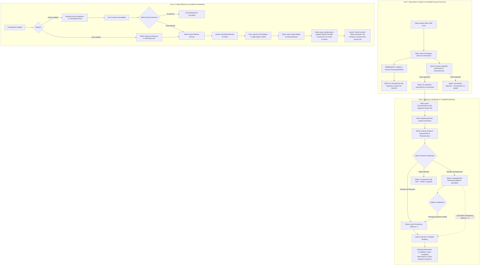

# Manual QR Payment & Refund Architecture Plan (Non-Destructive PayMongo Coexistence)

## 1. Executive Summary & Objectives

This document establishes the end-to-end technical specification for introducing a **Manual QR Payment and Two-Way Manual Refund Workflow** in the Thrail application. 

### Core Architectural Principle: Non-Destructive Coexistence
- **Zero Regression on PayMongo:** All existing PayMongo code, webhooks, checkout sessions, auto-redirect proxy handlers, and cloud functions remain intact.
- **Provider Abstraction:** The active payment pipeline is decoupled via a centralized configuration flag (`PAYMENT_PROVIDER = 'manual_qr' | 'paymongo'`), enabling seamless toggling between automated PayMongo processing and manual QR/receipt verification without structural debt.

---

## 2. Current Codebase Mapping & Findings

### A. Component & Screen Architecture
1. **User Payment Screens:**
   - [`PaymentScreen.tsx`](file:///d:/thrail_app/src/features/Book/screens/Payment/PaymentScreen.tsx): Controls the multi-step checkout stepper (`MethodScreen` -> `StatusScreen`), manages web popup lifecycle (`window.open`), handles cross-window postMessage handshake (`PAYMONGO_PAYMENT_SUCCESS`), mobile native browser sessions (`WebBrowser.openAuthSessionAsync`), signature checks, and transaction polling.
   - [`MethodScreen.tsx`](file:///d:/thrail_app/src/features/Book/screens/Payment/MethodScreen.tsx): Renders the amount card, full payment vs. 50% downpayment radio toggle, digital wallet channel radio buttons (GCash / Maya), and the digital terms signature agreement ([`TermsSignature.tsx`](file:///d:/thrail_app/src/features/Book/components/TermsSignature.tsx)).
   - [`StatusScreen.tsx`](file:///d:/thrail_app/src/features/Book/screens/Payment/StatusScreen.tsx): Success confirmation showing transaction reference, amount paid, and return navigation.
2. **Document & Image Upload Pattern:**
   - [`DetailsScreen.tsx`](file:///d:/thrail_app/src/features/Book/screens/Booking/DetailsScreen.tsx): Implements document collection using [`DocumentUploadCard.tsx`](file:///d:/thrail_app/src/components/DocumentUploadCard.tsx).
   - [`DocumentUploadCard.tsx`](file:///d:/thrail_app/src/components/DocumentUploadCard.tsx): Universal picker supporting camera and gallery uploads via `expo-image-picker`, client-side format & size limits (5MB maximum, allowed extensions: JPG, PNG, WEBP, HEIC), status indicators (pending, uploading, complete, rejected), and full-screen preview via [`ImagePreviewModal.tsx`](file:///d:/thrail_app/src/components/ImagePreviewModal.tsx).
3. **Admin Review & Verification Dashboards:**
   - [`ReviewScreen.tsx`](file:///d:/thrail_app/src/features/Admin/screens/Booking/ReviewScreen.tsx): Core controller for admin reviews, supporting split layout for desktop and vertical tabs for mobile. Contains Documents Tab, Payment Tab, [`AdminCancellationCard.tsx`](file:///d:/thrail_app/src/features/Admin/screens/Booking/components/AdminCancellationCard.tsx), [`AdminRefundModal.tsx`](file:///d:/thrail_app/src/features/Admin/screens/Booking/components/AdminRefundModal.tsx), and dynamic sticky footer actions.
   - [`PaymentTab.tsx`](file:///d:/thrail_app/src/features/Admin/screens/Booking/tabs/PaymentTab.tsx): Renders total hike price, gross collected, net collected, remaining balance progress bar, and list of transaction entries from `booking.payment[]`.
4. **Hiker MyBookings & Cancellation Tracking:**
   - [`BookingDetailsScreen.tsx`](file:///d:/thrail_app/src/features/Book/screens/MyBookings/BookingDetailsScreen.tsx): Renders active booking progress, contact info, emergency contacts, documents, and cancellation/refund actions.
   - [`CancellationCard.tsx`](file:///d:/thrail_app/src/features/Book/screens/MyBookings/components/CancellationCard.tsx): Displays cancellation reasons, organizer notices, decline notes, and handles hiker actions (`onWithdraw`, `onAppeal`, `onAcceptAdminCancellation`).
5. **Admin Hub:**
   - [`DashboardScreen.tsx`](file:///d:/thrail_app/src/features/Admin/screens/DashboardScreen.tsx): Business organization overview, personnel management, trails, and offers.

### B. Current Data Models & Schema State
- **`Booking` ([`Booking.types.ts`](file:///d:/thrail_app/src/core/models/Booking/interfaces/Booking.types.ts)):**
  - Statuses: `'for-reservation'`, `'approved-docs'`, `'for-payment'`, `'paid'`, `'downpayment'`, `'completed'`, `'cancelled'`, `'refund'`, `'refunded'`, `'for-cancellation'`, `'cancellation-rejected'`, `'for-reschedule'`, `'reschedule-rejected'`, `'rescheduled'`, `'expired'`.
  - Nested collections: `offer`, `user`, `business`, `trail`, `payment: IPayment<Date>[]`, `documents: Requirements[]`, `cancellationReason?`, `cancelledBy?`.
- **`IPayment`:** Records gateway (`'paymongo'`), `gatewayId`, `method`, `sessionId`, `referenceCode`, `status`, `amount`, `refundedAmount`, `createdAt`, `capturedAt`, `refundedAt`.
- **`Cancellation` ([`Cancellation.types.ts`](file:///d:/thrail_app/src/core/models/Cancellation/interfaces/Cancellation.types.ts)):**
  - Fields: `id`, `userId`, `cancelledBy ('user' | 'admin')`, `bookingId`, `offerId`, `businessId`, `reason`, `status ('pending' | 'approved' | 'rejected')`, `adminNote?`, `refundAmount?`, `refundedAt?`.
- **`User` & Roles ([`User.types.ts`](file:///d:/thrail_app/src/core/models/User/interfaces/User.types.ts)):**
  - Roles: `'superadmin' | 'admin' | 'user'`.
  - Business creators hold Firebase Auth custom claim `{ role: 'admin', owner: businessId }`.

---

## 3. Detailed Architectural Specifications



---

## 4. Database & State Schema Additions

### A. Provider Configuration Flag
**File:** `src/core/config/paymentConfig.ts`
```typescript
export type PaymentProvider = 'manual_qr' | 'paymongo';

export const PAYMENT_CONFIG = {
    /**
     * Determines whether checkout and refund workflows operate in manual QR mode
     * or automated PayMongo gateway mode.
     */
    PROVIDER: 'manual_qr' as PaymentProvider,
};
```

### B. Role Definition & Owner Verification
**File:** `src/core/models/User/interfaces/User.types.ts`
```typescript
export type Role = 'superadmin' | 'admin' | 'owner' | 'user';
```

**File:** `src/core/models/User/hooks/useAuthHook.ts`
```typescript
const isOwner = role === 'owner' || (Boolean(businessId) && (profile?.id === businessId || user?.uid === businessId));
```

### C. Business Master QR Storage Schema
**File:** `src/core/models/Business/interfaces/Business.types.ts`
```typescript
export interface IBusinessPaymentConfig<T = Date> {
    qrCodeUrl: string;                  // Firebase Storage download URL
    accountName?: string;               // Account name shown on QR (e.g. Organizer Name)
    accountNumber?: string;            // GCash / Maya account number
    providerName?: 'GCash' | 'Maya' | string;
    updatedAt: T;
    updatedBy: string;                  // Owner user ID
}

export interface IBusinessBase<T> extends Omit<IApplicationBase<T>, 'status' | 'message'> {
    active: boolean;
    paymentConfig?: IBusinessPaymentConfig<T>;
}
```

### D. Manual Payment & Balance Tracking Schema
**File:** `src/core/models/Booking/interfaces/Booking.types.ts`
```typescript
export interface IPayment<T> {
    gateway: string;                    // 'manual_qr' | 'paymongo'
    gatewayId?: string;
    method?: string;
    sessionId: string;
    referenceCode?: string | null;
    status: "pending" | "captured" | "failed" | "refunded" | "abandoned" | "processing_refund" | "rejected";
    refundableUntil?: T;
    amount: number;
    refundedAmount?: number;
    createdAt: T;
    capturedAt?: T;
    refundedAt?: T;
    refundReason?: string;

    // Manual QR fields:
    receiptUrl?: string;                // User-uploaded receipt screenshot
    classification?: 'full' | 'downpayment';
    adminNote?: string;
    verifiedBy?: string;
    verifiedAt?: T;
}

export interface IBookingBase<T> {
    // ... existing properties
    remainingBalance?: number;          // Exact remaining balance due (₱)
    paymentVerificationStatus?: 'pending_verification' | 'downpayment' | 'fully_paid' | 'rejected';
    paymentRejectionReason?: string;
}
```

### E. Two-Way Refund & Cancellation Handshake Schema
**File:** `src/core/models/Cancellation/interfaces/Cancellation.types.ts`
```typescript
export type HandshakeStep = 
    | 'awaiting_admin_approval'         // User requested refund/cancel -> Admin reviews
    | 'awaiting_user_acceptance'        // Admin initiated -> User must accept first
    | 'awaiting_admin_refund_decision'  // User accepted admin cancel -> Admin decides Refund vs No Refund
    | 'awaiting_user_wallet'            // Admin decided refund -> User enters GCash/Maya number
    | 'awaiting_admin_payout'           // User submitted wallet -> Admin sends payout & uploads receipt
    | 'completed';                      // Loop closed with admin refund proof

export interface IUserWalletDetails<T = Date> {
    walletType: 'GCash' | 'Maya';
    accountNumber: string;              // Validated 11-digit mobile number (09XXXXXXXXX)
    accountName?: string;
    submittedAt: T;
}

export interface ICancellationBase<T> {
    id: string;
    userId: string;
    cancelledBy: 'user' | 'admin';
    bookingId: string;
    offerId: string;
    businessId: string;
    reason: string;
    status: "pending" | "approved" | "rejected" | "user_accepted" | "refund_pending" | "refund_submitted" | "refund_completed";
    adminNote?: string;
    refundAmount?: number;
    refundedAt?: T | null;
    createdAt: T;
    updatedAt: T;

    // Handshake extensions:
    handshakeStep?: HandshakeStep;
    refundDecision?: 'issue_refund' | 'no_refund';
    userWallet?: IUserWalletDetails<T>;
    adminRefundReceiptUrl?: string;     // Proof of payout uploaded by Admin
    adminRefundReceiptUploadedAt?: T;
}
```

---

## 5. UI Architecture: Dedicated Subcomponents Reusing Shared Primitives

To guarantee that the existing PayMongo screens remain 100% unaltered, free of conditional clutter, and fully regression-safe, the UI is architected into **cleanly separated dedicated provider screens** that reuse Thrail's established design primitives:

```
src/features/Book/screens/Payment/
  ├── PaymentScreen.tsx                 <-- Orchestrator: branches on PAYMENT_CONFIG.PROVIDER
  ├── ManualQRMethodScreen.tsx          <-- NEW: Dedicated Manual QR layout & actions
  └── MethodScreen.tsx                  <-- PRESERVED: PayMongo method selection 100% intact

src/features/Admin/screens/Booking/components/
  ├── ManualQRVerificationCard.tsx      <-- NEW: Admin receipt inspection & classification
  └── AdminRefundModal.tsx              <-- PRESERVED: PayMongo refund modal

src/features/Book/screens/Refund/
  └── UserRefundScreen.tsx              <-- NEW: 11-digit GCash/Maya mobile wallet submission
```

### Part 1: Owner QR Management & User `PaymentScreen.tsx`
1. **Owner-Only Master QR Upload:**
   - Add `OwnerQRCard` inside [`DashboardScreen.tsx`](file:///d:/thrail_app/src/features/Admin/screens/DashboardScreen.tsx).
   - Render upload/edit controls **strictly** if `isOwner === true`. Staff admins see a read-only preview or no edit button.
   - Saves file to Firebase Storage at `businesses/{businessId}/payment/master_qr_{timestamp}.png`.
   - Updates `businesses/{businessId}.paymentConfig`.
2. **Dedicated `ManualQRMethodScreen.tsx` (Manual QR Mode):**
   - Keeps [`MethodScreen.tsx`](file:///d:/thrail_app/src/features/Book/screens/Payment/MethodScreen.tsx) completely untouched for PayMongo.
   - Inside [`ManualQRMethodScreen.tsx`](file:///d:/thrail_app/src/features/Book/screens/Payment/ManualQRMethodScreen.tsx):
     - Displays the Organizer's Master QR Code prominently in a dedicated card.
     - Adds a **"Save QR to Gallery"** button:
       - On Mobile: Invokes `expo-file-system` to download and `expo-media-library` to save to photos album, with permission handling and success toast.
       - On Web: Programmatically triggers image download.
     - Embeds receipt screenshot upload reusing [`DocumentUploadCard.tsx`](file:///d:/thrail_app/src/components/DocumentUploadCard.tsx) directly underneath with title: `"Upload the screenshot of your receipt"` and subtitle: `"JPG, PNG, or WEBP up to 5MB"`.
     - Reuses [`TermsSignature.tsx`](file:///d:/thrail_app/src/features/Book/components/TermsSignature.tsx) at the bottom.
   - Submission: Saves receipt into `booking.payment[]` as a `pending` record with `gateway: 'manual_qr'` and sets booking `paymentVerificationStatus = 'pending_verification'`. Transitions user to `StatusScreen.tsx` informing them that receipt verification is in progress.

### Part 2: Admin Verification on `ReviewScreen.tsx` (Payment Tab)
1. **Receipt Screenshot Display via `ManualQRVerificationCard.tsx`:**
   - In [`PaymentTab.tsx`](file:///d:/thrail_app/src/features/Admin/screens/Booking/tabs/PaymentTab.tsx), render [`ManualQRVerificationCard.tsx`](file:///d:/thrail_app/src/features/Admin/screens/Booking/components/ManualQRVerificationCard.tsx) when manual QR payment exists.
   - Displays the hiker's uploaded receipt thumbnail with tap-to-expand using [`ImagePreviewModal.tsx`](file:///d:/thrail_app/src/components/ImagePreviewModal.tsx).
2. **Admin Verification Actions:**
   - **Classify as Full Payment:**
     - Sets verified amount = total hike price.
     - Sets `booking.remainingBalance = 0`.
     - Sets `booking.status = 'paid'` and `paymentVerificationStatus = 'fully_paid'`.
   - **Classify as Downpayment:**
     - Opens numeric input modal for admin to enter verified amount (e.g. ₱500.00).
     - Automatically computes `remainingBalance = Math.max(0, offer.price - verifiedAmount)`.
     - Sets `booking.status = 'downpayment'` and `paymentVerificationStatus = 'downpayment'`.
     - Notifies user with exact remaining balance due.
   - **Reject / Request Re-upload:**
     - Prompts admin for explanation (e.g. "Receipt illegible / transaction amount mismatch").
     - Sets `paymentVerificationStatus = 'rejected'` and records note in `paymentRejectionReason`.
     - Hiker is alerted on `BookingDetailsScreen.tsx` with a "Re-upload Receipt" button.
3. **Downpayment & Balance Settling:**
   - Provide an admin action button: **"Mark Remaining Balance as Paid"** (for cash received at trailhead or secondary transfer).
   - Alternatively, hikers can upload an additional receipt to settle the remaining balance.
4. **Guarding "Complete Booking":**
   - In [`ReviewScreen.tsx`](file:///d:/thrail_app/src/features/Admin/screens/Booking/ReviewScreen.tsx#L422), enforce that `"Complete Booking"` is strictly **DISABLED** while `remainingBalance > 0` or status is `'downpayment'`.
   - Only enable `"Complete Booking"` once the remaining balance is ₱0.00 and payment is 100% verified.

### Part 3: User & Admin Refund / Cancellation Workflows (2-Way Handshake)
1. **Dedicated User-Initiated Refund Screen (`UserRefundScreen`):**
   - Create screen at `src/features/Book/screens/Refund/UserRefundScreen.tsx` mounted at route `/book/refund`.
   - Access Gate: Screen is **strictly locked** until user requests a refund AND the admin approves it (`handshakeStep === 'awaiting_user_wallet'`).
   - UI Layout:
     - Header displaying Booking ID, Trail Name, and Approved Refund Amount banner.
     - Radio button selector: `GCash` | `Maya`.
     - Validated text input: 11-digit mobile wallet number (`09XXXXXXXXX`).
     - Account Holder Name text input.
     - Primary button: `"Submit Wallet Details"`.
   - On submission: Updates `cancellation.userWallet` and advances `handshakeStep` to `'awaiting_admin_payout'`.
2. **Admin-Initiated Cancellation & Refund:**
   - In [`ReviewScreen.tsx`](file:///d:/thrail_app/src/features/Admin/screens/Booking/ReviewScreen.tsx) -> Manage Booking -> Cancel Booking:
     - Admin initiates cancellation with a reason.
     - Sets `handshakeStep = 'awaiting_user_acceptance'` and `cancelledBy = 'admin'`.
   - In [`CancellationCard.tsx`](file:///d:/thrail_app/src/features/Book/screens/MyBookings/components/CancellationCard.tsx):
     - Hiker sees cancellation notice with button: `"Accept Cancellation & Request Refund"`.
     - Tapping this sets `handshakeStep = 'awaiting_admin_refund_decision'`.
   - On [`ReviewScreen.tsx`](file:///d:/thrail_app/src/features/Admin/screens/Booking/ReviewScreen.tsx):
     - Admin receives notification that user accepted cancellation.
     - Admin is presented with 2 buttons:
       1. **"No Refund"**: Closes booking as cancelled without refund.
       2. **"Issue Refund"**: Prompts admin for **Refund Amount (₱)**.
     - Entering the refund amount sets `handshakeStep = 'awaiting_user_wallet'`.
     - User submits their GCash/Maya number via `UserRefundScreen`.
     - On [`ReviewScreen.tsx`](file:///d:/thrail_app/src/features/Admin/screens/Booking/ReviewScreen.tsx), admin sees:
       - User Wallet: `GCash - 0917XXXXXXX (Juan Dela Cruz)`
       - Upload Section: `"Upload Refund Receipt Screenshot"`
     - Admin transfers funds outside app, uploads receipt screenshot, and clicks `"Confirm Refund Issued"`.
     - Updates `cancellation.adminRefundReceiptUrl` and sets `handshakeStep = 'completed'`, closing the loop. Hiker can view the refund receipt proof in their `CancellationCard`.

---

## 6. Security Rules Specification

### A. Firestore Rules ([`firestore.rules`](file:///d:/thrail_app/firestore.rules))
```javascript
// Restrict updates to business paymentConfig strictly to the Owner account
match /businesses/{businessId} {
    allow update: if request.auth != null && (
        // Staff admin can update general fields, but NOT paymentConfig
        (
            request.auth.token.role == 'admin' && 
            request.auth.token.businessId == businessId &&
            !request.resource.data.diff(resource.data).affectedKeys().hasAny(['paymentConfig'])
        ) ||
        // Master Owner can update everything including paymentConfig
        (
            (request.auth.token.role == 'owner' || request.auth.token.owner == businessId) &&
            (request.auth.token.businessId == businessId || request.auth.token.owner == businessId)
        ) ||
        request.auth.token.role == 'superadmin'
    );
}

// Allow user to write wallet details and admin to write payout receipt in cancellations
match /{path=**}/cancellations/{cancellationId} {
    allow update: if request.auth != null && (
        request.auth.token.role in ['admin', 'owner', 'superadmin'] ||
        (
            request.auth.uid == resource.data.userId &&
            request.resource.data.diff(resource.data).affectedKeys().hasOnly(['userWallet', 'handshakeStep', 'status', 'updatedAt'])
        )
    );
}
```

### B. Storage Rules ([`storage.rules`](file:///d:/thrail_app/storage.rules))
```javascript
service firebase.storage {
    match /b/{bucket}/o {
        // Existing user uploads (retained intact)
        match /users/{userId}/{allPaths=**} {
            allow read: if request.auth != null;
            allow write: if request.auth != null && request.auth.uid == userId &&
                request.resource.size <= 5 * 1024 * 1024 &&
                request.resource.contentType.matches('image/.*');
        }

        // Owner Master QR Code uploads (Strictly Owner-Only)
        match /businesses/{businessId}/payment/{fileName} {
            allow read: if request.auth != null;
            allow write: if request.auth != null && (
                request.auth.token.role == 'owner' ||
                request.auth.token.owner == businessId
            ) &&
            request.resource.size <= 5 * 1024 * 1024 &&
            request.resource.contentType.matches('image/.*');
        }

        // Admin Refund Receipts proof of payout uploads
        match /businesses/{businessId}/refunds/{fileName} {
            allow read: if request.auth != null;
            allow write: if request.auth != null && (
                request.auth.token.role in ['admin', 'owner'] &&
                (request.auth.token.businessId == businessId || request.auth.token.owner == businessId)
            ) &&
            request.resource.size <= 5 * 1024 * 1024 &&
            request.resource.contentType.matches('image/.*');
        }
    }
}
```

---

## 7. Step-by-Step File Modification Plan

### Phase 1: Foundation, Types & Config
1. Create `src/core/config/paymentConfig.ts` with `PAYMENT_CONFIG = { PROVIDER: 'manual_qr' }`.
2. Update `src/core/models/User/interfaces/User.types.ts` to include `'owner'` role.
3. Update `src/core/models/User/hooks/useAuthHook.ts` to expose `isOwner`.
4. Update `src/core/models/Business/interfaces/Business.types.ts` and `BusinessFactory.ts` with `paymentConfig`.
5. Update `src/core/models/Booking/interfaces/Booking.types.ts` and `BookingFactory.ts` with `remainingBalance`, `paymentVerificationStatus`, and manual `IPayment` properties.
6. Update `src/core/models/Cancellation/interfaces/Cancellation.types.ts` and `CancellationFactory.ts` with handshake states and wallet structures.

### Phase 2: Owner Master QR Management (Owner-Only)
1. Create `src/features/Admin/screens/components/OwnerQRModal.tsx` for QR uploading and editing.
2. Mount the QR Management trigger inside [`DashboardScreen.tsx`](file:///d:/thrail_app/src/features/Admin/screens/DashboardScreen.tsx) gated strictly behind `isOwner`.
3. Update `storage.rules` and `firestore.rules` for business QR storage security.

### Phase 3: User `PaymentScreen.tsx` (Manual QR Mode)
1. Update [`PaymentScreen.tsx`](file:///d:/thrail_app/src/features/Book/screens/Payment/PaymentScreen.tsx) to check `PAYMENT_CONFIG.PROVIDER === 'manual_qr'`.
2. Update [`MethodScreen.tsx`](file:///d:/thrail_app/src/features/Book/screens/Payment/MethodScreen.tsx):
   - Hide Full/Downpayment toggle and Select Wallet when in Manual QR mode.
   - Render Organizer's Master QR code with "Save QR to Gallery" button.
   - Embed receipt upload using [`DocumentUploadCard.tsx`](file:///d:/thrail_app/src/components/DocumentUploadCard.tsx) with `"Upload the screenshot of your receipt"`.
   - Preserve [`TermsSignature.tsx`](file:///d:/thrail_app/src/features/Book/components/TermsSignature.tsx).
3. Connect submission handler to save `receiptUrl` and transition state to `pending_verification`.

### Phase 4: Admin Verification on `ReviewScreen.tsx` (Payment Tab)
1. Update [`PaymentTab.tsx`](file:///d:/thrail_app/src/features/Admin/screens/Booking/tabs/PaymentTab.tsx):
   - Render user receipt with full-screen [`ImagePreviewModal.tsx`](file:///d:/thrail_app/src/components/ImagePreviewModal.tsx).
   - Add verification buttons: Full Payment, Downpayment (with input for verified amount & downpayment calculation), Reject/Request Re-upload (with reason).
   - Add "Mark Remaining Balance as Paid" button.
2. Update [`ReviewScreen.tsx`](file:///d:/thrail_app/src/features/Admin/screens/Booking/ReviewScreen.tsx):
   - Enforce `"Complete Booking"` is disabled while `remainingBalance > 0` or status is `'downpayment'`.

### Phase 5: User-Initiated Refund Screen (`UserRefundScreen`)
1. Create `src/features/Book/screens/Refund/UserRefundScreen.tsx`:
   - Radio selector (`GCash` | `Maya`).
   - Validated 11-digit mobile wallet number input (`09XXXXXXXXX`).
   - Submit button updating `cancellation.userWallet` and transitioning `handshakeStep` to `'awaiting_admin_payout'`.
2. Create navigation route at `src/app/(app)/(main)/book/refund.tsx`.
3. Link navigation from `BookingDetailsScreen.tsx` / `CancellationCard.tsx` when `handshakeStep === 'awaiting_user_wallet'`.

### Phase 6: Admin-Initiated Cancellation & 2-Way Handshake
1. Update `cancelUserBooking` in [`useCancellationAdmin.ts`](file:///d:/thrail_app/src/core/models/Cancellation/hooks/useCancellationAdmin.ts) to set `handshakeStep = 'awaiting_user_acceptance'`.
2. Update [`CancellationCard.tsx`](file:///d:/thrail_app/src/features/Book/screens/MyBookings/components/CancellationCard.tsx) to render `"Accept Cancellation & Request Refund"`.
3. Update [`ReviewScreen.tsx`](file:///d:/thrail_app/src/features/Admin/screens/Booking/ReviewScreen.tsx):
   - When user accepts, present admin with `"Issue Refund"` (prompts for amount) vs `"No Refund"`.
   - Display submitted wallet details once hiker enters them.
   - Add `"Upload Refund Receipt Screenshot"` upload field to close the loop.

### Phase 7: PayMongo Coexistence & Non-Regression Verification
1. Verify that switching `PAYMENT_CONFIG.PROVIDER = 'paymongo'` restores the PayMongo popup, webhook listener, and cloud functions without any broken references.
2. Execute TypeScript type-checks and verify end-to-end user and admin workflows.

---

## 8. Atomic Cloud Functions Architecture (Server-Side Batch Execution)

To eliminate the vulnerability where a mobile client connection drop or timeout mid-process leaves Firestore in an inconsistent, half-updated state, all multi-document operations across bookings, group chats, offer slot inventories, and cancellations are executed atomically in Firebase Cloud Functions via `admin.firestore().batch()`.

### Why Atomic `db.batch()` is Mandatory
In client-side execution, chaining sequential updates (`updateDoc(booking)` then `updateDoc(group)` then `updateDoc(cancellation)`) means that if the network drops on step 2 or 3, earlier steps stay committed with no rollback. In a Cloud Function batch:
- **ACID Atomicity:** Either **ALL** document updates succeed simultaneously, or **NONE** do.
- **Server-Side Resilience:** Once the HTTPS callable request reaches the server, the batch commits reliably regardless of the client device's internet stability.

### The 3 Dedicated Atomic Cloud Functions:

#### A. `verifyManualPayment` (Callable)
- **File:** `functions/index.js`
- **Caller Guard:** Admin or superadmin for the target `businessId`.
- **Parameters:**
  ```javascript
  {
      bookingId: string,
      userId: string,
      businessId: string,
      offerId: string,
      classification: 'full' | 'downpayment',
      verifiedAmount?: number,
      note?: string,
      isRejection?: boolean,
      rejectionReason?: string
  }
  ```
- **Atomic Operations (`db.batch()`):**
  1. `bookingRef`:
     - If verified: updates `status` (`'paid'` or `'downpayment'`), `remainingBalance`, `paymentVerificationStatus` (`'fully_paid'` or `'downpayment'`), appends/updates verified payment record with `status: 'captured'`, and sets `updatedAt = serverTimestamp()`.
     - If rejected: updates `status: 'for-payment'`, `paymentVerificationStatus: 'rejected'`, `paymentRejectionReason: rejectionReason`, updates payment status to `'rejected'`, and sets `updatedAt = serverTimestamp()`.
  2. `groupRef` (`groups/{offerId}`):
     - If verified: atomically adds user to `participantsIds` via `FieldValue.arrayUnion(userId)` and appends hiker info to `members[]`.
  3. Commits `batch.commit()`.

#### B. `completeManualRefund` (Callable)
- **File:** `functions/index.js`
- **Caller Guard:** Admin or superadmin for the target `businessId`.
- **Parameters:**
  ```javascript
  {
      bookingId: string,
      userId: string,
      businessId: string,
      offerId: string,
      cancellationId: string,
      receiptUrl: string,
      refundAmount: number
  }
  ```
- **Atomic Operations (`db.batch()`):**
  1. `cancellationRef` (`businesses/{businessId}/cancellations/{cancellationId}`):
     - Sets `status = 'approved'`, `adminRefundReceiptUrl = receiptUrl`, `adminRefundReceiptUploadedAt = serverTimestamp()`, `handshakeStep = 'completed'`, and `updatedAt = serverTimestamp()`.
  2. `bookingRef` (`users/{userId}/bookings/{bookingId}`):
     - Sets `status = 'refunded'`, `paymentVerificationStatus = 'refunded'`, `refundedAmount = refundAmount`, updates payment records with `status = 'refunded'`, and sets `updatedAt = serverTimestamp()`.
  3. `offerRef` (`businesses/{businessId}/offers/{offerId}`):
     - Decrements `reservedPax` by 1 via `FieldValue.increment(-1)` to release the inventory slot.
  4. `groupRef` (`groups/{offerId}`):
     - Removes user from `participantsIds` via `FieldValue.arrayRemove(userId)` and filters out hiker from `members[]`.
  5. Commits `batch.commit()`.

#### C. `acceptAdminCancellation` (Callable)
- **File:** `functions/index.js`
- **Caller Guard:** Authenticated hiker owning the booking (`caller.uid === userId`).
- **Parameters:**
  ```javascript
  {
      bookingId: string,
      userId: string,
      businessId: string,
      cancellationId: string
  }
  ```
- **Atomic Operations (`db.batch()`):**
  1. `cancellationRef` (`businesses/{businessId}/cancellations/{cancellationId}`):
     - Sets `status = 'approved'`, `handshakeStep = 'awaiting_admin_refund_decision'`, and `updatedAt = serverTimestamp()`.
  2. `bookingRef` (`users/{userId}/bookings/{bookingId}`):
     - Sets `cancellationReason = 'Cancellation accepted by hiker'`, `updatedAt = serverTimestamp()`.
  3. Commits `batch.commit()`.

#### D. `settleManualBalance` (Callable)
- **File:** `functions/index.js`
- **Caller Guard:** Admin or superadmin for the target `businessId`.
- **Parameters:**
  ```javascript
  {
      bookingId: string,
      userId: string,
      businessId: string,
      offerId: string
  }
  ```
- **Atomic Operations (`db.batch()`):**
  1. `bookingRef` (`users/{userId}/bookings/{bookingId}`):
     - Sets `status = 'paid'`, `remainingBalance = 0`, `paymentVerificationStatus = 'fully_paid'`, appends full balance settlement payment record with `status = 'captured'`, and sets `updatedAt = serverTimestamp()`.
  2. Commits `batch.commit()`.

---

## 6. Implementation Summary & Verified Refinements

### A. Flexible Manual Payment & Downpayment Verification
1. **Removed Rigid Percentages:** Hiker side no longer forces 50% vs. 100% full payment presets. The user uploads their receipt and reference code.
2. **Admin-Side Classification:** The organizer verifies the receipt against bank/wallet records, enters the actual amount paid, and classifies the payment as either `full` (marking booking `paid` with ₱0 balance) or `downpayment` (calculating remaining balance and setting status `downpayment`).
3. **Balance Settlement:** Admin can either verify additional installment receipts or click **"Settle Balance"** when paid in cash or offline on hike day via `settleManualBalance`.

### B. Two-Way Manual Refund Lifecycle & Granular States
1. **Custom Refund Amount:** Admin enters the custom refund amount (e.g., ₱100 out of ₱1300 deposit). The cloud function `completeManualRefund` distributes `resolvedRefundAmount` across captured payments without overwriting original amounts.
2. **Handshake Steps:**
   - `awaiting_admin_refund_decision`: Hiker accepted organizer cancellation or requested cancellation; waiting for admin refund decision.
   - `awaiting_user_wallet`: Admin approved refund amount; awaiting hiker e-wallet submission.
   - `awaiting_admin_payout`: Hiker submitted GCash/Maya number; awaiting admin to send payout and upload proof.
   - `completed`: Admin uploaded payout receipt proof; booking status updated to `refunded`.

### C. Hiker Experience & Receipt Proof Transparency
1. **Dynamic Hiker Card Wording:**
   - Awaiting wallet: *"Cancellation Approved — Action Required"* / *"Please submit your wallet for refund"*
   - Awaiting payout: *"Cancellation Approved — Awaiting Payout"* / *"Wallet submitted · Awaiting organizer payout"*
   - Payout complete: *"Cancellation Approved & Refunded"* / *"Refund issued · Booking closed"*
2. **Organizer Proof Receipt Viewer:**
   - Both [`CancellationCard.tsx`](file:///d:/thrail_app/src/features/Book/screens/MyBookings/components/CancellationCard.tsx) and [`ReceiptScreen.tsx`](file:///d:/thrail_app/src/features/Book/screens/Payment/ReceiptScreen.tsx) ("View Receipt") provide direct full-screen inspection of the organizer's refund payout proof via `ImagePreviewModal`.

### D. Tab Placement & Status Badge Rules
1. **Pending Tab:**
   - Active refunds in progress (`'refund'`) stay in the **Pending** tab with an amber **`REFUNDING`** badge.
   - If the hiker needs to submit wallet details, an action-needed border highlight and **"Submit Wallet"** button appear. Once submitted, it displays **"Awaiting Payout"**.
2. **History Tab:**
   - Only moves to **History** once the refund is finalized (`status === 'refunded'` or `cancellation.adminRefundReceiptUrl` is present), displaying a green/check **`REFUNDED`** tag.
3. **Accurate Payment Breakdown:**
   - Deposit paid reflects original deposits (`-₱1300.00`), Amount Refunded displays actual refunded amount (`₱100.00`), and Remaining Balance displays `₱0.00` for cancelled/refunded records.


